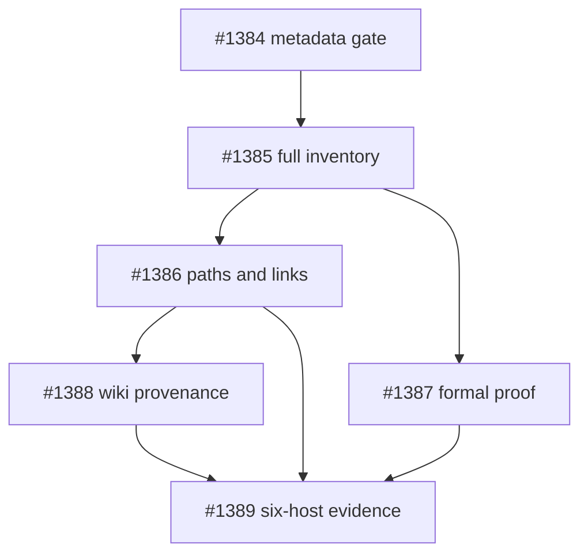

# PStack Agent Skills Conformance Audit (2026-11-15)

## Sources and method

- Repository: https://github.com/tommy-ca/pstack
- Canonical upstream: https://github.com/cursor/plugins/tree/main/pstack
- Official standard: https://agentskills.io/specification
- GitHub recursive main tree SHA: `2f82965aa0eb6e697446505c5fd696e955756e78`
- Methods: GitHub repository tree enumeration, selective source inspection of shared validator/scaffolder and test fixtures, upstream skill inventory, and issue/PR reconciliation. **No checkout-level pytest, packaging, host runtime, or live agent swarm was executed.**

## Inventory

84 SKILL.md files: 67 canonical (`skills/`), 12 host-local (`.agents`, `.codex`, `.factory`, `.grok`, `.omp`, `.opencode`, `.pi`), and 5 automation. No embedded skill helper with a recognized .py/.sh/.js/.ts/.mjs/.cjs extension was found outside its enclosing skill's `scripts/`. This is a path-based sample, not an executable-bit or shebang scan.

## Confirmed defects

1. `scripts/verify_harness.py::verify_skills_frontmatter` accepts a skill missing the spec-required `description`, although name and Cursor-only `mode` are checked.
2. `scripts/skill_frontmatter.py::validate_skill_name` omits the official max-64 length check.
3. The scaffold's separate `description` check demonstrates duplicated metadata rules.
4. Shared canonical verification scans only `skills/`; host-local and automation skills need a separate complete conformance inventory.

## Non-defects / boundaries

- Optional `scripts/`, `references/` and `assets/` are recommendations, not hard spec requirements. Flag placement under PStack policy, not official compliance.
- Global `scripts/` contains repository utilities and is not automatically misplaced.
- `scripts/scaffold_verification_skill.py` already creates `scripts/driver.sh`, a feature map, and proof-bar sections; reuse it.
- `scripts/llm_wiki.py check` proves structural integrity, not semantic correctness or live compilation.
- The existing scalar reader does not provide general YAML frontmatter validation. Full standard coverage should use the upstream `skills-ref` reference implementation, pinned and independently tested, rather than claiming the subset is complete.

## Minimal repair and verification plan

### Slice A. Shared metadata gate (#1384)
- Enforce 1-64-character name and nonblank 1-1024-character description, keep parent directory matching.
- One implementation for shared verifier and generated verification scaffolds.
- Negative tests for missing/blank/overlong values; existing valid fixtures updated.
- Run `uv run pytest -q tests/test_skill_frontmatter.py tests/test_scaffold_verification_skill.py tests/test_verify_harness.py`. Report results at exact commit; this document does not assert they passed.

### Slice B. Full reference and layout policy (#1385, #1386)
- Enumerate every skill root in a single, typed root registry; detect missing SKILL.md, inconsistent projections and link escapes.
- Prefer pinned `skills-ref validate` for YAML conformance; test PStack's own stricter policy separately.
- Broken link, misplaced local script and symlink cases must fail intentionally.

### Slice C. Formal proof and live harnesses (#1387, #1389)
- Reuse existing creator/maintainer verification skills; do not fork a new framework.
- For each property: code SHA, model assumptions, bound, proof tool, counterexample, failing mutant, cleanup.
- Record offline, static, host-dependent and observed-live evidence separately; qualify six hosts independently.

### Slice D. LLM Wiki (#1388)
- Ingest immutable snapshots with `python scripts/llm_wiki.py ingest`, not manual raw copies.
- Curate semantic atoms and crosslinks, regenerate index using `python scripts/llm_wiki.py index --write`, run `check` plus `check --sources`.
- QStack's knowledge governance remains independent; PStack owns development skills and spec semantics.

## Reference patterns (semantic crosswalk)

- Canonical Cursor PStack behavior-first `create-verification-skill`. Source of the user-path and proof-bar semantics.
- QStack `.agents/skills/formal-verify-llmwiki-layout`. Honest distinction between static negative fixtures and real source-bound formal proof. Recompose as a general evidence-grading rule, not a copied formal model.
- QStack `.agents/skills/verify-governance-hygiene`. Authority-boundary crosswalks, graph frontier checks, and negative control witnesses. Reuse the method while retaining PStack upstream semantics.
- QStack `.agents/skills/worktree-protocol`. Local helper placement under `scripts/`, on-demand references under `references/`, and fail-closed cleanup policies. Recommend for PStack repository policy rather than claiming a standard MUST.
- Swarm partitions inventory, reference links and runtime validation by independent bounded slices; Arena compares competing checker approaches; Interrogate tries to falsify evidence labels and assumption boundaries. These are planned methods, **not executed independent agent sessions**.

## Dependency graph

## SOLID / KISS / DRY / YAGNI and reviews

Single owner for metadata and source inventories; host-specific adapters behind narrow contracts; fail-closed proof boundaries; avoid new orchestration engines. Partition coverage into independent Swarm scopes, compare alternative approaches in Arena where necessary, and use Interrogate to falsify unproven assumptions. A manual audit is not evidence that these independent agent processes were performed.
