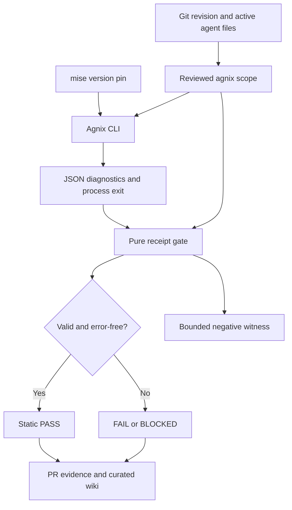

# Agnix static guard for PStack agent configuration

| Field | Value |
| --- | --- |
| Status | Verified in PR #1407, PR #1408, and PR #1409 |
| Tracking | Epic #1393 under Agent Skills epic #1383 |

## 1. Requirements

| ID | Requirement | Evidence gate |
| --- | --- | --- |
| AG-001 | Validate installed PStack SKILL.md, agents, AGENTS.md and recognized host configs/rules against agnix v0.61.0. | Exact-head pinned CLI receipt |
| AG-002 | Never silently exclude active skills, agents, host rules or plugin manifests. Historical docs/raw snapshots may be excluded. | Config-scope negative tests |
| AG-003 | Fail closed if binary is missing, wrong-version, malformed JSON, error diagnostics, nonzero return or vacuous coverage. | `tests/test_agnix_guard.py` and CI |
| AG-004 | Keep the CLI read-only; never auto-fix in PR/CI verification. | Source command inspection and clean Git diff |
| AG-005 | Preserve PStack's existing native profile, droid, plugin and runtime verifiers; agnix does not create model execution evidence. | Separate typed proof tiers |
| AG-006 | Record source, version, commits, diagnostic categories, scope and bounded negative witnesses; ratchet observed warnings rather than hiding them. | Observed CI receipt then budget issue #1395 |
| AG-007 | Keep QStack domain-specific policy and wiki promotion independent; PStack owns portable agent-development semantics. | Architecture review |

## 2. Semantic building blocks

| Atom | Input | Output | Trust boundary |
| --- | --- | --- | --- |
| ConfigSource | Repository and pinned commit | Active skill, agent, and rule files | Source-of-truth Git tree |
| Inventory | Paths and pattern exclusions | Validated candidate population | No silent wildcard |
| ConfigParse | `.agnix.toml` and `mise.toml` | Exact policy and pin | Rejected unsafe overrides |
| RuleEngine | Agnix v0.61.0 and active files | Versioned diagnostics | Third-party parser outside runtime |
| Diagnostic | Rule ID, severity, file, and line | Structured JSON receipt | Untrusted external output |
| Gate | Receipt, exit status, file floor, and budget | PASS, FAIL, or BLOCKED | Fail closed on unknown |
| ProofWitness | Boundary cases and explicit mutant | Scoped falsification | Bounded 288 guard states |
| HostProjection | PStack profiles and projected packages | Tool-host adaptation | Native PStack verification remains owner |
| KnowledgeAtom | Source, version, and documented rule | Curated Wiki page | Not immutable ingestion or promotion |

## 3. System and data flows



The implementation is stdlib Python `scripts/agnix_guard.py`. Canonical agent and skill manifests are not modified by the linter. PStack verification skill creator and maintainer layers invoke the same static gate. Their behavioral drivers and target-specific formal checkers remain independent.

## 4. Receipt model (logical JSON schema)

```json
{
  "version": "0.61.0",
  "files_checked": 84,
  "summary": {
    "errors": 0,
    "warnings": 1,
    "info": 0
  },
  "diagnostics": [
    {
      "level": "warning",
      "rule": "AS-020",
      "file": "skills/example/SKILL.md",
      "line": 2
    }
  ]
}
```

This is a field-level model of the expected Agnix JSON interface. It is not a published machine-validated JSON Schema. The displayed JSON is illustrative, not the full PStack linter receipt. Summary counts must strictly equal detail counts. A separate observed CI run reported version 0.61.0, 327 checked files, zero errors, 37 warnings, and 102 informational diagnostics. Nine unit negative tests and the 288-state bounded acceptance checker passed. Both Codex verification skills and wiki links passed structural validation. The guard separately checks the process exit status. No JSON field may overrule a nonzero exit. A binary that is missing is BLOCKED, not a PASS.

## 5. Verification

- Structural verification runs `mise run verify:agnix:policy` without linter execution.
- Active tree lint runs `mise run verify:agnix` with pinned binary in read-only mode.
- Bounded verdict exploration runs `mise run verify:agnix:formal` with 288 states and negative mutant witness.
- Codex skill driver verification runs `.codex/skills/verify-agnix-pstack` and `.codex/skills/verify-agnix-pstack-formal`.
- Continuous integration runs `.github/workflows/agnix-guard.yml` as an isolated gate.

Negative controls cover wrong version, missing or empty receipt, no-file coverage, error-level diagnostic, nonzero exit, warning-budget breach, summary-detail count mismatch, category suppression, broadened excludes, suppressed per-file rules, and node_modules executable shadowing.

## 6. Design rationale and pending work

- SOLID and DRY principles guide one receipt and policy engine with separate skill-facing wrappers.
- KISS and YAGNI principles prioritize upstream agnix rules and stdlib verification rather than writing another YAML or Agent Skills linter.
- Boundary discipline ensures no implicit binary PATH fallback. Project-specific Droid semantic schema validation remains in existing PStack scripts.
- Evidence integrity requires generic multi-host scanning. Target narrowing would conceal PStack harness variants.
- Agnix versus Agent Skills distinction preserves official specification requirements. Official Agent Skills requires metadata shape, while directory layout conventions remain local PStack policy under Issue #1386.
- Warning ratchet enforces the observed 37-warning ceiling by default. Higher ceilings are refused. Remaining warnings require classification and reduction under Issue #1395 rather than global suppression.
- Swarm, Arena, and Interrogate independent worker runs remain NOT_RUN. Planned tests should challenge exclusions, invalid receipts, model bounds, and raw source wiki promotion.

## 7. Provenance

- Agnix upstream release [v0.61.0](https://github.com/agent-sh/agnix/releases/tag/v0.61.0) and [configuration documentation](https://github.com/agent-sh/agnix/blob/main/docs/CONFIGURATION.md).
- QStack [configuration](https://github.com/tommy-ca/qstack/blob/main/.agnix.toml) and [guard](https://github.com/tommy-ca/qstack/blob/main/validate/agnix-config/run.py) for independently governed precedent.
- Canonical [Cursor PStack](https://github.com/cursor/plugins/tree/main/pstack) and [Agent Skills specification](https://agentskills.io/specification).
