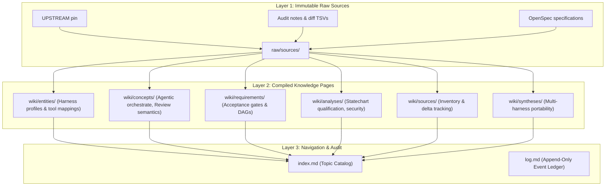

# LLM Wiki Architecture and Project-Local Integration

## 1. Executive Summary
The LLM Wiki is a structured, markdown-first knowledge store designed for language model agents and human engineers. It implements a layered knowledge lifecycle where raw external artifacts are frozen immutably, and concise, high-density knowledge pages are compiled and cross-referenced.

Previously maintained at `~/.llm-wiki` outside repository boundaries, the knowledge base is now integrated directly into the `pstack` repository at `.llm-wiki/`. This ensures git versioning, SHA-traceable provenance, and CI-verifiable knowledge integrity across all six declared hosts (`grok`, `codex`, `omp`, `opencode`, `antigravity`, `droid`).

---

## 2. How the LLM Wiki is Built for PStack

The LLM Wiki follows a two-tier knowledge hierarchy:

### Layer 1: Raw Sources (`.llm-wiki/raw/sources/`)
- Contains untouched or authoritative reference documents (`UPSTREAM`, `CHANGELOG.md`, `pstack-portability-spec.md`, `upstream-pstack-0.15.36-delta.tsv`).
- Governed by the **Immutability Invariant**: once captured, a raw source is never edited in-place; new versions receive new filenames or revision hashes.

### Layer 2: Compiled Knowledge Pages (`.llm-wiki/wiki/`)
- Domain-specific summaries written for cold-reading agents.
- Sections:
  - `entities/`: Physical or architectural components (e.g. `pstack-harnesses.md` detailing the six declared hosts and their tool bindings).
  - `concepts/`: Deep semantic patterns (e.g. `agentic-orchestrate.md` detailing single-PR ownership and independent verifiers; `review-semantics-and-verification.md` detailing Arena diverse family resolution and Interrogate reproducible command verification).
  - `requirements/`: Program goals, dependency DAGs, and gate criteria (e.g. `epic-840-acceptance-gates.md`).
  - `analyses/`: Technical feasibility and qualification reports (e.g. `statechart-qualification.md`).
  - `sources/`: Classified delta inventories.
  - `syntheses/`: Unified domain decisions.

### Layer 3: Navigation and Audit
- `index.md`: Concise, top-level catalog mapping each topic to its compiled page. Keeps LLM token usage low by avoiding full-tree exploration.
- `log.md`: Append-only timestamped ledger recording every ingestion and compilation event.
- `config.json`: Project metadata, mode (`engineering`), and schema version.
- `WIKI_SCHEMA.md`: Explicit ownership rules and maintenance contracts.

---

## 3. Guiding Principles (SOLID, KISS, DRY, YAGNI)

- **Single Responsibility (SOLID):** The wiki tool (`scripts/llm_wiki.py`) separates ingestion, validation, and index compilation into clean, independent functions.
- **Keep It Simple (KISS):** Pure Markdown and standard library Python. No heavy databases, vector stores, or binary runtimes required.
- **Don't Repeat Yourself (DRY):** `index.md` is derived from knowledge page frontmatter/headings rather than manually duplicated.
- **You Aren't Gonna Need It (YAGNI):** No speculative semantic vector indexers or dynamic web servers. Static markdown files readable directly by any LLM or code viewer.
