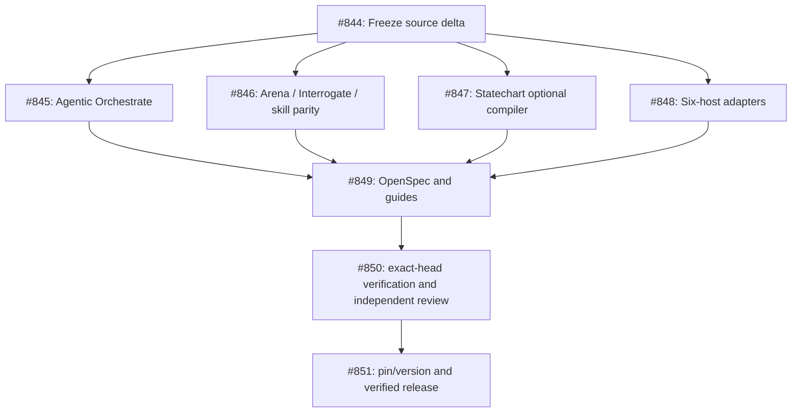

# Cursor PStack 0.15.36 → portable PStack: audited upstream delta

**Status:** Investigation / planning only. No upstream implementation files copied; no `UPSTREAM` pin or adapter version changed. Linked to [epic #840](https://github.com/tommy-ca/pstack/issues/840) and [classification task #844](https://github.com/tommy-ca/pstack/issues/844).

## Source revision contract

| Property | Verified input |
|---|---|
| Port base | `tommy-ca/pstack@b40f223a564a523e98cc4fcb91ee5591d7bca1fb` |
| Port applied upstream pin | `cursor/plugins@88d47514b82e7c44f00f2b2a72ff6dd12158038c` |
| Upstream PStack-specific target | `cursor/plugins@c742dd61706fbacc1b95f1a20b7b988cf096ce6c` |
| Pinned pstack tree | `34a0b817e5ea92375bb10f20b15cf750d4e8095a` |
| Target pstack tree | `4719e1c4b4c43bac85d4206a8b41dd2899769c1c` |
| Declared package versions | upstream `0.15.36`, port `0.15.29-preview.0` |

Source-scoped Git blob comparison found **408 added files, 7 deleted files, and 33 modified files**; among added files, **356** are statechart corpus fixture files. These are file changes, not missing capabilities. The complete machine-generated path and blob manifest is in [upstream-pstack-0.15.36-delta.tsv](./upstream-pstack-0.15.36-delta.tsv). Classification values are **candidates to review**, not permissions to copy or delete.

## High-impact semantic changes

1. **Agentic Orchestrate [#845](https://github.com/tommy-ca/pstack/issues/845)**: upstream [#1043](https://github.com/cursor/plugins/commit/c742dd61706fbacc1b95f1a20b7b988cf096ce6c) removes `orch.ts`, `store.ts`, its test, and invokes host-owned agent/Project/PR/CI tools. Port's flat-depth/host-owned state adaptation is not identical to Cursor's nested coordinator topology. Preserve GAP labels instead of implementing a parallel scheduler or copying native Cursor calls.
2. **Review and workflow discipline [#846](https://github.com/tommy-ca/pstack/issues/846)**: upstream [#986](https://github.com/cursor/plugins/commit/ab1f702ce8e8b6557edb56b09f52cde8bfb83f17) changes Arena cross-family judging and fallback, Interrogate evidence requirements, autopilot unit ownership, Explain-the-Number and kickoff reporting. Port canonical intent while keeping host references separate.
3. **Statechart [#847](https://github.com/tommy-ca/pstack/issues/847)**: new [#741](https://github.com/cursor/plugins/commit/eb4db2b55b2b7dec3d9282754cddf0a56bf4ff10) and compiler [#977](https://github.com/cursor/plugins/commit/34b1b7c96f09f81a21a6c78f65b7833f7dcb5b24) introduce a TypeScript/TLC/Java pipeline with Mermaid output. Do not copy 356 static fixture files before establishing runtime, size, failure and output path policy.
4. **Portability [#848](https://github.com/tommy-ca/pstack/issues/848)**: preserve Grok, Codex, OMP, OpenCode, Antigravity and Droid profiles; distinguish declared packaging from observed native behavior.
5. **Spec drift [#849](https://github.com/tommy-ca/pstack/issues/849)**: `openspec/specs/pstack-sync-from-upstream/spec.md` still cites dashed script names, while current scripts use snake_case. The sync recipe remains pinned to 0.15.29 and mentions obsolete executable surfaces. Fix contract/test/docs as one migration; do not silently rewrite historical evidence.

## Principles and review

- Follow upstream `principle-boundary-discipline`, `principle-subtract-before-you-add`, `principle-sequence-verifiable-units`, `principle-test-behavior-not-implementation`, `principle-prove-it-works`. QStack may consume these, but PStack remains domain-neutral.
- Apply Cursor Thermos `thermo-nuclear-review` to **the actual proposed diff** for correctness, security, regression and developer-experience risks; `thermo-nuclear-code-quality-review` for code judo, boundary and abstraction clarity.
- Use Swarm for independent slices, Interrogate with reproduce-and-rerun evidence, and Arena for real conflicting decisions. This investigation does not claim live model fanout, real runtime verification, or successful CI.

## Dependency DAG

The earlier 0.15.29 sync [#622](https://github.com/tommy-ca/pstack/issues/622), Grok-neutral authority [#695](https://github.com/tommy-ca/pstack/issues/695), and snake_case cleanup [#831](https://github.com/tommy-ca/pstack/issues/831) are closed historical work; do not reopen them.

## Promotion gate

`UPSTREAM`, `pstack.package.json#upstream_pin`, `plugin.json`/host versions, canonical inventory and package projections must reflect the **applied and tested** source, not only the latest observed upstream release. Require exact-head negative tests, host-specific evidence labels, checks and independent review first. Final merger is separate from this audit.

## QStack downstream contract (verified source)

`tommy-ca/qstack/principles/README.md` explicitly treats shared PStack principles as **host analogs**, not a second QStack principle forest. `skills/qstack-mode/SKILL.md` declares QStack a **thin domain overlay**, with generic feature/refactor/test/review/worktree orchestration remaining in PStack. Its research state is separately owned by **qorch**, not PStack's generic Orchestrate. Preserve this split during upstream #1043 migration: renaming/removing an upstream `orch` CLI must not imply deleting QStack research orchestration or importing its state machine into PStack.

The QStack index still describes the host generic orchestration authority as `pstack orch`; verify downstream documentation references whether this means the Orchestrate playbook or a removed CLI, and migrate any executable callers explicitly. QStack-specific `declare-your-falsifier` and `boundary-fuzzy-vs-deterministic` remain domain-owned. Reuse shared PStack `prove-it-works`, `subtract-before-you-add`, and `boundary-discipline` rather than copying their implementations into QStack.

**Downstream acceptance:** verify QStack's host-analog references and read-only routing contract against the applied PStack pin, without falsely claiming quant runtime or qorch execution parity.
