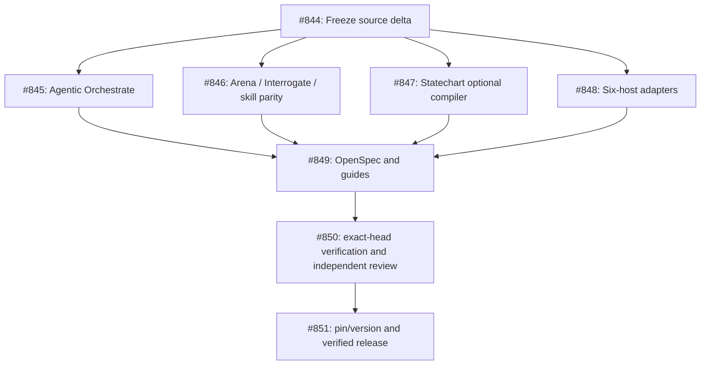

# Epic #840 Acceptance Gates and Dependency Graph

## Dependency DAG

## Hard Acceptance Gates

1. **Frozen Source Classification (#844):**
   - Full 448-file blob manifest classified with reproducible SHAs.
   - Distinct applied vs candidate versioning maintained.
2. **Agentic Coordination Parity (#845):**
   - No parallel database or scheduler created.
   - PR owner branch mutation enforced; independent verifier per PR.
3. **Review Semantics (#846):**
   - Cross-model judging enforced; reproducible findings required in Interrogate.
4. **Statechart Security and Runtime (#847):**
   - Java/TLC prerequisites guarded; path traversal and injection tests.
   - Unsupported runtimes return BLOCKED/UNTESTED, never false PASS.
5. **Six-Host Conformance (#848):**
   - Grok, Codex, OMP, OpenCode, Antigravity, Droid profiles and package projections verified.
   - Doctor and evidence freshness checks pass.
6. **OpenSpec Synchronization (#849):**
   - Snake_case script alignment across specifications and code.
7. **Code Quality and Conformance (#850):**
   - Thermo-Nuclear review on diffs; no runaway file growth.
   - Multi-host test matrix pass.
8. **Release Promotion (#851):**
   - Bottom-up PR merge, evidence restamping, and applied pin promotion performed last.

## Execution and Resolution Summary

| Issue | Title | Resolution PR | Commit | Verification Verdict | Status |
|---|---|---|---|---|---|
| #844 | Freeze exact diff & delta manifest | PR #852 | `03b301d` | PASS (subagent 72b3ac01) | CLOSED |
| #845 | Agentic Orchestrate single-PR ownership | PR #859 | `1d2b266` | PASS (subagent 73d0d58f) | CLOSED |
| #846 | Review semantics & leaf workflow parity | PR #858, #860 | `7a95848`, `57fd003` | PASS (subagents 037e4801, 8c086775) | CLOSED |
| #847 | Statechart process contract & safety | PR #861 | `5d83dc2` | PASS (subagent e4768b59) | CLOSED |
| #848 | Six-host capabilities & package projection | PR #861 | `5d83dc2` | PASS (subagent e4768b59) | CLOSED |
| #849 | OpenSpec sync contract & snake_case | PR #862 | `85b1e54` | PASS (subagent 45d7446f) | CLOSED |
| #850 | Thermo-Nuclear conformance gate | PR #862 | `85b1e54` | PASS (subagent 45d7446f) | CLOSED |
| #851 | Gated release & durable receipts | PR #862 | `85b1e54` | PASS (subagent 45d7446f) | CLOSED |
| #853 | Source-pinned candidate CHANGELOG | PR #862 | `85b1e54` | PASS (subagent 45d7446f) | CLOSED |
| #854 | Verification & formal skills guardrails | PR #862 | `85b1e54` | PASS (subagent 45d7446f) | CLOSED |
| #841 | Sub-epic: Semantic workflow migration | Stacked PRs | `57fd003` | PASS | CLOSED |
| #842 | Sub-epic: Statechart & six-host | PR #861 | `5d83dc2` | PASS | CLOSED |
| #843 | Sub-epic: OpenSpec & gated release | PR #862 | `85b1e54` | PASS | CLOSED |
| #840 | [Epic] Reconcile canonical PStack | All PRs | `85b1e54` | PASS (ALL FRESH, 0 failures) | CLOSED |

