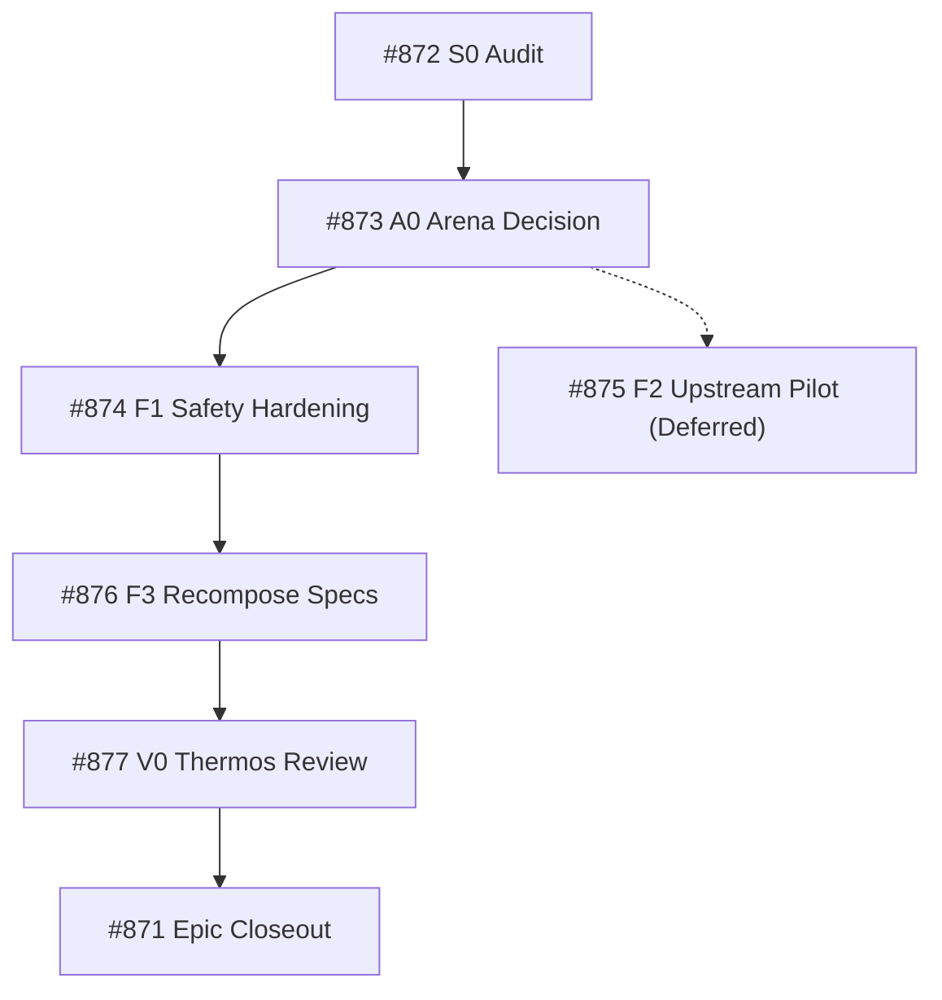

# Epic #871 LLM Wiki v2 Requirements and Contracts

Epic #871 evaluates reference engines, hardens knowledge contracts, and governs migration for the PStack LLM Wiki.

## Program Goals and Deliverables

1. **Exact-Head Inventory & Security Audit (Issue #872):** Audit baseline contracts, identify raw overwrite hazards, and verify link confinement. Merged in PR #878.
2. **Arena Decision (Issue #873):** Formally resolve engine selection between Python stdlib baseline, optional adapters, and full migration. Confirmed Option A (Python stdlib) and deferred Option B (Issue #875 resolved as `not_planned`). Merged in PR #880.
3. **Safety Hardening & Verification Skills (Issue #874):** Enforce write-once exclusive creation, atomic index replacement, local link confinement, bounded model exploration, and worktree confinement protocol. Merged in PR #882.
4. **Recompose Formal Specs & Semantic Blocks (Issue #876):** Formalize semantic blocks, data flows, and QStack governance crosswalk. Addressed in this specification.
5. **Thermos Review & Acceptance Gate (Issue #877):** Final adversarial quality and correctness review, refreshing durable evidence receipts to `ALL FRESH` and closing Epic #871.

## Dependency Graph

## Related Resources

- Acceptance Gates: [Epic #840 Acceptance Gates](epic-840-acceptance-gates.md)
- Reference Engine Analysis: [Reference Evaluation](../analyses/llm-wiki-reference-evaluation.md)
- Semantic Crosswalk: [Semantic Blocks](../concepts/semantic-blocks-and-crosswalk.md)
