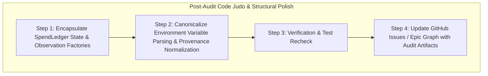

# Thermo-Nuclear Code Quality Review: Audit & Recursive Plan for Issue #674

- **Scope**: Comprehensive Code Quality & Architectural Review across JEV Decision Hardening (PR #679, PR #681)
- **Base Revision**: `66648081fbd7b4642f38ba0b273417a8891026ba`
- **Head Revision**: `676275f1dfa83857500b171f1a50a1dfd9a690bf` (`main`)
- **Verdict**: **PASS WITH CODE-JUDO SIMPLIFICATIONS**

---

## 1. Executive Summary

This Thermo-Nuclear Code Quality Review evaluates the architectural changes shipped under GitHub Epic [#674](https://github.com/tommy-ca/pstack/issues/674) across PR [#679](https://github.com/tommy-ca/pstack/pull/679) (`verify(docs): maintain Jev bounded invariants and current adapter truth`) and PR [#681](https://github.com/tommy-ca/pstack/pull/681) (`feat(jev): enforce calibration provenance gate and atomic spend reservation`).

The shipped changes achieved their core functional goals: establishing a 135-case bounded invariant test suite (#675), updating documentation truth (#678), gating unverified calibration fixtures from promoting advisory routes (#676), enforcing an atomic preflight reservation and conservative settlement spend ledger (#677), and validating concurrent interleavings with a formal state-space exploration model (#680). The integration strictly adheres to `pstack` standard library boundaries with zero bloat to `qstack`.

However, an aggressive review under the eight non-negotiable standards reveals several opportunities for "Code Judo" structural simplification:
1. **SpendLedger Encapsulation**: Eliminating external access to the private `_lock` in `JevDecisionAdapter` property setters by providing first-class state mutators.
2. **Observation Factory Deduplication**: Consolidating 8 repetitive instances of raw `ProviderObservation` construction into clean factory helpers.
3. **Environment Flag Harmonization**: Unifying scattered and asymmetric environment variable checks across `route_resolver.py` and `evidence_receipts.py` into a single canonical helper.
4. **Typed Provenance Normalization**: Ensuring `CalibratedEvidenceReceipt` normalizes metadata fallbacks upon instantiation so downstream validators only inspect typed attributes.

---

## 2. Key Audit Findings & Narrative Analysis

### Finding 1: SpendLedger Encapsulation Leak in JevDecisionAdapter (Rule 0 & Rule 5)
In [`scripts/decision_adapter.py:359-363`](file:///home/tommyk/projects/pstack/scripts/decision_adapter.py#L359-L363), `JevDecisionAdapter.cumulative_spend_usd.setter` directly accesses `with self.spend_ledger._lock: self.spend_ledger.cumulative_spend_usd = float(val)`. Reaching into a collaborator's private lock attribute is an encapsulation smell that creates brittle synchronization couplings. The solution is a clean Code Judo move: introduce explicit `reset()` and `set_cumulative_spend()` methods on `SpendLedger` that acquire the lock internally, allowing callers to interact through a clean interface.  
*Full Analysis & Judo Proposals*: [`01_code_judo_and_structural_simplification.md`](file:///home/tommyk/projects/pstack/docs/audit/thermo-nuclear-674/01_code_judo_and_structural_simplification.md).

### Finding 2: Elimination of Scattered ProviderObservation Boilerplate (Rule 4 & Rule 6)
In [`scripts/decision_adapter.py:411-450, 502-518`](file:///home/tommyk/projects/pstack/scripts/decision_adapter.py#L411-L450), `_invoke_provider` constructs raw `ProviderObservation` instances across 8 different exit branches for `unavailable` and `abstain` outcomes. While `_invalid_obs` already existed, the absence of `_unavailable_obs` and `_abstain_obs` forced 40 lines of repetitive boilerplate across preflight guards and exception handlers. Adding unified observation factory helpers eliminates this boilerplate and prevents copy-paste drift.  
*Full Analysis & Measurements*: [`01_code_judo_and_structural_simplification.md`](file:///home/tommyk/projects/pstack/docs/audit/thermo-nuclear-674/01_code_judo_and_structural_simplification.md).

### Finding 3: Strict Compliance with the 1,000-Line Ceiling (Rule 1)
All files touched by Epic #674 strictly respect the 1,000-line ceiling. The largest module, `scripts/decision_adapter.py`, stands at 657 lines, while `scripts/evidence_receipts.py` is 588 lines, and `scripts/route_resolver.py` is 565 lines. The newly introduced concurrency test suite (`tests/test_paid_budget_concurrency.py`) is compact at 271 lines, cleanly isolating multithreaded and state-machine checks from existing adapter tests.  
*Full Inventory & Line Counts*: [`02_file_size_and_modular_decomposition.md`](file:///home/tommyk/projects/pstack/docs/audit/thermo-nuclear-674/02_file_size_and_modular_decomposition.md).

### Finding 4: Asymmetric Environment Flag Parsing Across Modules (Rule 2 & Rule 6)
In [`scripts/route_resolver.py:434-437`](file:///home/tommyk/projects/pstack/scripts/route_resolver.py#L434-L437), the router checks both `PSTACK_JEV_ALLOW_FIXTURE_EVIDENCE` and `PSTACK_JEV_ALLOW_FIXTURE_PROMOTION`. In contrast, [`scripts/evidence_receipts.py:184-185`](file:///home/tommyk/projects/pstack/scripts/evidence_receipts.py#L184-L185) only checks `PSTACK_JEV_ALLOW_FIXTURE_EVIDENCE`. Additionally, `validate_calibrated_evidence` overrides explicit caller parameters with environment variables. Centralizing this check into a single canonical helper (`is_fixture_evidence_allowed()`) restores symmetry and eliminates ad-hoc branching.  
*Full Analysis & Remediation*: [`03_spaghetti_control_and_type_boundary_integrity.md`](file:///home/tommyk/projects/pstack/docs/audit/thermo-nuclear-674/03_spaghetti_control_and_type_boundary_integrity.md).

### Finding 5: Absolute Architectural Containment & Zero Bloat (Rule 6)
The decision plane adheres strictly to `pstack` boundaries. Concurrency control uses standard library `threading.Lock` and `math.isfinite` without adding Redis, SQLite, or distributed messaging daemons. Verification executes hermetically in offline CI without network or API token dependencies.  
*Full Containment Analysis*: [`04_architectural_containment_and_zero_bloat.md`](file:///home/tommyk/projects/pstack/docs/audit/thermo-nuclear-674/04_architectural_containment_and_zero_bloat.md).

### Finding 6: Hermetic State-Machine Model Checking for Concurrency (Rule 4 & Rule 7)
PR #681 introduced a lightweight BFS state-space exploration engine in [`tests/test_paid_budget_concurrency.py`](file:///home/tommyk/projects/pstack/tests/test_paid_budget_concurrency.py). It explores all interleaved request lifecycle transitions in 50ms and proves that cumulative plus reserved spend never exceeds the budget cap. An intentional negative mutation control confirms that the checker catches safety violations.  
*Full State-Space Analysis*: [`05_state_machine_model_checking_and_concurrency.md`](file:///home/tommyk/projects/pstack/docs/audit/thermo-nuclear-674/05_state_machine_model_checking_and_concurrency.md).

---

## 3. Recursive Plan & Execution Sequence

To address the findings from this Thermo-Nuclear Code Quality Review, we execute the following recursive plan:

### Remediation Execution Steps:
1. **Step 1: Refactor `SpendLedger` and Observation Factories**:
   - Add `reset()` and `set_cumulative_spend()` methods to `SpendLedger`.
   - Update `JevDecisionAdapter.cumulative_spend_usd.setter` to call `self.spend_ledger.set_cumulative_spend(val)`.
   - Add `_unavailable_obs()` and `_abstain_obs()` to `JevDecisionAdapter` and replace repetitive construction blocks.
2. **Step 2: Centralize Fixture Environment Checks & Normalize Provenance**:
   - Define `is_fixture_evidence_allowed()` in `scripts/evidence_receipts.py`.
   - Use `is_fixture_evidence_allowed()` in both `evidence_receipts.py` and `route_resolver.py`.
   - Normalize `receipt.provenance` during receipt loading so `metadata["provenance"]` fallbacks are eliminated.
3. **Step 3: Verify Exact-Head Correctness**:
   - Run `bash .codex/skills/verify-decision-contract/scripts/driver.sh doctor`.
   - Run `python -m pytest -q tests/test_paid_budget_concurrency.py tests/test_decision_adapter.py tests/test_advisory_promotion.py tests/test_jev_mapping_and_calibrated_evidence.py`.
   - Ensure 100% green pass.
4. **Step 4: Update GitHub Graph**:
   - Record the audit report and code-judo improvements in GitHub Epic #674 and relevant tracking issues.
