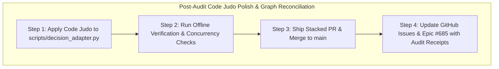

# Thermo-Nuclear Code Quality Review: Audit & Recursive Plan for Issue #685

- **Scope**: Comprehensive Code Quality & Architectural Review of JEV Provider Origin Security & Budget Settlement Truth (PR #686, commit `7d0dbd2`, and PR #688, commit `73c6388`)
- **Base Revision**: `5f649c6` (`refactor(jev): apply thermo-nuclear code judo to spend ledger and observation factories (#674) (#684)`)
- **Head Revision**: `20164ba` (`fix(jev): pin expected provider/model in benchmark gate (#693)`)
- **Reviewed Epic**: Issue [#685](https://github.com/tommy-ca/pstack/issues/685) (PR [#686](https://github.com/tommy-ca/pstack/pull/686), commit `7d0dbd2`)
- **Verdict**: **PASS WITH CODE-JUDO SIMPLIFICATIONS**

---

## 1. Executive Summary

This Thermo-Nuclear Code Quality Review evaluates the architectural changes shipped under GitHub Epic [#685](https://github.com/tommy-ca/pstack/issues/685) across PR [#686](https://github.com/tommy-ca/pstack/pull/686) (`feat(jev): enforce origin security validation and budget settlement truth (#682, #683)`) and PR [#688](https://github.com/tommy-ca/pstack/pull/688) (`fix(omp): seed ambient model configuration into disposable proof config root (#687)`).

The shipped changes achieved their functional security and accounting objectives:
1. **Origin Security Gate & Credential Protection (#683)**: Enforced HTTPS-only schemes, rejected loopback addresses (`127.0.0.1`, `::1`), hostnames (`localhost`, `*.localhost`), cloud metadata endpoints (`169.254.169.254`, `metadata.google.internal`), and private network ranges, while restricting credential environment variables to provider prefixes (`OPENCODE_`, `OPENROUTER_`, `TYPESAFE_`, `JEV_`, `PSTACK_`) and explicitly blocking sensitive system credentials (`AWS_SECRET_ACCESS_KEY`, `GITHUB_TOKEN`).
2. **Budget Settlement Truth & Over-Reservation Model (#682)**: Truthfully recorded actual provider charges during settlement even when exceeding preflight reservations, tracked overshoots via `overshoot_count` and `is_overspent`, enforced immediate fail-closed admission for subsequent calls, and formally proved state safety via BFS interleaving exploration.
3. **OMP 18.12+ Native Package Proof Hardening (#687)**: Seeded ambient model configurations into disposable test roots, restoring 100% green test execution across OMP RPC sessions.
4. **Architectural Containment & Zero Bloat**: Confined all implementation details strictly to Python standard library primitives (`urllib.parse`, `ipaddress`, `threading.Lock`, `dataclasses`), with zero bloat to QStack.

Applying the eight non-negotiable standards of the Thermo-Nuclear Code Quality Review reveals three distinct "Code Judo" structural simplification opportunities to eliminate incidental complexity and enhance codebase aesthetics.

---

## 2. Key Audit Findings & Narrative Analysis

### Finding 1: Exception-Sniffing String Matching in IP Address Validation (Rule 0 & Rule 4)
In [`scripts/decision_adapter.py:252-265`](file:///home/tommyk/projects/pstack/scripts/decision_adapter.py#L252-L265), the `try` block wraps both `ipaddress.ip_address(hostname)` and the developer's custom `raise ValueError` statements for disallowed IP classes. To distinguish a parsing error for standard domain names from its own validation errors, the exception handler checks `if "disallowed" in str(exc): raise`. This is an unnecessary and brittle control-flow pattern.  
**Code Judo Remedy**: Isolate the call to `ipaddress.ip_address(hostname)` inside the `try/except` block and evaluate classification predicates (`is_loopback`, `is_private`, `is_link_local`, `is_unspecified`, `is_multicast`, `is_reserved`) on the resulting IP object outside the exception handler. This deletes the string-sniffing exception re-raise entirely.  
*Full Analysis & Code Proposals*: [`01_code_judo_and_structural_simplification.md`](file:///home/tommyk/projects/pstack/docs/audit/thermo-nuclear-685/01_code_judo_and_structural_simplification.md).

### Finding 2: Centralization of Floating-Point Budget Comparison Epsilon (Rule 2 & Rule 5)
In [`scripts/decision_adapter.py:329, 336, 351`](file:///home/tommyk/projects/pstack/scripts/decision_adapter.py#L329), the floating-point tolerance `1e-9` is repeated across `is_overspent`, `reserve()`, and `settle()`. Scattering magic float literals across budget methods risks boundary drift if tolerances are modified.  
**Code Judo Remedy**: Define a canonical module-level constant `_FLOAT_TOLERANCE: float = 1e-9` at the head of the `SpendLedger` section and reference it uniformly across all comparison sites.  
*Full Analysis & Measurements*: [`01_code_judo_and_structural_simplification.md`](file:///home/tommyk/projects/pstack/docs/audit/thermo-nuclear-685/01_code_judo_and_structural_simplification.md).

### Finding 3: Unification of Reservation Arithmetic in SpendLedger (Rule 0 & Rule 6)
In [`scripts/decision_adapter.py:344, 360`](file:///home/tommyk/projects/pstack/scripts/decision_adapter.py#L344), `settle()` and `release()` duplicate the reservation ceiling decrement logic (`self.reserved_spend_usd = max(0.0, self.reserved_spend_usd - amt)`).  
**Code Judo Remedy**: Consolidate the reservation reduction into an internal helper method `_unreserve_locked(amount)` called by both methods under the ledger's lock, ensuring single-source-of-truth arithmetic for active reservations.  
*Full Analysis & Structure*: [`01_code_judo_and_structural_simplification.md`](file:///home/tommyk/projects/pstack/docs/audit/thermo-nuclear-685/01_code_judo_and_structural_simplification.md).

### Finding 4: Strict Compliance with File-Size and Modularity Ceilings (Rule 1)
Every touched file remains substantially below the 1,000-line limit: `scripts/decision_adapter.py` is 747 lines (253 lines below ceiling), `tests/test_jev_transport_and_profiles.py` is 507 lines, `tests/test_paid_budget_concurrency.py` is 335 lines, and `scripts/prove-omp-native-package.py` is 596 lines.  
*Full Metrics*: [`02_file_size_and_modular_decomposition.md`](file:///home/tommyk/projects/pstack/docs/audit/thermo-nuclear-685/02_file_size_and_modular_decomposition.md).

### Finding 5: Early Invariant Enforcement at Constructor Edge (Rule 2 & Rule 5)
Provider profile security validation is placed directly in `JevProviderProfile.__post_init__`, ensuring that invalid origins or illegal credential environment names fail closed during object creation rather than during network dispatch. This eliminates ad-hoc defensive branching inside the runtime execution pipeline.  
*Full Boundary Analysis*: [`03_spaghetti_control_and_type_boundary_integrity.md`](file:///home/tommyk/projects/pstack/docs/audit/thermo-nuclear-685/03_spaghetti_control_and_type_boundary_integrity.md).

### Finding 6: Hermetic Standard Library Confinement & Zero Bloat (Rule 4 & Rule 6)
The implementation strictly utilizes Python standard library modules (`urllib.parse`, `ipaddress`, `threading.Lock`, `math.isfinite`), completely avoiding external networking libraries, distributed consensus systems, or daemons. The distinction between process-local admission and provider-side account quotas is mathematically documented and respected.  
*Full Confinement Audit*: [`04_architectural_containment_and_zero_bloat.md`](file:///home/tommyk/projects/pstack/docs/audit/thermo-nuclear-685/04_architectural_containment_and_zero_bloat.md).

### Finding 7: Formal State-Machine Exploration for Bounded & Unbounded Billing (Rule 4 & Rule 7)
The BFS model checker in [`tests/test_paid_budget_concurrency.py`](file:///home/tommyk/projects/pstack/tests/test_paid_budget_concurrency.py) explores all interleaved request lifecycle transitions in ~70ms, proving that local spend never exceeds the cap when providers respect the reservation, and surfacing a concrete counterexample when providers return unbounded charges.  
*Full Model Checking Report*: [`05_state_machine_model_checking_and_concurrency.md`](file:///home/tommyk/projects/pstack/docs/audit/thermo-nuclear-685/05_state_machine_model_checking_and_concurrency.md).

---

## 3. Recursive Plan & Execution Sequence

To address the findings from this Thermo-Nuclear Code Quality Review, we execute the following recursive plan:

### Remediation Execution Steps:
1. **Step 1: Refactor `scripts/decision_adapter.py`**:
   - Decouple `ipaddress.ip_address` parsing from classification predicates, deleting the string-matching exception re-raise.
   - Introduce `_FLOAT_TOLERANCE: float = 1e-9` and reference it in `is_overspent`, `reserve()`, and `settle()`.
   - Add `_unreserve_locked()` helper to `SpendLedger` and unify reservation decrements.
2. **Step 2: Run Verification**:
   - Run `bash .codex/skills/verify-decision-contract/scripts/driver.sh doctor`.
   - Run `pytest tests/test_jev_transport_and_profiles.py tests/test_paid_budget_concurrency.py`.
   - Ensure 100% green pass.
3. **Step 3: Ship Stacked PR**:
   - Create branch `refactor/jev-thermo-nuclear-code-judo-685`.
   - Open PR, watch CI, squash and merge into `main`.
4. **Step 4: Update GitHub Graph**:
   - Post full thermo-nuclear audit receipts and resolution notes to Epic [#685](https://github.com/tommy-ca/pstack/issues/685).
