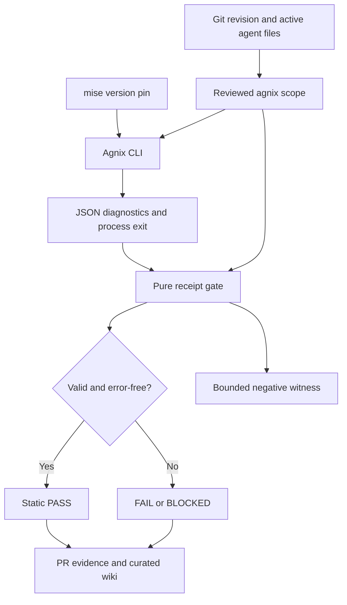

# Agnix static guard for PStack agent configuration

**Status:** Source-level integration and isolated Agnix CI verified (run #43743339184, 2026-11-15); repository-wide portability CI remains independently failing (#1392).
**Tracking:** [Epic #1393](https://github.com/tommy-ca/pstack/issues/1393), under [Agent Skills epic #1383](https://github.com/tommy-ca/pstack/issues/1383).

## 1. Requirements

| ID | Requirement | Evidence gate |
| --- | --- | --- |
| AG-001 | Validate installed PStack SKILL.md, agents, AGENTS.md and recognized host configs/rules against agnix v0.61.0. | Exact-head pinned CLI receipt |
| AG-002 | Never silently exclude active skills, agents, host rules or plugin manifests. Historical docs/raw snapshots may be excluded. | Config-scope negative tests |
| AG-003 | Fail closed if binary is missing, wrong-version, malformed JSON, error diagnostics, nonzero return or vacuous coverage. | `tests/test_agnix_guard.py` and CI |
| AG-004 | Keep the CLI read-only; never auto-fix in PR/CI verification. | Source command inspection and clean Git diff |
| AG-005 | Preserve PStack's existing native profile, droid, plugin and runtime verifiers; agnix does not create model execution evidence. | Separate typed proof tiers |
| AG-006 | Record source, version, commits, diagnostic categories, scope and bounded negative witnesses; ratchet observed warnings rather than hiding them. | Observed CI receipt then budget issue #1395 |
| AG-007 | Keep QStack domain-specific policy and wiki promotion independent; PStack owns portable agent-development semantics. | Architecture review |

## 2. Semantic building blocks

| Atom | Input | Output | Trust boundary |
| --- | --- | --- | --- |
| ConfigSource | Repository + pinned commit | Active skill/agent/rule files | Source-of-truth Git tree |
| Inventory | Paths, pattern exclusions | Validated candidate population | No silent wildcard |
| ConfigParse | `.agnix.toml` / `mise.toml` | Exact policy and pin | Rejected unsafe overrides |
| RuleEngine | Agnix v0.61.0 + active files | Versioned diagnostics | Third-party parser (not runtime) |
| Diagnostic | Rule ID, severity, file, line | Structured JSON receipt | Untrusted external output |
| Gate | Receipt, exit status, file floor, optional budget | PASS / FAIL / BLOCKED | Fail closed on unknown |
| ProofWitness | Boundary cases, explicit mutant | Scoped falsification | Only 216 bounded guard states |
| HostProjection | PStack profiles and projected packages | Tool-host adaptation | Native PStack verification remains owner |
| KnowledgeAtom | Source/version and documented rule | Curated Wiki page | Not immutable ingestion/promotion |

## 3. System and data flows



The implementation is stdlib Python `scripts/agnix_guard.py`; canonical agent/skill manifests are not modified by the linter. PStack's verification skill creator/maintainer layers invoke the same static gate; their behavioral drivers and target-specific formal checkers remain independent.

## 4. Receipt model (logical JSON schema)

```json
{
  "version": "0.61.0",
  "files_checked": 84,
  "summary": {"errors": 0, "warnings": 0, "info": 0},
  "diagnostics": [
    {"level": "warning", "rule": "AS-020", "file": "skills/example/SKILL.md", "line": 2}
  ]
}
```

This is a *field-level model of the expected Agnix JSON interface*, not a published machine-validated JSON Schema. The displayed JSON is illustrative, not the full PStack linter receipt. A separate observed [CI run #43743339184](https://github.com/tommy-ca/pstack/actions/runs/43743339184) reported version 0.61.0, 327 checked files, **zero errors, 37 warnings, 102 informational diagnostics**. Eight unit negative tests and the 216-state bounded acceptance checker passed; both Codex verification skills and wiki links passed structural validation. The guard separately checks the process exit status; no JSON field may overrule a nonzero exit. A binary that is missing is BLOCKED, not a PASS.

## 5. Verification

- Structural: `mise run verify:agnix:policy` (no linter execution).
- Active-tree lint: `mise run verify:agnix` (pinned binary, read only, static).
- Bounded verdict exploration: `mise run verify:agnix:formal` (216 states, negative mutant; not an unbounded Agnix proof).
- Codex skill doctor/drive: `.codex/skills/verify-agnix-pstack` and `.codex/skills/verify-agnix-pstack-formal`.
- CI: `.github/workflows/agnix-guard.yml` as an isolated gate; it does not mask existing `portability-offline.yml` failures tracked by #1392.

**Negative controls:** wrong version, missing or empty receipt, no-file coverage, error-level diagnostic, nonzero exit, warning-budget breach, category suppression, broadened excludes, suppressed per-file rules, and node_modules executable shadowing.

## 6. Design rationale and pending work

- **SOLID/DRY:** one receipt/policy engine, separate skill-facing wrappers.
- **KISS/YAGNI:** use upstream agnix rules and stdlib verification rather than writing another YAML/Agent Skills linter.
- **Boundary discipline:** no implicit binary PATH fallback; project-specific Droid semantic schema validation remains in existing PStack scripts.
- **Evidence integrity:** generic multi-host scanning is intentional; target narrowing would conceal PStack harness variants.
- **Agnix vs Agent Skills:** official Agent Skills requires metadata shape, while `scripts/`, `references/`, and `assets/` are recommendations; stricter PStack layout policy belongs to #1386, not an invented official MUST.
- **Warnings:** the observed 37-warning ceiling is enforced by default; higher ceilings are refused. Remaining warnings require classification and reduction under #1395, not global suppression.
- **Swarm/Arena/Interrogate:** independent worker runs remain NOT_RUN; their planned tests should challenge exclusions, invalid receipts, model bounds, and raw-source wiki promotion.

## 7. Provenance

- Agnix upstream [v0.61.0](https://github.com/agent-sh/agnix/releases/tag/v0.61.0), [configuration](https://github.com/agent-sh/agnix/blob/main/docs/CONFIGURATION.md).
- QStack [`.agnix.toml`](https://github.com/tommy-ca/qstack/blob/main/.agnix.toml) and [guard](https://github.com/tommy-ca/qstack/blob/main/validate/agnix-config/run.py) for independently governed precedent.
- Canonical [Cursor PStack](https://github.com/cursor/plugins/tree/main/pstack), [Agent Skills specification](https://agentskills.io/specification).
