# LLM Wiki Formal Specifications, Semantic Blocks, and Navigation Architecture

**Document Date:** 2026-10-31  
**Logical Parent:** [Epic #871](https://github.com/tommy-ca/pstack/issues/871)  
**Issue:** [Issue #876](https://github.com/tommy-ca/pstack/issues/876)  
**Status:** CANONICAL SPECIFICATION  

---

## 1. Executive Summary

This specification formalizes the architecture, semantic block contracts, data flows, and cross-repository governance boundaries of PStack's project-local LLM Wiki (`.llm-wiki/`).

Following the Arena decision in [PR #880](https://github.com/tommy-ca/pstack/pull/880) and safety hardening in [PR #882](https://github.com/tommy-ca/pstack/pull/882), PStack retains its pure Python standard library baseline (`scripts/llm_wiki.py`), with write-once raw source capture, local link confinement, atomic index replacement, and deterministic validation across all six supported hosts (`grok`, `codex`, `omp`, `opencode`, `antigravity`, `droid`).

---

## 2. Crosswalk: QStack Semantic Roles to Formal Semantic Blocks

QStack issue #2624 and PR #878 identified nine semantic knowledge roles. This section defines the exact mapping between QStack roles and PStack's concrete formal semantic blocks:

| QStack Governance Role | PStack Formal Semantic Block | Definition and Contract |
| :--- | :--- | :--- |
| **`WikiSource`** | **`SourceRevision`** | Immutable raw external artifact. Stored write-once in `.llm-wiki/raw/sources/`. Identified by SHA-256 digest, original filename, and capture timestamp. Never edited in place. |
| **`WikiArticle`** | **`FieldContract`** | Structured knowledge document in `.llm-wiki/wiki/{entities,concepts,requirements,analyses,syntheses}/`. Conforms to structural schema with non-empty headings and local relative links. |
| **`WikiSynthesis`** | **`PromotionDecision`** | Architectural decision or multi-source synthesis resolving competing approaches (e.g. Arena decisions). Requires explicit rationale, evidence links, and operator review. |
| **`WikiGraphMap`** | **`RelationType`** | Directed cross-reference edge between knowledge documents (e.g. `requires`, `implements`, `evaluates`, `supersedes`). Validated structurally by `scripts/llm_wiki.py check`. |
| **`WikiSearchIndex`** | **`QueryPlan`** | Headless catalog scanning and keyword matching. In PStack's minimal baseline, this is satisfied by deterministic Markdown navigation (`index.md`) and ripgrep queries without external vector databases. |
| **`WikiLogEntry`** | **`Attestation`** | Append-only human-readable ledger line in `.llm-wiki/log.md`. Records action name, target digest, and summary. Disclaims transactional atomicity with Git commits. |
| **`WikiIndex`** | **`ProjectionManifest`** | Derived topic catalog in `.llm-wiki/index.md`. Atomically regenerated by `scripts/llm_wiki.py index --write`. Fully reproducible from on-disk markdown files. |
| **`WikiLever`** | **`EvidenceSpan`** | Executable verification script, test case, or driver (e.g. `verify-llm-wiki` driver and `tests/test_llm_wiki_safety.py`). Produces observable PASS/FAIL proof receipts. |
| **`WikiIntent`** | **`Candidate`** | Proposed or draft analysis submitted via pull request. Has zero canonical authority until merged through operator code review and CI verification. |

---

## 3. End-to-End Data and Code Flows

The lifecycle of knowledge in PStack follows a strict four-stage pipeline:

```mermaid
flowchart LR
    A["Raw Artifact (PR/Spec/Log)"] -->|scripts/llm_wiki.py ingest| B["Layer 1: raw/sources/<br/>(Write-once, SHA-256 digest)"]
    B -->|Human/Agent Curation| C["Layer 2: wiki/<br/>(Curated Knowledge Pages)"]
    C -->|scripts/llm_wiki.py index --write| D["Layer 3: index.md<br/>(Atomic replacement)"]
    D -->|scripts/llm_wiki.py check| E["Gate: Structural Check<br/>(Zero broken links, no escapes)"]
    E -->|Git Commit & PR Review| F["Canonical PStack Memory"]
```

### Stage 1: Ingestion
- Executed via `python3 scripts/llm_wiki.py ingest <file>`.
- Opens destination file with exclusive creation (`"xb"` mode).
- If identical file exists, returns idempotent success without duplicate log entry.
- If conflicting file exists, raises `FileExistsError` fail-closed.
- Rejects symlink attacks against `raw/` or `log.md`.

### Stage 2: Compilation & Curation
- Markdown articles authored under appropriate category directory: `entities/`, `concepts/`, `requirements/`, `analyses/`, `syntheses/`, `sources/`.
- Must contain valid relative links confined within `.llm-wiki/`. Escapes via `../` outside root are strictly disallowed.

### Stage 3: Index Generation
- Executed via `python3 scripts/llm_wiki.py index --write`.
- Scans all categories recursively.
- Extracts H1 title and summary sentence from each article.
- Generates categorized markdown catalog.
- Writes to a temporary file in `.llm-wiki/` and performs atomic replacement (`os.replace`) to prevent torn index files.

### Stage 4: Verification & Conformance Gate
- Executed via `python3 scripts/llm_wiki.py check`.
- Validates config shape, top-level files, category directories, unindexed pages, and link targets.
- Independent verification subagents run on every PR modifying wiki files.

---

## 4. Cross-Repository Governance Boundary

To eliminate cross-repository authority conflicts and ontology duplication:

1. **PStack Boundary:**
   - Exclusive authority over `.llm-wiki/` and `scripts/llm_wiki.py`.
   - Never directly writes to or mutates QStack's `knowledge/` or `knowledge/operations.jsonl`.
2. **QStack Boundary:**
   - Sole authority over cross-repository multi-project ontology, `knowledge/operations.jsonl` operations ledger, and admission policies.
3. **External Reference Engines (Atomicstrata, Geronimo):**
   - Maintained as optional, unprivileged candidate producers only.
   - Zero direct write or commit permissions in PStack.
   - Any candidate output must pass through standard Git PR gates with human and subagent verification.
