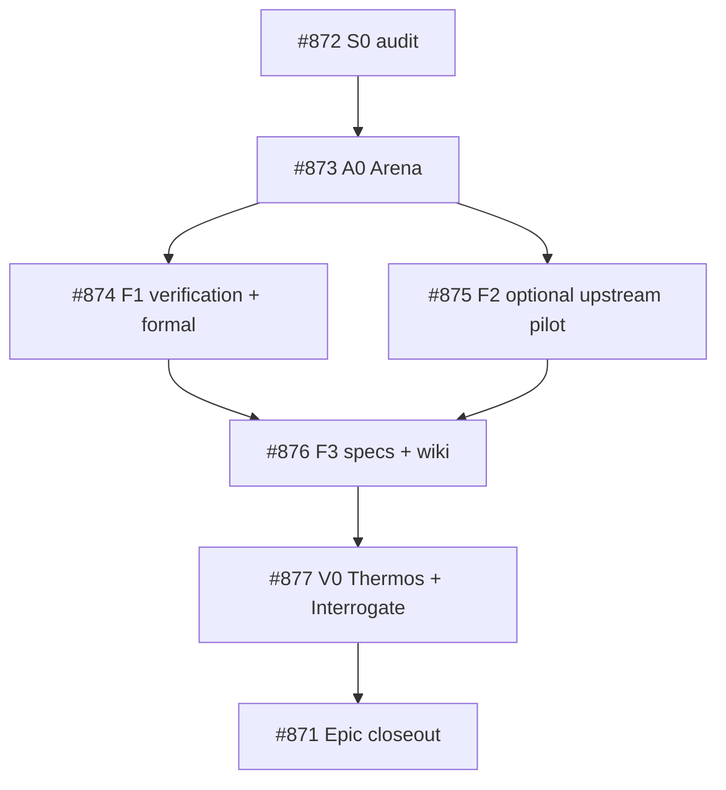

# LLM Wiki reference-engine evaluation and migration contract (PStack #871)

> **Status:** research and proposed design only. **NOT** a migration, verified tool execution, or host-runtime PASS.
> **Date:** 2026-10-31. **Decision owner:** PStack #871; finished historical implementation #863 remains closed.
> **Read with:** `docs/research/llm-wiki-architecture.md`, `.llm-wiki/WIKI_SCHEMA.md`, `scripts/llm_wiki.py`, `tests/test_llm_wiki.py`, and QStack `openspec/specs/wiki-governance/spec.md`.

## 1. Pinned references and evidence strength

| Repo | Inspected main SHA | Primary inspected paths | Finding scope |
| --- | --- | --- | --- |
| tommy-ca/pstack | `e21a196797969691106e6bba095c4438b9ffe643` | #863; `docs/research/llm-wiki-architecture.md`; `scripts/llm_wiki.py`; `tests/test_llm_wiki.py`; `.llm-wiki/` | Source-reviewed, no runtime run in this pass |
| atomicstrata/llm-wiki-compiler | `0f8ff86ef0a28f4c15627a2ea5e94a96cadd834e` | `README.md`, `ARCHITECTURE.md`, `package.json`, `docs/concepts/wiki-model.mdx` | Described SDK/compiler and storage/review contract; no SDK execution |
| geronimo-iia/llm-wiki | `9d974c9e4d9d6c21638a5f520e6d89f79647724e` | `README.md`, `docs/specifications/model/{wiki-repository-layout,type-system}.md`, `docs/specifications/engine/ingest-pipeline.md` | Described engine/type/graph/CLI/MCP/ACP; no binary execution |
| tommy-ca/qstack | `149b6082fe7bcd00e86a13ed48fbf8ee51268882` | `docs/spec/catalog/llm-wiki-v1-{system-spec,atomic-primitives,reference-audit}.md`, `.agents/skills/llm-wiki/SKILL.md`, wiki-curate playbook, issues #923 and #2624 | Governance crosswalk; NOT QStack's currently executed runtime proof |
| cursor/plugins | upstream main, not pinned by this pass | `pstack/` and `thermos/skills/{thermo-nuclear-review,thermo-nuclear-code-quality-review}/SKILL.md` | Review method/reference, not independently executed reviewers |

The historical QStack #2624 program and PStack #863 were closed before this work. Preserve their historical state and receipts. The former issue's body contains old graph-status text; the actual live issue state is CLOSED.

## 2. Current and reference architecture

**PStack v1:** project-local Markdown in `.llm-wiki/wiki/{sources,entities,concepts,requirements,analyses,syntheses}/`, raw captures in `.llm-wiki/raw/sources/`, navigation `index.md`, human activity `log.md`, JSON `config.json`, and a Python stdlib CLI with `check`, `index`, `ingest`. This is a small structural compiler, not a verified LLM semantic compiler, content-addressed source registry, or typed graph store.

**Atomicstrata v1.5.0:** Node >=24, sources under `sources/`, generated pages under `wiki/`, compiler/review/recovery state under `.llmwiki/`. Compiler runs extraction and page generation using providers; selected writes are staged as review candidates; storage interfaces separate domain operations and filesystem effects. Review, provenance, path confinement and recovery must be tested against the *actual pinned SDK*, not inferred from docs. For QStack it can only be an untrusted candidate producer.

**Geronimo:** Rust engine with Markdown/Git history, type schemas, Tantivy BM25 index, typed graph via petgraph, MCP and ACP transport. Agents/skills perform LLM semantic synthesis outside the binary. Its engine is a potentially useful optional read/inspection adapter, **not** a replacement for a semantic compiler or QStack's admission policy. The repository has detailed model/tool specifications and integration tests; this pass did not execute them.

### Data/control flows

```text
PStack baseline:
file -> ingest_file -> raw/sources/<name> + human log
human/agent authored page -> wiki/<category>/*.md -> index/check -> Git PR
(IMPORTANT: current ingest overwrites an existing basename; see findings.)

Optional candidate-producer composition:
external bytes -> SourceRevision + rights/provenance -> isolated compiler
-> proposed Candidate + claims + cited spans + pinned prompt/provider
-> independent deterministic validation + human review
-> PStack Git PR / QStack EXISTING publisher -> canonical Markdown + Git
-> disposable index/graph/search/context projection -> query with canonical re-entry

Optional Geronimo read adapter:
canonical page snapshot -> typed frontmatter conversion -> derived index/graph
-> ranked PageRef/edge -> exact canonical page and evidence resolution
(no canon writes; failure falls back to direct Markdown).
```

## 3. Stable semantic roles and atomic vocabulary

Do not introduce ten new engines for nine responsibilities. Reuse QStack's nine named roles as **semantic responsibilities**, not services.

| Stable role | Minimal PStack composition | Optional reference capability |
| --- | --- | --- |
| `WikiSource` | `SourceRef`, immutable `SourceRevision`, `EvidenceSpan`, SHA-256 | content-addressed source inventory |
| `WikiArticle` | `RecordIdentity`, `WikiRecord`, `FieldContract`, markdown page | Geronimo type schema |
| `WikiSynthesis` | bounded `ExtractionUnit`, `Claim`, held `Candidate` | Atomicstrata extraction and review staging |
| `WikiGraphMap` | `WikiRelation`, `RelationType` with endpoint checks | optional Geronimo graph |
| `WikiSearchIndex` | `QueryPlan`, `RetrievalCandidate`, `ProjectionManifest` | optional Tantivy/BM25 |
| `WikiLogEntry` | immutable accepted action/receipt | PStack human log **not** equivalent to QStack operation ledger |
| `WikiIndex` | deterministic index built from accepted pages | no second authority |
| `WikiLever` | `GateCheck`, `TrustDecision`, `VerificationAttestation` | format/schema/freshness/negative controls |
| `WikiIntent` | bounded workflow with explicit permission | pstack skills/playbooks, host-specific adapter only |

QStack **authority crosswalk:** `knowledge/` = admitted canonical knowledge, `.wiki/` = quarantine, registered schemas and living OpenSpec = governance, `knowledge/operations.jsonl` = sole operation-event ledger, `knowledge/log.md` = derived human-readable projection. Neither upstream engine may write directly into `knowledge/`; its candidates must pass QStack's current publisher and durable CAS/review/rights gates. Do not map PStack `.llm-wiki/log.md` onto `knowledge/operations.jsonl`.

## 4. Known source-review gaps in PStack (not runtime-validated)

1. **Raw immutability violation (high priority to reproduce):** `ingest_file()` computes a target from `source.name` then calls `dest.write_bytes(content)`. A second source with the same basename replaces the first. The architectural invariant in `docs/research/llm-wiki-architecture.md` says raw sources are immutable. Require no-clobber create or content-addressed immutable revisions, with refusal or dedup if the same digest.
2. **Directory boundary/aliasing (security review):** source destination and `raw/sources` directory require explicit symlink/path-confinement tests; index/page link resolver currently checks existence after `Path.resolve()`, but not whether a local path exits the allowed wiki content root. Prove the intended external-link policy and refuse escapes before admitting untrusted content.
3. **Schema overclaim (correctness):** `check_wiki()` validates required files, JSON *key presence*, index inclusion and some regex Markdown links. It does **not** validate page frontmatter types, category membership, immutable source hashes, link fragments, or semantic evidence. Update either the implementation or the docs; a clean check must never be represented as semantic correctness.
4. **Projection truthfulness (correctness):** `index --write` uses direct replacement without temporary-file/atomic rename; page enumeration uses only direct `*.md` children, not nested pages. Decide whether nested pages are forbidden and fail on them, or support recursive listing. Compare generated index to tracked index with a read-only check and deterministic sort.
5. **Parsing and conflict recovery:** regex links may miss Markdown constructs, and source ingestion log and raw copy are two writes without an atomic journal. Ensure interrupted or concurrent work is either recoverable or clearly reported. Do not claim serializable transaction semantics without proof.

A reviewer should first reproduce each with isolated filesystem fixtures and classify CONFIRMED, FALSE_POSITIVE, or NOT_TESTED. The above are code observations and risk hypotheses, not reports of exploit execution.

## 5. Proposed contracts and schema boundary

A thin candidate adapter may emit JSONL/JSON for **staged** candidates; PStack must not pretend QStack already uses this exact schema. Suggested interchange model (versioned and tested before use):

```json
{
  "schema_version": "wiki-candidate/v1",
  "candidate_id": "sha256:<full digest>",
  "source": {
    "id": "repo:owner/name:path",
    "revision": "<immutable git SHA or content SHA256>",
    "content_sha256": "<64 hex>",
    "rights_state": "verified"
  },
  "records": [
    {"id": "concepts/example", "type": "concept", "body_sha256": "<64 hex>",
     "claims": [{"statement": "...", "evidence_spans": ["source:line-start-line-end"]}]}
  ],
  "generation": {"engine": "pinned-sdk", "engine_revision": "<SHA>",
                 "model_id": "<identity or null>", "prompt_sha256": "<digest or null>"},
  "admission": {"state": "held", "reviewed_revision": null}
}
```

This is a **proposal**, not a registered executable contract. If implemented, JSON Schema SHALL reject unknown mutation authority, unsupported relation targets, missing evidence identity, unverified rights and unsupported source revisions. The target publisher must remain the existing repository-specific write owner.

## 6. Evaluation decision and phased migration

**A / retain PStack stdlib (default):** cheapest, zero provider and cross-host dependency; fix safety/schema truthfulness first. Weak on graph, retrieval and autonomous cross-source compilation.

**B / optional composition (preferred only if measured):** retain the baseline; invoke Atomicstrata as isolated semantic *candidate producer*, Geronimo as disposable *search/graph projection*. No mandatory Node >=24/Rust/LLM credentials for offline checks. Maintain one canonical publisher and a compatibility/fallback contract.

**C / wholesale replacement:** only consider if A/B cannot meet required quality and full parity has been proved for source identity, page ownership, links, citations, rights, exact data location, recovery, host support, cost and rollback. A full replacement is *not* approved by this research.

Adoption gates, in order: S0 inventory and mutation reproductions (#872); A0 measured Arena (#873); parallel F1 skill/verification hardening (#874) and F2 real SDK/binary pilot (#875); F3 spec/wiki reconciliation (#876); V0 exact-head independent audit (#877); epic #871 closeout. If F2 is deferred in Arena, explicitly close it `not_planned` with evidence and let F3 proceed on the chosen baseline—do not invent a successful adapter pilot.

**Rollback:** all trials run on isolated source/candidate copy; external indexes are disposable and can be removed. A failed compiler cannot modify canonical Markdown. Retain old CLI and tracked wiki until dual-read diff and operator review pass. No raw deletion, history rewrite, silent schema migration, or cross-repo publisher replacement.

## 7. Verification and formal checks

Use the existing `skills/create-verification-skill/SKILL.md` for a host-native `verify-llm-wiki` CLI verifier (not a second canonical global skill). Run `scripts/scaffold_verification_skill.py --host codex --app llm-wiki --write` only in a suitable workspace, tailor the generated driver to `python3 scripts/llm_wiki.py check|index|ingest`, and test in disposable scratch directories. Include Launch/Doctor/Drive/Evidence/Cleanup/Helpers and feature map with clean, duplicate-source, malformed, no-provider, broken-link, unchanged-index and interrupted-write scenarios. Structural scaffold pass != observed live proof.

Use `skills/create-formal-verification-skill/SKILL.md` for a project-local formal verifier. Candidate temporal properties:
- **I1 No overwrite:** once source revision digest is admitted, no later ingest changes its bytes.
- **I2 No escape:** no accepted local path resolves outside the configured root.
- **I3 Gate before publish:** accepted page implies all required source/rights/schema/review gates passed at that same revision.
- **I4 Recoverability:** interrupted copy + ledger/index update is detected and can be retried without duplicate accepted events.
- **I5 Writer isolation:** concurrent overlapping source identities cannot both commit conflicting bytes.
Translate each bounded TLA+/SMT model step into actual code operations and track code paths and exact sync SHA. Mutate one guard in a scratch implementation to **prove each check fails**. If TLC/SMT/Java unavailable: status BLOCKED and retain deterministic Python negative tests; do not call a model-only check code-level proof.

### Verification matrix

| Layer | Required observed evidence | Status from this review |
| --- | --- | --- |
| Static architecture | Exact source references, option matrix, proposed contracts | SOURCE_REVIEWED |
| Functional regression | `python3 -m pytest tests/test_llm_wiki.py -q`, scratch negative fixtures, `python3 scripts/llm_wiki.py check` | NOT_RUN |
| Index reproducibility | captured index vs regenerated; clean diff on rerun | NOT_RUN |
| Formal | checker version, bounded state count/properties, violated mutant, sync revision | NOT_RUN |
| Reference runtime | actual Node SDK call and Rust binary search/graph with pinned version | NOT_RUN |
| Security | symlink/traversal, source rights, forged citations, stale CAS, crash/retry | NOT_RUN |
| Independent review | Thermos changed diff; distinct Swarm lanes; Arena scoring; Interrogate controls with reviewer receipts | NOT_RUN |

Follow `docs/verification-test-tiers.md`: static/offline/observed_live are distinct. A green CI cannot establish external provider or host-runtime behavior. Apply Thermos review strictly to added/modified PR diff, while pre-existing defects are tracked as separate audit findings. Require exact-head CI and independent verification before marking any gate PASS.

## 8. Issue graph, ownership and non-goals



Do not reopen completed PStack #863 or QStack #2624. Do not create a second QStack wiki ontology, publisher, ledger, router or mandatory search engine. Reuse `skills/qstack-mode/playbooks/wiki-curate.md` and PStack's verification/quality procedures, not duplicated engineering orchestration.

## Primary links

- PStack historical [#863](https://github.com/tommy-ca/pstack/issues/863) and follow-on [#871](https://github.com/tommy-ca/pstack/issues/871)
- [Atomicstrata compiler](https://github.com/atomicstrata/llm-wiki-compiler/blob/main/ARCHITECTURE.md)
- [Geronimo model specifications](https://github.com/geronimo-iia/llm-wiki/tree/main/docs/specifications)
- [QStack consolidation #2624](https://github.com/tommy-ca/qstack/issues/2624) and [real compiler parity audit #923](https://github.com/tommy-ca/qstack/issues/923)
- [Thermos security/correctness review](https://github.com/cursor/plugins/tree/main/thermos/skills/thermo-nuclear-review), [code quality review](https://github.com/cursor/plugins/tree/main/thermos/skills/thermo-nuclear-code-quality-review)
