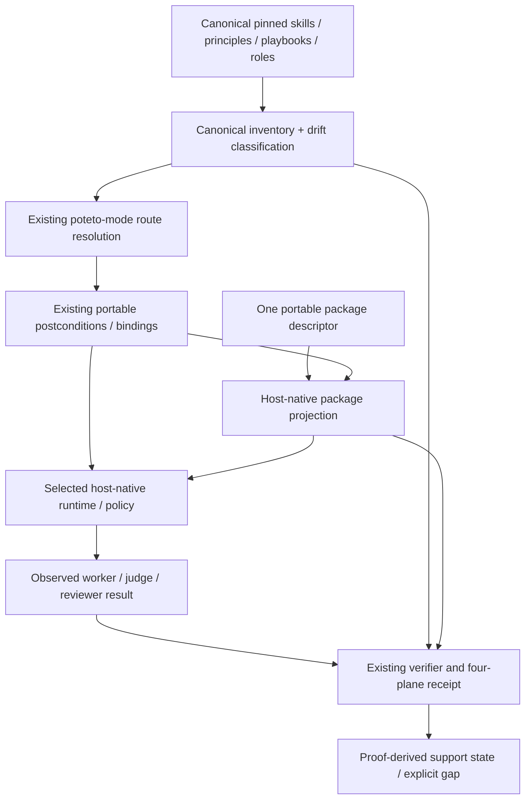

# pstack semantic building blocks: audit, reduction, recomposition

Status: **design proposal / source-backed desk audit**, not an implemented runtime or a multi-model review. This is the shared semantic contract underlying the OMP-native adapter in this OpenSpec change, **not** a second orchestration framework.

## Authority and baseline

- Canonical upstream: `cursor/plugins/pstack`, referenced by `UPSTREAM` at `df581122cde17e6e27686b5a448bde23e4ad4318`. Later upstream head is a separate **freshness** dimension and never silently updates the contract.
- Reference port: `tommy-ca/pstack@3b1d8efb4d4332de1b084691690e952893fe0c06` (before the spec-only branch).
- Existing normative contracts: `openspec/specs/pstack-portability/spec.md`, `openspec/specs/pstack-playbooks/spec.md`, `openspec/specs/pstack-principles/spec.md`, `openspec/specs/pstack-router/spec.md`, `pstack.package.json`, `profiles/*.json`, `schemas/portability/*.schema.json`.
- OMP behavioral source: `can1357/oh-my-pi@0affc77e41c357bb33f8bf056c3ea3cf50fd408b` and official `docs/tools/eval.md`, `docs/rpc.md`, `docs/task-agent-discovery.md`, `docs/skills.md`, `docs/plugin-manager-installer-plumbing.md`.
- Active architecture decisions: ADR-0005 (Markdown playbooks, no Rhai/portable DSL), ADR-0006 (host-owned durable orchestration), ADR-0012 (one portable descriptor), ADR-0017 (routing/proof/lifecycle).
- Cursor principle skills consulted: Model the Domain; Boundary Discipline; Prove It Works; Subtract Before You Add; canonical Swarm, Arena and Interrogate. This reference port adapts host mechanics while preserving their **required outcomes**.

## Domain model: minimal independently meaningful blocks

These are **semantic roles of existing files/interfaces**, not a request to introduce a new Python/TypeScript class per row.

| Block | Meaning / owner | Existing representation | Observable invariant |
| --- | --- | --- | --- |
| CanonicalArtifact | Upstream principle, leaf skill, Markdown playbook or role; upstream-owned | `skills/**/SKILL.md`, `skills/poteto-mode/playbooks/*.md`, `agents/*.md`, `UPSTREAM` | Every pinned artifact is preserved, adapted, excluded or marked gap; origin and pin retained |
| IntentRoute | User intent selects a playbook via the existing router | `skills/poteto-mode/SKILL.md`, route resolver, pstack-router spec | One exact route or explained fallback; preserve copied steps and explicit skipped steps |
| Capability | Small host-neutral operation with required postconditions | `schemas/portability/capability.schema.json`, `pstack-portability` | Requests specify observable result rather than native tool name |
| AdapterBinding | Versioned capability-to-host-mechanism classification | `profiles/<host>.json`, `binding.schema.json` | `native|shim|version-gated|gap`, `hard|soft|advisory`, proof status remain independent |
| ExecutionUnit | Immutable brief/scope and output ownership for one worker/verifier | Existing agent and playbook brief templates; **ephemeral**, not a new task DB | Goal, scope, relevant SHAs, required verification, timebox, forbidden actions, expected report; one writer per target |
| WorkspaceBoundary | Shared vs isolated vs read-only *effective* policy | `workspace.*` capabilities; `runtime_conventions` | No unintended parent changes, colliding writer or falsely claimed hard read-only boundary |
| NativeSession | Process/session and child lifecycle **owned by harness** | Host `session.*`, `agent.*`, native task/eval/RPC | No cold-parent-resume = live-child-handle inference; bounded spawn/join/cancel |
| PackageProjection | Generate host-installable skill/role assets from *one* portable package descriptor | `pstack.package.json`, `package-descriptor.schema.json`, project/package scripts | Skills and roles are actually discovered; no copy of credentials; unmanaged files retained |
| VerificationObservation | One concrete check at a declared evidence level | `DriverScenarioResult`, four-plane receipt `scenarios[]` | Static/offline/observed_live/legacy labelled accurately with terminal evidence |
| VerificationReceipt | Aggregation and revision attribution for proven behavior | `schemas/portability/receipt.schema.json` | Canonical/adapter/package/runtime planes, exact revisions, FAIL dominance, no promotion from stale/proxy results |
| HostState | Durable task/session/inbox/approval information | Native harness or external explicitly selected host control plane | pstack does not create a competing scheduler, job queue, task database or session manager |

**Not additional primitives:** `agent.fan_out` as a higher-level operation, `WorkPool`, `Swarm`, `Arena`, `Interrogate`, `Orchestrate`, `model.role`, `route`, `cross-judge`, `graft`, `resume-wave`, `rpc.ready` are workflow policies, schemas/projection concerns or host-specific mechanisms. They compose from the established portable primitives and MUST NOT enter `binding.schema.json` as extra low-level capabilities merely to support OMP.

The existing 17 **portable capabilities** are the exhaustive v1 vocabulary:

```text
agent.spawn  agent.join  agent.message  agent.cancel  agent.resume
workspace.shared  workspace.isolated  workspace.readonly
human.ask  human.gate  plan.update
schedule  monitor  session.persist  session.resume
evidence.capture  verify
```

The tool-mapping schema's `agent_fanout` and other operational names are host convenience bindings, **not additions** to the normative semantic capability enumeration.

## Atomic postconditions: smallest useful capability contracts

This is a **design-level behavior table**, mapped back to the existing `Capability.required_postconditions` shape. It introduces no new normative capability names. Verify both the success and negative case at the appropriate evidence level.

| Capability | Required observable postcondition | Representative failure or gap |
| --- | --- | --- |
| `agent.spawn` | Child identity and accepted execution with an independently scoped brief | String alias, help text or rejected spawn is not execution |
| `agent.join` | Specific child reaches terminal result, correlated with parent/request; output captured | Prompt admitted or parent yielded while child still runs |
| `agent.message` | Addressed child receives correlated message during supported lifetime | Parent chat resumed but original child handle is gone |
| `agent.cancel` | Cancellation reaches target, terminal/cleanup observed within deadline | Cancellation request acknowledged while child persists |
| `agent.resume` | Previously known child can accept a further turn with tested identity/context contract | Only parent `--resume` works; fresh child created silently |
| `workspace.shared` | Defined cwd/scope visibility and exclusive writes policy respected | Conflicting concurrent changes or untracked parent mutations |
| `workspace.isolated` | Child writes occur only in assigned isolated workspace and are not auto-applied | Worktree exists but unapproved merge/apply changed parent |
| `workspace.readonly` | Prohibited write attempt is denied by enforced tool/filesystem policy (or declared advisory) | Prompt `do not edit` is not hard enforcement |
| `human.ask` | Human request routed through native supported interaction, result attributed to request | Background/headless host with no prompt channel |
| `human.gate` | Side effect remains blocked until explicit authorized human approval | Advisory instruction incorrectly reported as hard gate |
| `plan.update` | Native task/todo state reflects intended progress and skipped steps | Local Markdown prose claimed to be host task update |
| `schedule` | Host-owned future trigger is registered and observed or declared a gap | `async` background job falsely treated as durable scheduling |
| `monitor` | Native current execution status can be queried and correlated with unit | Stale file presence treated as live job status |
| `session.persist` | Host-owned session data survives configured persistence boundary | In-memory eval kernel treated as durable |
| `session.resume` | After cold restart, host can reopen prior session with expected continuity | Agent handle reuse assumed across process restart |
| `evidence.capture` | Reproducible evidence references preserve command, revision, result and source | File existence replaces actual observation |
| `verify` | Relevant check executes against real artifact; observed PASS/FAIL/BLOCKED is attributable | Static schema pass promoted to native runtime parity |

**Proof rules:** A capability mapping may be `gap` without inventing an alternative; a version-gated native binding is not hard enforced until exercised. A runtime postcondition requiring a real model must use `observed_live`, not `offline`. A single receipt may contain mixed evidence strengths, but aggregation never upgrades the weakest mandatory proof by borrowing a stronger unrelated scenario.

### Three conceptual concerns vs four serialized proof planes

Existing `openspec/specs/pstack-portability/spec.md` has a heading **“Verification has three planes”** (canonical, adapter, runtime). Existing `receipt.schema.json` requires **four serialized keys**: `canonical`, `adapter`, `package`, `runtime`. The correct non-breaking reconciliation is **three conceptual concerns but a separately audited package projection plane in serialized receipts**. The portable design must say so explicitly: the package is an adapter-derived artifact that receives its own installation/discovery evidence and must not be folded into static adapter PASS or live runtime PASS. This is a documentation-contract inconsistency requiring a formal modified requirement, *not* a reason to invent a fifth plane.

## Composition grammar: behavior without a second DSL

```text
Playbook = canonical ordered intent + roles + required capability postconditions + gates
Skill    = canonical instruction package + optionally references/playbook invocation
Execution = host adapter realizes needed capabilities within host-owned session/state
Proof    = scenario observation(s) + provenance + deterministic postcondition check
```

No separately executable playbook parser, portable WorkPool, scheduler or state engine. The grammar is explanatory; Markdown remains the authoritative workflow definition.

### Swarm

```text
freeze done predicate / slices / race-selection policy
→ freeze N independent briefs, SHA and verification method
→ native agent.spawn per worker, distinct workspace when writing
→ bounded agent.join / cancel when necessary
→ reject incomplete provenance, optionally respawn once
→ aggregate independent PASS / ISSUES / BLOCKED + uncovered slices
→ one root report; verification lever
```

**Tests:** absent worker leaves a GAP, not PASS; overlapping writes prohibited; all same-task race arms use predeclared selection rule; no `agent.join` observed implies no completed Swarm. Native OMP `task` / eval handles are candidates; `workpool` reuse is not independence proof.

### Arena

```text
same task prompt + 3–6 criterion rubric frozen before generation
→ independent candidates and exclusive output worktrees
→ join candidates, record dropout
→ single read-only cross-judge sees frozen rubric and complete outputs
→ compare judge to lead, choose base, justify disagreements
→ graft at most justified improvements into coherent one-owner artifact
→ deterministic post-graft verification + report
```

**Tests:** judge cannot read in-progress candidates; no shared mutable output; graft remains an explicit writer action. Native OMP cross-judge model selection through agent role/frontmatter + `modelRoles`, never a fictitious `agent({model})` option.

### Interrogate

```text
freeze reviewed diff + intent + common rubric + code-quality lens
→ each reviewer gets identical pack in independent read-only contexts
→ join under deadline, collect source-backed findings
→ deduplicate and retain which models agreed/disagreed
→ lead adjudicates act-on / consider / noted / dismissed
→ emit report; NEVER auto-apply reviewer changes
```

**Tests:** reusing one warm WorkPool worker across independently labelled reviewer arms does not count as independent context; prompt-only no-write restriction is advisory until enforced; missing models = gap.

### Orchestrate (long horizon, not automatically fully portable)

Canonical upstream allows coordinator → sub-coordinator → worker nesting and explicit coordinator role constraints. This reference port currently uses flat coordinator → workers with host-owned track state. **Not equivalent.** A host should expose `adapted:flat` versus `gap:nested-tracks` in parity reports until actual nested spawn/ownership/join/cancel demonstrates otherwise. Native OMP default recursion depth is not a pstack verification result.

## Code flow: authority, dispatch and proof



A host API or plugin command is parsed and validated **at the boundary**. Routing rules, coverage classification and receipt reduction are pure domain decisions. Driver shell/adapters are thin; keep host-native errors instead of inventing cross-harness wire aliases.

## Data flow and non-invented schemas

```text
pstack.package.json + canonical UPSTREAM
    → versioned package projection (native skills/agents/manifests)
profiles/omp.json + existing capability/binding/tool/runtime schemas
    → selected native mapping and enforcement policy
canonical playbook + worker brief (in-session ephemeral data)
    → host agent/task/eval process or RPC command
host events + child terminal results + sentinel/worktree checks
    → existing DriverScenarioResult evidence level
    → existing four-plane receipt with exact surface_revisions
    → current verifier support decision
```

Existing schema distinctions MUST remain intentional:
- `binding.schema.json` has `implementation_status`, `enforcement`, `verification_status`; these do **not** equal `receipt.scenarios[].evidence_level`.
- `evidence.schema.json` uses `kind: static|runtime|external` and permits `PASS|FAIL|BLOCKED`; `receipt.schema.json` uses `static|offline|observed_live|legacy` and `PASS|FAIL|BLOCKED|UNTESTED`. These are two existing shapes with **different semantics**. Do not fabricate `live` or `documented` enum values, merge types blindly or serialize an unvalidated hybrid.
- `surface_revisions` is a closed shape in the receipt. Keep per-child OMP RPC details in referenced evidence artifacts unless a compatible schema extension is explicitly reviewed.
- `agent.resume` is a child capability; `session.resume` is parent/session state. Their verification scenarios and receipts differ.

A precise receipt reducer treats current known FAIL as dominant, then BLOCKED, UNTESTED, PASS for mandatory scenarios, while evaluating freshness and proof strength **separately**; it cannot reinterpret historical `legacy` as `observed_live`.

## Audit findings / SOLID, KISS, DRY, YAGNI

| Finding | Risk | Minimal corrective action | Tracking |
| --- | --- | --- | --- |
| OMP runtime PASS synthesized from profile strings, `--help` text and receipt existence (relabeled static in #316) | False parity | Native child identity/output/settlement check; the live driver path is #297 | #291 / #297 |
| OMP package branch emits a pseudo `plugin.json`; role files are now projected (#299) | Unproven native loader acceptance | One native projection with actual install/discovery checks | #290 / #298 |
| `profiles/omp.json` hard/read-only/resume/wire-alias claims exceed proof | Undocumented security/equivalence | Classify each binding by mechanism, mode, evidence and enforcement | #289 |
| `receipt` vs `evidence` vocabulary differs | Schema confusion, false claims | Reuse both existing schemas with an explicit boundary; reduce once | #296 |
| Reused OMP WorkPool agents can contaminate independent judges | Biased Arena/Interrogate outcomes | Fresh agents per judge, or report adaptation | #293 |
| Canonical nested orchestrate vs port flat coordinator | Silent loss of behavior | Separate canonical pin conformance vs host adaptation/gap | #289 / #293 |
| Over-specified new orchestration domain types | Duplicate scheduler / DRY regression | Document mappings of existing artifacts; add NO new portable engine | This document |

**SOLID**: roles and proof classes retain single responsibility; host adapters implement existing capabilities (DIP/ISP). **KISS/YAGNI**: reuse existing schemas and only one native OMP packaging/transport option after empirical proof. **DRY**: one pstack descriptor, one route resolver, one verifier reducer, one receipt format. **Principle-model-the-domain**: encode distinct state/evidence dimensions. **Boundary Discipline**: validate native input and plugin origins at ingress. **Prove It Works**: separate document and runtime. **Subtract Before You Add**: remove unsound aliases and redundant shims before more interfaces.

## Behavioral parity matrix / proof gates

| Composition | Canonical minimum | OMP mapping | Current status |
| --- | --- | --- | --- |
| Principle + leaf skill | Canonical pin inventory + discoverable trigger | OMP native one-level skill discovery | source-mapped; package runtime unverified |
| Router/playbooks | Intent route / verbatim todo semantics | Native skill + host todo | static route proxy only |
| Roles | Named agent + configured model role | `agents/*.md`, `modelRoles` | projected since #299; native install/discovery proof open |
| Spawn and join | Child output and terminal result | task / eval handles / RPC | observed live over RPC v2 with a typed settlement (#319); eval-handle variant untested |
| Swarm | Distinct worker contributions and one synthesis | task/eval candidates | untested |
| Arena | Frozen rubric, independent candidates, single judge, verified graft | isolated task/eval + reviewer | untested |
| Interrogate | Identical review pack, fresh contexts, read-only, lead disposition | fresh native agents, not default reusable WorkPool | untested |
| Orchestrate | nested canonical track ownership | flat current port / depth policy | adapted/gap, not full parity |
| Verification | Actual artifact + exact SHA, no false success | receipt/static/native runner | offline CI only; live pending |

No row is marked native PASS without corresponding executed receipt. The execution DAG remains [#288](https://github.com/tommy-ca/pstack/issues/288); this design does not create an alternative issue graph or execution store.
