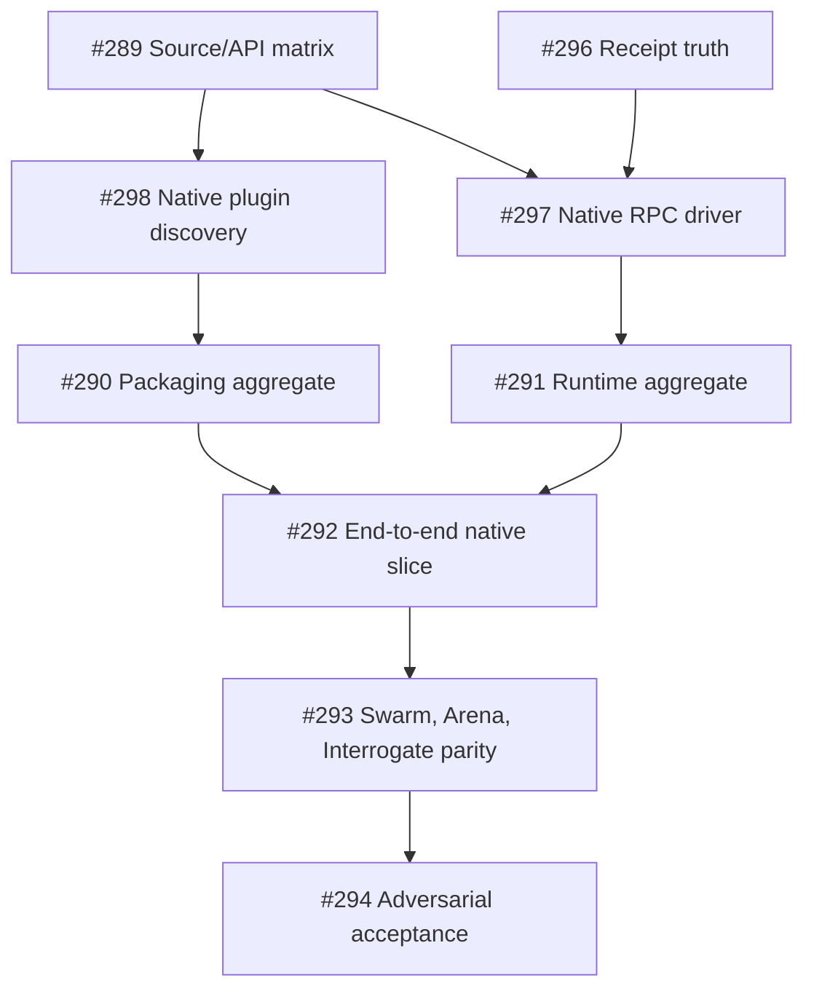

# OMP Native Adapter — Recursive Execution Graph and Verification Plan

This file is the depth-first implementation contract for [epic #288](https://github.com/tommy-ca/pstack/issues/288). All nine leaf issues (#289-#294, #296-#298) are CLOSED as COMPLETED on 2026-10-12 via merged PRs #330, #337, and #339-#347. The status below records what was believed when the change was written; the implementation status section at the end records what landed. Historical closed work #62/#66/#67/#68 and #235/#238/#247/#248 remains context only. This change merged as [PR #295](https://github.com/tommy-ca/pstack/pull/295).

## Inputs and authority
- Canonical: Cursor `cursor/plugins/pstack`, immutable portable `UPSTREAM` pin `df581122cde17e6e27686b5a448bde23e4ad4318`; compare with current Cursor head independently.
- OMP runtime/spec pin: `can1357/oh-my-pi@0affc77e41c357bb33f8bf056c3ea3cf50fd408b`. Audited newer head `2070e3049aafbcf3aca0e87c1d15993d363d33e1` is +1 provider/judgment commit, without changed core OMP RPC/task/skill/plugin docs; refresh pin comparison at implementation time.
- Target baseline: `tommy-ca/pstack@3b1d8efb4d4332de1b084691690e952893fe0c06`.
- Existing authoritative receipt schema: `schemas/portability/receipt.schema.json`, with `static | offline | observed_live | legacy`.

## Execution and dependencies

## Semantic-block parity gates (no new scheduler or issue epic)
- [x] Source-audit existing `pstack-portability`, `pstack-playbooks`, `pstack-principles`, `pstack-router` and canonical Cursor principles/playbooks at recorded pins; list existing domain block owners and avoid duplicate capability identifiers.
- [x] Document the *mapping*, not code implementations, of CanonicalArtifact, IntentRoute, Capability, Binding, ExecutionUnit, WorkspaceBoundary, NativeSession, PackageProjection, Observation, Receipt and HostState in [semantic-building-blocks.md](./semantic-building-blocks.md).
- [x] Add the `pstack-portability` OpenSpec delta (ten requirements, eleven testable scenarios) covering postconditions, context independence, orchestrate adaptation, package roles, evidence-schema boundaries and truth-preserving parity reports.
- [x] **#289** source matrix must demonstrate that all 17 existing capabilities remain the normative atomic set and each required OMP-specific mechanism is a binding or composition, not a hidden new capability. (Closed via #340; see Implementation status.)
- [x] **#293** behavioral fixtures must prove or explicitly gap Swarm, Arena, Interrogate and canonical nested Orchestrate semantics. A static skill inventory alone is not sufficient. (Closed via #339 plus #346; see Implementation status.)
- [x] **#294** six-host regression must assess both canonical pin conformance and independent host-runtime evidence, preserving `preserve|adapt|exclude|gap` classifications and distinct `evidence.schema.json` vs `receipt.schema.json` enums. (Closed via #344 plus #347; see Implementation status.)

## Phase 0 — Independent roots: contracts before implementation
- [x] **#289 Source parity**. Audit `task`, `agent()`, `wait()`, `workpool()`, `modelRoles`, skill/agent discovery and precedence, mode-specific RPC/SDK/CLI behavior, process-local handles and orchestration depth. Produce source-anchored capability table separating documented/hard/advisory/gap; update `profiles/omp.json` only in implementation PR. (Closed via #340.)
- [x] **#296 Receipt truth**. Keep existing receipt enums, closed hash schema and four planes; test FAIL > BLOCKED > UNTESTED > PASS, historical legacy cannot become live, source docs are not live proof, changed SHAs stale receipts. Separate `documented` mapping metadata from `observed_live` scenario evidence. (Closed via #337 plus #344.)

## Phase 1 — Parallel leaves after source audit
- [x] **#298 Native packaging probe** (depends #289). Arena candidate A (native `.omp/skills` / `.omp/agents`), B (recognized `package.json#omp` with canonical `skills/` + `agents/`), C (TypeScript extension, only if necessary). Check loader-recognized package, actual named skill/role invocation **including the OMP `agents/` projection added by #299**, namespace collisions, shadowing, disable, preservation and invalid-manifest behavior in a disposable isolated OMP plugin data root (verify effective HOME/XDG/profile directories before install/link). (Closed via #330 plus #341.)
- [x] **#297 Actual native RPC probe** (depends #289 + #296). Use `omp --mode rpc` (or explicitly justified SDK) with bounded `ready` handshake, `id` correlation, prompt admission, `prompt_result` and `session_settled`, `get_subagents` child result/error, cancellation, role resolution and isolated worktree/sentinel verification. Treat `omp -p` as limited smoke, not full subagent runtime proof. (Closed via #342.)

## Phase 2 — Aggregate package and runtime
- [x] **#290 Package aggregate** (depends #298). Build minimal OMP-native generated package from `pstack.package.json` and reusable canonical skills/roles; ownership-safe link/install/update/disable/uninstall; test project/user precedence and exact OMP version. (Closed via #330 plus #341.)
- [x] **#291 Runtime aggregate** (depends #297). Replace OMP driver proxy runtime PASS with evidence-level-labelled model-backed runtime results, safe failures, bounded timeout, cancellation and exact revision receipts. Unsupported host prerequisites => BLOCKED/UNTESTED, not runtime PASS. (Closed via #343.)

## Phase 3 — Depth-first end-to-end demonstration
- [x] **#292 Vertical slice** (depends #290 + #291). Isolated real package install → actual `poteto-mode` discovery → role-frontmatter `model: "@review"` via OMP `modelRoles` → native model-backed worker spawn/join → observed output/negative → receipt and clean uninstall. Preserve unmanaged files and parent sentinel. If live prerequisites are unavailable, report the slice BLOCKED and do not unlock full playbook acceptance. (Closed via #345.)

## Phase 4 — Native playbook recomposition (after real slice)
- [x] **#293 Swarm**: frozen done predicate and partition/race, separate worker briefs and writable contexts, deadline/join/dropout report, provenance-bound results, root lever. (Closed via #339 plus #346.)
- [x] **#293 Arena**: same artifact prompt, frozen 3–6-item rubric, independent candidate worktrees, one cross-judge after candidates settle, documented base/grafts/rejections, deterministic post-graft verification. (Closed via #339 plus #346.)
- [x] **#293 Interrogate**: identical packed diff, same rubric and code-quality lens, independent fresh reviewer contexts or clearly disclosed adaptation, no writes, dedup/consensus/disagreement and lead verdict buckets. (Closed via #339 plus #346.)
- [x] **#293 Orchestrate parity edge case**: portable flat coordinator depth-1 versus canonical Cursor nested track coordinators; classify nested behavior as adapted/gap until OMP-owned depth, cancellation, join and worktree semantics demonstrated. No second scheduler/store. (Closed via #339 plus #346.)

## Phase 5 — Independent final gates
- [x] **#294 Adversarial Interrogate gate**: challenge RPC admitted-vs-settled, false PASS, stale receipt enums, plugin scope/name collisions, unsafe link overwrite, extension trust, WorkPool cross-contamination, role fallback, model/auth failure, early cancellation, orphan worktrees and data loss; publish reviewer disagreement and disposition. No automatic fixes by reviewers. (Closed via #344 plus #347.)
- [x] **#294 Six-harness mixed-evidence regression**: run deterministic offline CI, then available hosts' native tests; absence of a binary/provider is BLOCKED/UNTESTED, never a fabricated host-runtime PASS. Verify exact source/driver/manifest/profile/receipt hashes. Preserve controlled merge/PR review. (Closed via #344 plus #347.)
- [x] Only mark OMP `supported` after mandatory native outcomes pass **observed_live** criteria and negative safety probes. Historical `overall_verdict: PASS` is not retroactive proof. (Gate satisfied at close; see Implementation status.)

## Verification status at spec writing
- [x] Deep source/doc review and duplicate-issue audit; existing historical work preserved.
- [x] Formal change created as draft PR #295, with OpenSpec proposal, Gherkin scenarios, design, ADR manifest and this graph.
- [x] GitHub epic and nine issue nodes updated with dependency/acceptance requirements.
- [x] Native model-backed OMP worker executed — performed after the spec-only audit: `.audit/evidence/omp-receipt.json` run `omp-1791892165` carries `runtime-child-spawn-omp`, `runtime-child-cancel-omp`, `runtime-isolation-omp` at `observed_live` PASS against pin `1dcc2ba`.
- [x] Native independent multi-model Swarm/Arena/Interrogate — recomposed over native dispatch with live runs on both routes (closed via #339 plus #346); adversarial gate via #344 plus #347 with live two-model review at the E04 head.

## Implementation status (2026-10-12 stack)

Appended, not back-edited: the plan above records what was believed when the change was written.

- **#298 native packaging probe: satisfied.** The OMP install now emits `package.json#omp`
  with conventional `skills/` and `agents/` siblings, and
  `scripts/prove-omp-native-package.py` reads the discovery back from the real binary. The
  loadability evidence is the sentinel skill injected into the temp copy, which appears
  only after the link, plus the package's skills displacing same-named ambient ones into
  their namespaced form; a listing alone is not loadability, because OMP lists a package
  whose `package.json` lacks the `omp` key and then loads nothing from it. With `--live` a
  packaged role agent spawns with `agentSource=user` and no ambient directory defines that
  name. A root `plugin.json` package with no `package.json` is not enrolled, which is the
  negative control in `tests/test_omp_native_package.py`. Remaining: the disabled-plugin
  case.
- **#290 package aggregate: partially satisfied.** The manifest is native and the lifecycle
  is exercised by the proof lever (link, list, uninstall) with the ambient plugin root
  snapshotted before and after. The project/user precedence matrix and `omp plugin
  disable` are not yet covered.
- **#297 RPC proof: spawn/join satisfied, cancellation open.** The live receipt carries a
  typed settlement from a real child. `get_subagents` and `cancel_subagent` have session
  methods but no observed scenario, and `steer_subagent` has no session method at all.
- **#291 runtime aggregate: satisfied for the driver's own claim.** The runtime plane's
  spawn scenario is `observed_live`; the isolation scenario is recorded `static` and its
  description says it is a CLI probe with no observed isolation.
- **Arena, observed with the real binary on 2026-10-12.** Arm A (project `.omp/skills` and
  `.omp/agents`) has no package, no lifecycle and no distribution. Arm B (`package.json#omp`
  with conventional `skills/` and `agents/`) links, enrolls, and loads both surfaces; it is
  the shipped projection. Arm C (Agent Plugins 1.0.0 root `plugin.json` with the canonical
  `$schema`) also loads skills and agents when wired through `extensions:` or `-e`, but
  `omp plugin link` refuses it outright without a `package.json`, and the standard's closed
  skill-frontmatter set rejects `disable-model-invocation`, which 49 of the 58 canonical
  skills carry: a probe skill carrying that field was not advertised at all. Arm B stays the
  contract, and a future portable projection needs the frontmatter work first.
- **#289 source matrix: closed via #340.** Every OMP binding pins the scenario that settles it with honest statuses and a typed `evidence_ref` gate.
- **#296 receipt truth: closed via #337 plus #344.** The `live`/`documented` rejection fixture and the adapter-PASS-plus-package-FAIL refusal both landed with independent verdicts.
- **#298 native packaging probe: closed via #330 plus #341.** Enrollment, load, collision, precedence, disable, key variants and nesting negatives all recorded.
- **#297 RPC proof: closed via #342.** Live cancel settlement with typed negatives; the steering gap stays recorded, unobserved by design.
- **#290 package aggregate: closed via #330 plus #341.** Native `package.json#omp` proof plus precedence, disable, key and nesting negatives.
- **#291 runtime aggregate: closed via #343.** Isolation observed live with settlement and `workspace.isolated` verified.
- **#292 vertical slice: closed via #345.** End-to-end slice observed live with head-bound receipt. Residual cold-resume and depth boxes observed later at #362 and current head; depth stays a pstack policy claim, not a host ceiling.
- **#293 playbook recomposition: closed via #339 plus #346.** Parity gap closed, skills recomposed over native dispatch with live runs on both routes.
- **#294 adversarial gate: closed via #344 plus #347.** Package-precedence fixture plus adversarial negatives and matrix; standing live two-model review ran at the E04 head with findings addressed in #361 and #363.
