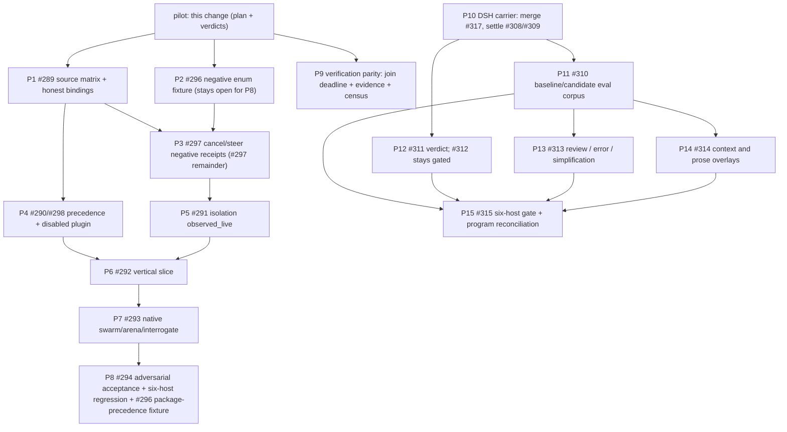

# Poteto audit program — recursive plan and issue-graph reconciliation

Pilot unit of program `pstack-poteto-audit-20261012`. This was the depth-first execution
contract for the two programs at head `40382c9516e7b4a19838eb29a2d9629b90d3df2e`.
Both programs are now CLOSED as COMPLETED on 2026-10-12:
- OMP native adapter epic **#288** (children #289–#294, #296–#298), closed via merged PRs #330, #337, and #339–#347.
- DSH skill portability program **#305** (sub-epics #306/#307, leaves #308–#315), closed via merged PRs #321, #331, #332, and #348–#364.
The per-section boxes below record what was believed when the change was written. Thirty
commits landed after the baseline (`40382c9..b6551fb`), and the verdict table in section 17
is reconciled to that merged state at the end of this file.

Read as an inventory of what remains, not as a second source of truth: where a program
already has a graph (OMP: merged `openspec/changes/2026-10-11-omp-native-adapter/tasks.md`;
DSH: PR #317 `tasks.md`), this file sequences it and assigns verdicts instead of restating
its checklists.

**Read-only baselines.** OMP doc pin `can1357/oh-my-pi@0affc77e41c357bb33f8bf056c3ea3cf50fd408b`;
DSH source pin `deepseek-ai/deepseek-harness@d743267388641bc76f17c45ce8b4c231aed1d32c`;
canonical `UPSTREAM` pin `df581122cde17e6e27686b5a448bde23e4ad4318`.

**Unit size rule.** One PR per section, bottom-up, one unit only, no carried-over verdict:
a new head gets a fresh verdict at that head. Sections P1–P9 are the OMP and
verification-parity track; P10–P15 are the DSH track. P9 is independent of P1 and can run
in parallel.

## 1. Recursive execution graph



Stop rules, unchanged from both programs and enforced by this plan:

1. A manifest path existing is not loadability; a skill listing is not skill resolution.
2. A child must return an observed result and a terminal settlement; the receipt token is
   `observed_live`, never `live`, and metadata `documented` is not execution proof.
3. An unavailable binary, provider or auth is `BLOCKED`/`UNTESTED`, never `PASS`.
4. `FAIL` outranks `BLOCKED`, which outranks `UNTESTED`, which outranks `PASS`.
5. No new scheduler, router, capability enum or state store; no second skill namespace.
6. No promotion of an issue to closed while a named acceptance item has no recorded
   observation. That rule is what keeps #298 open below.

- [x] 1.1 Recursive graph written for both programs, with the pilot as its single root.
- [x] 1.2 Per-issue verdict table (section 17) covers all 21 open issues with an artifact
      pointer each; no gated issue (#290, #311, #312) is closed.
- [x] 1.3 Offline gate subset run and recorded with its exit code (section 18).
- [x] 1.4 `todo.md` reconciliation section updated to point at this plan.
- [x] 1.5 No PR opened by the worker; the coordinator stacks the PRs this plan names.

## 2. P1 — OMP source matrix and honest bindings (#289)

- **Files**: `profiles/omp.json`, `scripts/portability_schema.py`,
  `schemas/portability/binding.schema.json`, `tests/test_portability_schemas.py`,
  `tests/test_evidence_durability.py`.
- **Build step**: build one source-anchored row per portable capability from the pinned OMP
  docs (`docs/tools/eval.md`, `docs/rpc.md`, `docs/sdk.md` @ `0affc77`), then set each
  profile binding from the artifact that settles it. Today
  `agent.cancel`, `agent.resume`, `session.resume`, `monitor` and `schedule` are
  `verification_status: verified` while `.audit/evidence/omp-receipt.json` has no scenario
  for any of them, and `evidence_ref` is a free string
  (`schemas/portability/binding.schema.json`), so only a dangling path fails. Downgrade
  those rows to `static-only` or cite the scenario id that proves them; split
  `agent.resume` into cold parent `--resume` versus child handle revival; reject a `hard` +
  `verified` binding whose cited scenario is missing or not `observed_live`.
- **Observable result**: `python scripts/verify-portable.py check-evidence --host omp`
  exits 0 while omp `derived_support_state` drops from `verified` to at most `packaged`,
  because the unproven rows no longer claim `verified`.
- [ ] 2.1 unit: `tests/test_portability_schemas.py tests/test_evidence_durability.py` green,
      including a new rejection case for `hard` + `verified` citing a scenario that does not
      exist or is not `observed_live`.
- [ ] 2.2 live: `PSTACK_RUN_OMP_LIVE=1 pytest -q tests/test_omp_rpc.py` records the scenario
      ids that exist at the head; every surviving `verified` row cites one of them.
- [ ] 2.3 perf: profile validation stays O(bindings) with one receipt parse per profile,
      not one per capability; record `verify-portable.py doctor --host omp` wall clock
      before and after against the same baseline.

## 3. P2 — #296 residual: negative enum fixture (issue stays open for P8)

- **Files**: `tests/test_portability_schemas.py` or `tests/test_evidence_durability.py`
  (whichever already imports `receipt.schema.json` most directly), reference
  `schemas/portability/receipt.schema.json`.
- **Build step**: the enum is already closed (`static | offline | observed_live | legacy`)
  and the merged spec forbids invented `live`/`documented` values
  (`…/2026-10-11-omp-native-adapter/design.md:52`,
  `specs/pstack-omp-native-adapter/spec.md:76`), but nothing asserts the rejection. Add the
  two negative fixtures; assert the OMP live receipt keeps `observed_live` after the run.
- **Observable result**: a receipt-shaped scenario with `evidence_level: "live"` and one with `"documented"` both fail schema validation; #296 stays open when this lands, because the package-precedence fixture (P8) is still owed.
- [ ] 3.1 unit: the two negative fixtures raise `ValidationError`; suite green.
- [ ] 3.2 live: `.audit/evidence/omp-receipt.json` still validates and still carries
      `runtime-child-spawn-omp` as `observed_live` after a live refresh.
- [ ] 3.3 perf: no runtime path — record "schema validation only, no measured counter".

## 4. P3 — #297 remainder: cancellation and steering with negative receipts

- **Files**: `scripts/drivers/omp_rpc.py`, `scripts/drivers/omp.py`,
  `tests/test_omp_rpc.py`, `profiles/omp.json`, `.audit/evidence/omp-receipt.json`.
- **Build step**: this is `todo.md` Unit 10. `get_subagents` and `cancel_subagent` exist as
  session methods but have no observed scenario, and `steer_subagent` has no session method
  at all. Drive a bounded session, cancel one in-flight child and record
  `terminal_outcome: cancelled` with a settlement; add the timeout and dropped-frame
  negatives; where steering is unsupported, record the gap in the profile row rather than a
  claim.
- **Observable result**: a `runtime-child-cancel-omp` scenario at `observed_live` with a
  typed settlement, and a truthful gap note for steering.
- [ ] 4.1 unit: reducer tests over recorded frames cover cancel, timeout and dropped frame
      without a binary.
- [ ] 4.2 live: the bounded session cancels a real child and tears the process tree down;
      no orphan process, no orphan worktree.
- [ ] 4.3 perf: cancellation latency recorded and bounded by the runner timeout.

## 5. P4 — #290/#298 package precedence and disabled plugin

- **Files**: `scripts/package-lifecycle.py`, `scripts/project-package.py`,
  `scripts/prove-omp-native-package.py`, `tests/test_omp_native_package.py`,
  `tests/test_package_lifecycle_safety.py`.
- **Build step**: the native manifest, enrollment, sentinel-delta skill load, namespaced
  collision and live agent resolution are already proven against the real binary. What is
  not: the project-versus-user precedence matrix, `omp plugin disable`/re-enable, a
  missing/malformed `omp` key, and a deeply nested skill that must not be discovered. Add
  those four cases to the existing lever and tests; keep the ambient root snapshot.
- **Observable result**: with the package disabled, none of its skills or agents are
  advertised; each negative case produces a recorded observation, and the unmanaged sentinel
  survives link, disable, re-enable and uninstall.
- [ ] 5.1 unit: `tests/test_omp_native_package.py tests/test_package_lifecycle_safety.py`
      green, with the four new cases skipping (not passing) when `omp` is absent.
- [ ] 5.2 live: `scripts/prove-omp-native-package.py --live` under a disposable config root
      records precedence and the disabled-plugin observation.
- [ ] 5.3 perf: lifecycle stays idempotent — link, disable, re-enable, uninstall each under
      the recorded wall-clock budget; no unbounded retry.

## 6. P5 — #291 isolation at `observed_live`

- **Files**: `scripts/drivers/omp.py`, `profiles/omp.json`,
  `.audit/evidence/omp-receipt.json`.
- **Build step**: `runtime-isolation-omp` is recorded `static`, its description admits it is
  a CLI probe, and it still sits inside a runtime plane that reduces to `PASS`. Run the
  isolation scenario for real — isolated worktree, parent sentinel, explicit `apply:false`
  — then promote the row to `observed_live` and delete the CLI-probe description.
- **Observable result**: the runtime plane no longer derives support from a static row.
- [ ] 6.1 unit: profile/plane reduction tests still show the isolation row's evidence level
      truthfully, including the negative direction (a static row cannot satisfy the runtime
      plane on its own).
- [ ] 6.2 live: the worktree and sentinel are observed; cleanup leaves nothing behind.
- [ ] 6.3 perf: the isolation scenario stays bounded by its declared timeout.

## 7. P6 — #292 vertical slice

- **Files**: `scripts/prove-omp-native-package.py` (extend) or a new
  `scripts/prove-omp-vertical-slice.py`; `tests/test_omp_native_package.py`;
  `profiles/omp.json`; `.audit/evidence/omp-receipt.json`.
- **Build step**: one isolated, smallest real slice — install/link the native package,
  discover `poteto-mode`, resolve the `independent-verifier` role by `model: "@review"`
  through OMP `modelRoles`, spawn/join one read-only child, write the four-plane exact-head
  receipt, uninstall while preserving an unmanaged sentinel. Report `BLOCKED` explicitly
  when no model route exists; do not fan out before this passes.
- **Observable result**: one run whose receipt carries the whole chain, plus an uninstall
  diff that removes only owned paths.
- [ ] 7.1 unit: the offline half (package projection, manifest shape, uninstall plan) runs
      without a binary.
- [ ] 7.2 live: observed child output, resolved role model, parent sentinel, cleaned
      workspace, exact SHAs.
- [ ] 7.3 perf: one child, one session; record session wall clock and that it stays inside
      the bounded runner rather than tail-spinning.

## 8. P7 — #293 native swarm/arena/interrogate recomposition

- **Files**: `skills/swarm/SKILL.md`, `skills/arena/SKILL.md`,
  `skills/interrogate/SKILL.md`, `skills/interrogate/scripts/pack.py`,
  `skills/poteto-mode/playbooks/orchestrate.md`, `tests/test_interrogate_pack.py`,
  `tests/test_swarm_partition.py`, `tests/test_swarm_apply.py`.
- **Build step**: recompose each playbook over native OMP dispatch — frozen briefs, isolated
  writer worktrees, bounded join, gap-preserving synthesis — using `task` batch or
  `eval.agent()`; WorkPool keep-alive workers must not be presented as blinded independent
  contexts unless `freshAgents` is observed. Label flat-depth orchestrate `adapted`/`gap`
  until nested depth, ownership, cancellation and terminal join are observed. Add dropout
  and cancellation negatives per route.
- **Observable result**: each playbook's observable outcome plus an exact-revision receipt
  and a dropout case; still no second scheduler or durable store.
- [ ] 8.1 unit: pack/partition/apply suites green with the new negative cases.
- [ ] 8.2 live: distinct workers observed as completed, with a bounded join and one root
      report; cancelled and dropped lanes appear as dropouts, not passes.
- [ ] 8.3 perf: N lanes bounded by the declared join deadline; record the wall clock for
      N=2 and N=4 so the next run has a comparison.

## 9. P8 — #294 adversarial acceptance and six-harness regression

- **Files**: `scripts/verify-portable.py`, `tests/test_verdict_reduction.py`,
  `tests/test_evidence_durability.py`, `docs/verification-test-tiers.md`,
  `.audit/evidence/*-receipt.json`.
- **Build step**: adversarial interrogate over the shipped artefacts — fake wire aliases,
  shadowed `poteto-mode`, ambient extension trust, WorkPool reviewer contamination,
  unapproved apply/merge, timeout/cancel/missing model, stale receipt, cleanup and data
  loss, session-versus-child resume. Then the six-harness offline matrix, with any host
  lacking a binary or provider reported `BLOCKED`/`UNTESTED`. Reviewers fix nothing.
- **Also owned here (#296 item)**: a regression proving adapter PASS plus package FAIL
  never becomes accepted package or runtime PASS. `derive_support_state` gates `verified`
  on canonical plus adapter plus runtime and package only on the `supported` leg, so add
  the negative case (adapter PASS with package FAIL stays rejected) to
  `tests/test_verdict_reduction.py` or `tests/test_evidence_durability.py`. #296 stays
  open until P2 and this case both land with observations.
- **Observable result**: published dispositions (act-on/consider/noted/dismissed) plus a
  per-host receipt at exact SHAs, and an explicit statement of any host left blocked.
- [ ] 9.1 unit: verdict lattice and evidence durability suites green at the reviewed head, including the adapter-PASS-plus-package-FAIL rejection.
- [ ] 9.2 live: independent reviewer contexts, two models where available, disagreement
      published rather than averaged.
- [ ] 9.3 perf: six-host offline matrix wall clock recorded; a failure budget, not a vanity
      metric.

## 10. P9 — verification parity: join deadline, evidence binding, host census

- **Files**: `skills/swarm/SKILL.md`, `skills/arena/SKILL.md`,
  `skills/interrogate/SKILL.md`, `tests/test_playbook_parity.py` (new),
  `scripts/verify-portable.py` (read-only census source).
- **Build step**: three gaps, three edits. (1) **Timeout** — each playbook names a bounded
  join deadline and turns a lane that never returned into a reported dropout; today none of
  the three mentions deadline, timeout or cancellation in its join phase. (2) **Evidence**
  — a report must bind to an artifact (receipt scenario id, file hash, PR head SHA) instead
  of prose; arena and interrogate currently require no binding at all. (3) **Census** — when
  a run claims host parity it must name the declared census read from
  `pstack.package.json#host_targets` (`scripts/verify-portable.py::get_declared_hosts`), and
  a missing host is a stated gap, not silence.
- **Observable result**: a run whose workers never returned cannot be reported as a pass,
  and a claim of six-host parity names the six hosts and their evidence tier.
- [ ] 10.1 unit: the new parity test asserts each playbook names a deadline, an evidence
      binding and the census source; the existing three skill suites stay green.
- [ ] 10.2 live: one real swarm run at the head records the deadline it enforced and the
      dropouts it observed.
- [ ] 10.3 perf: the deadline becomes the measured budget — record lanes joined within it
      versus dropped.

## 11. P10 — DSH carrier: merge #317

- **Files** (all on branch `spec/deepseek-portable-skill-patterns-20261011`):
  `openspec/changes/2026-10-11-deepseek-skill-portability/{proposal.md,design.md,tasks.md,evidence-matrix.md,atomic-patterns.md,qualification-and-eval.md,.openspec.yaml,specs/pstack-reusable-skill-patterns/spec.md,schemas/skill-pattern-qualification.schema.json}`.
- **Build step**: rebase the carrier on `main`, run
  `openspec validate 2026-10-11-deepseek-skill-portability --type change --strict`, mark the
  draft ready and merge. The PR review is the #308/#309 gate: close them on the review
  record, or list exactly what the review found missing. If the validator demands an `adr`
  artifact the branch lacks, add a manifest stating no durable decision was introduced.
- **Observable result**: nine files on `main`, validator exit 0, and #308/#309 either closed
  with the review link or annotated with their residual.
- [ ] 11.1 unit: `openspec validate … --strict` and the offline gate suite green on the
      rebased head.
- [ ] 11.2 live: not applicable — spec-only carrier; record "no runtime artifact".
- [ ] 11.3 perf: not applicable; record "no measured counter".

## 12. P11 — #310 baseline and candidate eval corpus

- **Files**: eval corpus fixtures (new), `scripts/eval_blinded_pstack.py`,
  `openspec/changes/2026-10-11-deepseek-skill-portability/qualification-and-eval.md`
  (corpus E01–E07, N01–N07).
- **Build step**: the issue has two non-circular phases — freeze the baseline and negative
  cases on current pstack **before** implementation, then run the candidate after P12–P14.
  Blinded scoring, with false activation, false PASS, unsafe effect and total context work
  recorded per case.
- **Observable result**: a corpus directory plus a sanitized scoring table with raw counts
  and pinned model/tool budgets; a no-change verdict is a valid outcome.
- [ ] 12.1 unit: corpus cases run deterministically offline; negative controls do not
      trigger.
- [ ] 12.2 live: candidate phase runs on a real model route; artifacts verified independently
      of the judge summary.
- [ ] 12.3 perf: context work (tool tokens, re-reads, search retries) recorded per case.

## 13. P12 — #311 verdict; #312 stays gated

- **Files**: `tests/test_ci_resource_isolation.py` (merged, PR #331),
  `skills/create-verification-skill/SKILL.md`,
  `skills/maintain-verification-skill/SKILL.md`.
- **Build step**: check the merged pilot against #311's acceptance — one Python and one
  Node/TS fixture, a collision that fails before the fix, atomic allocation, observed
  readiness, barrier-confirmed overlap, quiescent release, no universal `pnpm`/`Vitest`
  dependency. Close #311 once #309's review gate passes. **Do not close #312**: `todo.md`
  Unit 11 records it as pending its #309, #311 and #310 prerequisites.
- **Observable result**: #311 closed with fixture paths and the negative-control evidence;
  #312 carries a comment naming the open prerequisite, not a closure.
- [ ] 13.1 unit: the merged isolation suite green, with the colliding half failing before
      the fix (recorded, not bypassed).
- [ ] 13.2 live: not applicable — deterministic process fixtures; record "no model route
      involved".
- [ ] 13.3 perf: the fixtures stay bounded by their barrier timeout rather than sleeps.

## 14. P13 — #313 review, failure ownership, simplification

- **Files**: `skills/thermo-nuclear-code-quality-review/SKILL.md`,
  `skills/interrogate/SKILL.md`, `skills/fix-ci/SKILL.md`, `skills/how/SKILL.md`, tests for
  the new contract cases.
- **Build step**: typed partial/unknown effects with a named recovery owner; exact-head
  review of consumers and lifecycle before any deletion; simplification justified by
  consumer reachability and behaviour equivalence, not byte count. No new `/review` or
  `/error` skill.
- **Observable result**: tests for partial-commit retry safety, fake-positive review and
  unsafe dead-code removal, plus a read-only audit that triggers no mutation.
- [ ] 14.1 unit: the three negative cases above run offline.
- [ ] 14.2 live: one read-only audit on a real diff proves no write occurred.
- [ ] 14.3 perf: record maintained-obligation reduction (files/lines removed with
      equivalence evidence), not a byte count alone.

## 15. P14 — #314 context, prose and optional overlays

- **Files**: `skills/principle-guard-the-context-window/SKILL.md`,
  `skills/technical-writing/SKILL.md`, docs surfaces; overlay references gated by project
  capability.
- **Build step**: extend existing authoring/context owners with the measured-context and
  bounded-output contracts; make UI, bilingual docs, upgrade guides, archival notes, GIF and
  stacked-PR CLI behavior opt-in on positive project capability, each with a non-trigger
  test.
- **Observable result**: two task traces with reduced or equal total work and no quality
  loss; a docs-only project invokes no browser, bilingual or DSH-specific command.
- [ ] 15.1 unit: non-trigger tests for each overlay.
- [ ] 15.2 live: traces show no quality regression on a real task.
- [ ] 15.3 perf: total work including re-reads and search retries, measured before/after.

## 16. P15 — #315 six-host gate and program reconciliation

- **Files**: `scripts/verify-portable.py`, `docs/verification-test-tiers.md`,
  `.audit/evidence/*-receipt.json`.
- **Build step**: swarm independent implementation/evidence lanes, arena over
  enrich-existing versus a new layer (default enrich-existing), interrogate against false
  success, stale heads, cleanup and DSH-specific assumptions; then the exact-head six-host
  offline matrix with per-plane receipts and explicit unresolved gaps. A host without real
  model-backed evidence stays `BLOCKED`/`UNTESTED`.
- **Observable result**: linked PRs, runnable verification output, per-plane receipts, and a
  truthful close only when each host's status is stated at its actual tier.
- [ ] 16.1 unit: offline matrix green on all six hosts; unavailable hosts recorded, never
      fabricated.
- [ ] 16.2 live: only where a binary and provider genuinely exist; #288's OMP work may stay
      blocked without failing this gate.
- [ ] 16.3 perf: record the matrix wall clock and the per-PR selection savings where
      `--select-checks` applies.

## 17. Per-issue verdict table (all 21 open issues)

Vocabulary: **OPEN-correct** (the issue still describes real work), **SHOULD-CLOSE**
(an artifact settles the acceptance; residual named), **NEEDS-WORK** (a named acceptance
item has no recorded observation). Evidence pointers are files plus an id, so a reader can
re-derive the verdict rather than trust it.

| Issue | Verdict | Evidence pointer | Residual / next |
| --- | --- | --- | --- |
| #288 epic | OPEN-correct | issue comment `omp-execution-graph-v4-20261012`; leaf statuses below | Leaves #289–#294, #296–#298 |
| #289 | NEEDS-WORK | `profiles/omp.json` rows `agent.cancel`/`agent.resume`/`session.resume`/`monitor`/`schedule` are `verified`; `.audit/evidence/omp-receipt.json` has no scenario for them; `schemas/portability/binding.schema.json` `evidence_ref` is a free string; only `tests/test_evidence_durability.py::test_dangling_evidence_path_fails` guards it | P1 |
| #290 | NEEDS-WORK | PR #330 lifecycle (link/list/uninstall, ambient snapshot); `package.json#omp` emitted; missing precedence matrix and `omp plugin disable` | P4 (do not close: gated) |
| #291 | NEEDS-WORK | `runtime-child-spawn-omp` `observed_live` with settlement; `runtime-isolation-omp` `static` inside a runtime plane that reduces to `PASS` | P5 |
| #292 | NEEDS-WORK (blocked) | no slice artifact in `scripts/`; merged `tasks.md` marks #292–#294 gated on the slice | P6 |
| #293 | NEEDS-WORK (blocked) | `skills/swarm`, `skills/arena`, `skills/interrogate` carry no native-dispatch or parity fixture | P7, P9 |
| #294 | NEEDS-WORK (blocked) | gate depends on #293; six-host offline receipts exist via `verify-portable.py check-evidence --host all` | P8 |
| #296 | NEEDS-WORK (reopened 2026-10-12) | closed enum in `schemas/portability/receipt.schema.json`; premature closure reversed by reopen 2026-10-12; package-precedence regression unowned until P8 | Two fixtures owed: the `live`/`documented` rejection (P2) plus the adapter-PASS-plus-package-FAIL rejection (P8); close only when both land |
| #297 | OPEN-correct | `runtime-child-spawn-omp` `observed_live` (PR #319/#323); `scripts/drivers/omp_rpc.py` exposes no `steer_subagent` session method | P3 (`todo.md` Unit 10) |
| #298 | NEEDS-WORK | `scripts/prove-omp-native-package.py` + `tests/test_omp_native_package.py` cover enrollment, sentinel skill load, namespaced collision, live agent resolution, root-`plugin.json` negative | Disabled plugin, deeply nested skill, missing/invalid `omp` key, precedence → P4 (kept open) |
| #305 epic | OPEN-correct | PR #317 draft carrier; `openspec/changes/2026-10-11-deepseek-skill-portability/` | P10–P15 |
| #306 sub-epic | OPEN-correct | #308/#309/#310 leaves; carrier carries their artifacts | P10, P11 |
| #307 sub-epic | OPEN-correct | #311/#312 merged in part (#331, #321/#332); #313–#315 open | P12–P15 |
| #308 | OPEN-correct | `evidence-matrix.md` (16 pinned links) on the carrier branch | Review gate runs in P10 |
| #309 | OPEN-correct | `atomic-patterns.md`, `qualification-and-eval.md`, `schemas/skill-pattern-qualification.schema.json` on the carrier branch | Review gate runs in P10 |
| #310 | NEEDS-WORK | `scripts/eval_blinded_pstack.py` exists but no DSH corpus E01–E07/N01–N07 | P11 |
| #311 | OPEN-correct (gated) | `tests/test_ci_resource_isolation.py` (PR #331) | Close only after #309 review (P12); do not close now |
| #312 | OPEN-correct (gated) | `tests/test_select_checks.py` (PR #321/#332) | #310/#311/#309 prerequisites; do not close |
| #313 | NEEDS-WORK | no contract tests for partial effects or consumer reachability | P13 |
| #314 | NEEDS-WORK | no measured context trace or overlay non-trigger tests | P14 |
| #315 | NEEDS-WORK (blocked) | depends on #310–#314 | P15 |

Closure actions taken by this pilot, corrected 2026-10-12: **#296 reopened** after a
premature closure and stays open: two named acceptance fixtures have no recorded
observation yet, the `live`/`documented` rejection (P2) and the adapter-PASS-plus-
package-FAIL rejection (P8). It closes only when both land. **#298 kept open** — four
acceptance items have no
observation. **#290, #311, #312 not closed**, per the standing gate.

## 18. Offline gate receipt

Command (the repo `.venv`; the bare `python` on this host resolves to a tool interpreter
without pytest):

```sh
.venv/bin/python -m pytest tests/test_canonical_index.py tests/test_route_resolver.py -q
```

Output at `main` `40382c9516e7b4a19838eb29a2d9629b90d3df2e`:

```text
.............................................                            [100%]
45 passed in 0.47s
```

Exit code: **0**.

Note for the next unit (settled via #354, see section 19): `tests/test_canonical_index.py`
is now in `.github/workflows/portability-offline.yml`'s gate list. The note above records
what was believed at `40382c9` and stays as history.

## 19. Residual register (reconciled to merged state at `7b2040a`)

Snapshot rows above recorded what was owed at `40382c9`. Each row below names the
merged PR that settled it, or labels it an accepted residual carried with owner consent.
`7b2040a` is this file's own reconciliation commit on `main`; the verification rerun
in section 20 ran at its parent `b6551fb` before the doc-only amend.

| Residual | Settled by | Resolution |
| --- | --- | --- |
| Negative fixture: schema rejects `live`/`documented` | P2 via #337 | `tests/test_evidence_durability.py:717` parametrizes both invented levels as rejection cases |
| Adapter PASS plus package FAIL never accepted as package/runtime PASS | P8 via #344 | precedence refusal fixture landed; #296 closed on both fixtures |
| `agent.cancel`/`agent.resume`/`session.resume`/`monitor`/`schedule` claim `verified` without a scenario | P1 via #340 | every binding pinned to its settling scenario with honest statuses |
| Binding cannot cite the scenario that proves it | P1 via #340 | typed `evidence_ref` gate; dangling and invented-scenario refs rejected at `test_evidence_durability.py:156,212` |
| Isolation row is `static` inside a runtime `PASS` | P5 via #343 | isolation observed live with settlement; `workspace.isolated` verified |
| Cancellation over RPC | P3 via #342 | live cancel settlement with typed negatives landed |
| Steering over RPC (`steer_subagent` has no session method) | accepted residual | no observed scenario by design; #297 closed with the gap recorded, no steering claim made anywhere |
| Disabled plugin, nested skill, invalid `omp` key, precedence | P4 via #341 | four recorded observations in the native package lever |
| Swarm/arena/interrogate have no join deadline, evidence binding or census | P9 via #339 plus #346 | parity test plus native recomposition with live runs on both routes |
| DSH reference line-audit deferred to #310 | accepted residual | #308 closed via #348 with the catalogued-but-unaudited references named; owner deferred to baseline evaluation, not silently dropped |
| DSH schema sample-record and ownership-review evidence | accepted residual | #309 closed via #348 with both items owned by #310/#313; #313 later landed via #351 |
| DSH carrier has no `adr` artifact | accepted residual | validator run decides; spec-only carrier stayed ADR-free by owner decision in #348 |
| `tests/test_canonical_index.py` absent from the offline workflow | settled via #354 | workflow now lists the suite at `.github/workflows/portability-offline.yml:50`; #354 also forbids reviewer edits in pack |

## 20. Reconciliation to merged state (2026-10-12, head `b6551fb`)

Appended, not back-edited: the boxes above record what was believed at `40382c9`.
Thirty commits landed after that baseline, and every issue named below is CLOSED as
COMPLETED with a landed-via comment naming its merged PR.

| Issue | Closed via | Evidence |
| --- | --- | --- |
| #289 source matrix | #340 | all 17 bindings pinned to settling scenarios, typed `evidence_ref` gate |
| #296 receipt truth | #337 plus #344 | `live`/`documented` rejection plus adapter-PASS-plus-package-FAIL refusal |
| #298 native packaging | #330 plus #341 | enrollment, load, collision, precedence, disable, key variants, nesting |
| #297 RPC proof | #342 | live cancel settlement with typed negatives; steering gap recorded |
| #290 package aggregate | #330 plus #341 | native manifest proof plus four negatives |
| #291 runtime aggregate | #343 | isolation observed live with settlement, `workspace.isolated` verified |
| #292 vertical slice | #345 | end-to-end slice observed live; cold-resume and depth residuals observed at #362 and current head |
| #293 playbook parity | #339 plus #346 | parity gap closed, native recomposition with live runs on both routes |
| #294 adversarial gate | #344 plus #347 | precedence fixture plus adversarial negatives; live two-model review at E04 head addressed in #361/#363 |
| #305 DSH epic | #348–#353 plus #354–#364 | carrier through gate PRs merged; gate satisfied at `b6551fb` per #315 comment |
| #306 sub-epic | #348 plus #350 plus #353 | inventory and contracts via #348; baseline corpus via #350; candidate phase via #353 |
| #307 sub-epic | #349 plus #351 plus #352 plus #353 plus #354–#364 | prose via #349; review via #351; currency via #352; candidate via #353; gate matrix via #354–#364 |
| #308 inventory | #348 | carrier with validator-clean spec and 16 pinned rows; reference line-audit residual deferred to #310 |
| #309 contracts | #348 | contracts and structure; schema fixtures owned by #310/#313 |
| #310 eval corpus | #350 plus #353 | baseline frozen via #350; candidate phase via #353 |
| #311 isolation | #331 per #311 comment | merged pilot satisfies acceptance; byte-identical tree noted in comment |
| #312 selection | #321 plus #332 plus #352 | select-checks stack plus rebase-currency fix; comment names #312 satisfied by landed stack plus #352 |
| #313 review | #351 | four owners extended, 33 contract tests, read-only audit proven |
| #314 prose | #349 | overlay gating with non-trigger controls, owner contracts, measured traces |
| #315 gate | #354–#364 | linked PRs with verdicts, runnable matrix ALL FRESH, gate satisfied at `b6551fb` |
| #288 epic | all above | zero open leaves; graph reconciled with the four accepted residuals in section 19 |

Cleanup tally: ten merged worktrees removed; `p14b-context` intentionally retained on
its pushed ref `origin/spec/p14-context-owners` (review bucket, clean tree, no live owner
found in this session's transcript scan).

Verification rerun in this session: `verify-portable.py run --host omp` PASS on all four
planes (canonical, adapter, package, runtime) with receipt at
`/tmp/omp-evidence-20261012/omp-receipt.json`; vertical slice PASS with `observed_live`
child settlement; full suite `879 passed, 10 skipped`, run at head `7b2040a` and recorded
in `.audit/evidence/full-suite-20261012-receipt.json`. Scoped honestly: `doctor --host omp`
reports UNTESTED overall with no runtime plane (offline checks only), and
`drive --feature smoke` FAILs on `runtime-route-playbook-omp` because `smoke` is a
synthetic feature with no route, not a product surface.
