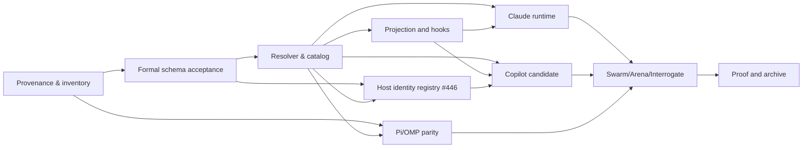

# Recursive implementation plan

This change is design-stage with static planner landed on trunk; it does not assert production runtime implementation.

- [ ] **G0** Approve canonical/reference parity and explicit policy-fork classification; check frozen commits and licenses.
- [ ] **G1** Accept Arena architecture seam, Interrogate review of the formal change, and unique-role model with schema fixtures.
- [ ] **G2** Implement deterministic role/model/effort resolver with model discovery, precedence, fail-closed negative paths and receipt identity.
- [ ] **G3** Integrate projector/model roles and host-local hooks; preserve installed files and opt-out; do not overwrite user configuration.
- [ ] **G4** Add Claude Code native profile/manifest and limited runtime smoke; classify supported capabilities honestly.
- [ ] **G5** Add Copilot candidate/profile only after source/license and host capability analysis.
- [ ] **G6** Run Pi-vs-OMP *separate* parity and capability checks; do not copy another host's process/session manager.
- [ ] **G7** Run Swarm host matrix, Arena design comparison and independent Interrogate review on exact implementation head.
- [ ] **G8** Run strict OpenSpec, schema, projection, role fixture and host-native acceptance tests with durable receipts, then apply/archive accepted requirements.

Dependency graph:

Every child issue MUST state its dependency, deterministic acceptance, file/API ownership and evidence type. Parent closes only when all dependent tasks are proven or explicitly descoped with reason.

## Published GitHub execution graph (2026-10-15)

Program: [#429](https://github.com/tommy-ca/pstack/issues/429). Superseded draft: [PR #428](https://github.com/tommy-ca/pstack/pull/428) (CLOSED; landed on trunk via #450 as 66f67c8, #451 spec change, #452 as 59a6d0c, #453 as ca6f8d9, #454 supersede marker, #455 as 5115205, #456 as dca31a7, #457 fork matrix, #458 skill-token tests, #459/#460/#461 license disposition; then thermo pass #464/#465/#467/#468 at 419fb36, arena record #469, repins and guard coverage #470/#471/#472 at 0bf5657).

| Epic | Children | Dependencies |
| --- | --- | --- |
| [#430](https://github.com/tommy-ca/pstack/issues/430) Provenance/spec | #434, #435, #436 | #434 → #435 → #436 |
| [#431](https://github.com/tommy-ca/pstack/issues/431) Role/model | #437, #438, #439 | #436 → #437 → (#438, #439) |
| [#432](https://github.com/tommy-ca/pstack/issues/432) Adapters | #440, #441, #442, #443, #446 | #437/#438 → #440 → (#439 →) #441; #434/#437 → #443; #436/#437 → #446; #440/#446 → #442 |
| [#433](https://github.com/tommy-ca/pstack/issues/433) Verification | #444, #473, #445 | #435/#437/#440/#441/#442/#443 → #444; #444 related #473 (lineage, not a dependency); #436/#438/#439/#444/#473 → #445 |

These are **open issues** until their acceptance criteria receive independent evidence. The source review is not a completed live multi-model Swarm/Arena/Interrogate run.

## Design-to-code progress snapshot (2026-10-15, superseded draft #428; landed state)

The policy schema now supports bounded `seats` independent of distinct model slugs. The landed implementation includes `scripts/model_role_resolver.py`, a pure role-planning seam with explicit precedence, declared capability gaps, cross-judge selection, and honest status labels. No native harness is dispatched. Host integrations are tracked under #440-#443; #444 owns verification fixtures and receipts. Issue #437 stays open until actual host integration and runtime receipts settle. The planner output has a JSON Schema Draft 2020-12 wire contract (`schemas/portability/model-plan.schema.json`); tests check both honest error plans and rejection of forged runtime PASS. This is a **static type contract**, not a live host integration or settlement protocol.

## New design task #446 (P1) — extensible host identity

Parent: #432. Dependencies: #436 and #437. Implement a bounded, backwards-compatible declarative host identity registry following the formal OpenSpec requirement, with unique namespaced IDs and fail-closed capability states. No host is added automatically by the static model-role policy. Future Copilot issue #442 MUST consider this contract before extending the closed enums; do not duplicate host inventory sources. Superseded PR #428 documented the contract; trunk carries it through #472 at 0bf5657; #446 performs code migration only after acceptance.

## Dated evidence (2026-10-16, thermo pass)

A thermo-nuclear review of the landed stack plus three audit lanes produced the plan for the runtime and evidence gates. Its findings are recorded rather than folded into this change's requirements, because the change is design-stage and G2 through G8 stay open.

Four code units landed: an ownership guard making uninstall refuse a foreign-source install (#464, extended in #472 to refuse install behind a symlinked ancestor and to refuse install over a foreign tree at all), one canonical choice-list rule with a cached validator (#465), skills reconciliation with evidence regeneration (#467), and a decomposition of the role policy and resolver hot paths (#468). Test coverage for each landed behaviour is pinned, including a mutation-proven case for the duplicate-choice rule (#471) and a repin of the DSH candidate table to a trunk revision (#470).

The design question the review surfaced, that the module interpreting evidence is byte-hashed and therefore costs a full multi-host re-proof on a comment, is recorded at [`docs/research/arena-surface-revision-2026-10-16.md`](../../../docs/research/arena-surface-revision-2026-10-16.md) with three candidate designs, two of them measured with runnable harnesses, and a selected base. Its boundary is a product question: whether the freshness gate answers "is this claim still true" or "has anything in the interpretation path changed". G7 and G8 stay open on that decision, and on multi-family independence, which no run in this pass supplied.

## Dated evidence (2026-10-16, wave-2 reconcile)

Trunk moved `3852f4e` to `7a10736` across nine commits: thermo-pass plan reconcile (#474), ownership-guard extension (#472 at `0bf5657`), duplicate-choice guard coverage (#471), DSH candidate repin (#470), surface-revision arena record (#469), role policy and resolver decomposition (#468), skills reconciliation (#467), single choice-list rule (#465), and foreign-source uninstall refusal (#464). This wave-2 note sits outside that range on trunk `927a2d0` (PR #475).

Wave-2 baseline is green: full suite `961 passed, 10 skipped` with `TMPDIR` on a multi-GB filesystem (receipt `.audit/evidence/full-suite-20261016-receipt.json` at head `7a10736`), and `scripts/verify-portable.py doctor --host all` reports `6-Harness Matrix Verdict: PASS` with all six hosts `PASS` at the offline planes and `Runtime: UNTESTED` after syncing the live Antigravity install to trunk. The one full-suite failure seen mid-run was `tests/test_verify_portable.py::test_portable_verifier_antigravity`; the failing receipt said `Stale installed copy`, and the designed sync script fixed the drift, so the cause is recorded as a stale live install rather than a code regression. That failure mode also shows the suite reads live-install state through the durable receipts; this coupling is identified here but has no tracking issue yet, and `#473` owns only the freshness-plane gaps, not this coupling.

Eighteen open issues (`#429`–`#446`) keep their delivery refs historical at `3852f4e`; this note records trunk `7a10736` alongside them without editing those refs. `#473` carries no `3852f4e` delivery pin and dates its measurements to `0bf5657`. The freshness gaps that review proved, four of six hosts unable to fail on a stale package driver and a vacuous droid row, remain tracked in issue #473 rather than fixed here.

## Dated evidence (2026-10-16, wave-3 reconcile)

Trunk moved `927a2d0` to `c6bd628` across two commits: interrogate-findings record plus suite receipt (#476 at `af1b12e`), and hermeticity-coupling scope note (#477). No code changed. This note also records the graph wiring made in this pass: #473 is now a #433 child feeding #445 (#429 inventory and mermaid, #433 checklist, #445 dependencies, #473 parent plus owned-surfaces and evidence-type fields, and the §Published-graph table row for #433). The 19 wave-3 comments posted during this pass say dependencies are unchanged; that sentence is superseded by this paragraph for #429, #433, #445 and #473.

Wave-2 baseline stands with one correction: full suite `961 passed, 10 skipped` (receipt `.audit/evidence/full-suite-20261016-receipt.json` at head `7a10736`). The receipt's `timestamp` field reads `2026-10-16T22:20:00Z` but is local `+02:00` wall clock mislabeled `Z` (true UTC `20:20:00Z`); it postdates its introducing commit and must be regenerated from UTC before being cited as a durable artifact. `scripts/verify-portable.py doctor --host all` reports `6-Harness Matrix Verdict: PASS` with all six hosts `PASS` at the offline planes and `Runtime: UNTESTED`.

Nineteen open issues (`#429`–`#446` plus `#473`): the eighteen pinned issues keep delivery refs historical at `3852f4e` with the wave-2 footer at trunk `7a10736` (pilot #475 at `927a2d0`); `#473` (measured at `0bf5657`, REOPENED 2026-10-16 after a premature COMPLETED closure with acceptance unmet) is the live freshness-gate gap tracker, not a delivery pin. Related to `#444` by studied-surface lineage, not a dependency. The suite's live-install coupling identified in #477 has no tracking issue yet and is not owned by #473. G7 and G8 stay open on the freshness-design decision (#473 live gate blocks #445), the untracked hermeticity coupling, and multi-family independence, which no run in this pass supplied.

## Dated evidence (2026-10-17, thermo-nuclear review)

Three read-only lanes on trunk `d61a2fd`, single model family, no multi-model
PASS claimed. Lane A (freshness gate, `scripts/portability_schema.py`):
verdict not approvable as-is; `supported` derived from a weaker per-row proof
than `verified` (foreign-host and all-FAIL-plane receipts accepted, probe 2
also accepted by `check_evidence_durability`); code-judo ladder fix proven
74/74 in a disposable copy, filed as proposal. Lane B (verifier lever,
`scripts/verify-portable.py` 1305 L): honesty machinery sound; four P1 seam
defects (filename-list binding misses `route_resolver.py`; self-hash freezes
the file; runtime PASS on zero live evidence; corrupt `index.json` silently
reset). Lane C (planner/spec): split earns its keep, boundary misdrawn
(whole-document revalidation per call, three rules written twice, 16-seat cap
planner-only); one wording ambiguity on Interrogate model diversity (delta conditions
diversity on declared policy and permits one-model multi-seat panels, main
spec calls diversity an adapter choice; filed as conflict, corrected to
ambiguity with a one-sentence clarification proposed). Findings filed as
comments on #473 (lane A), #444 (lane B), #437 + #436 (lane C); no trunk code
changed by this review. Full reports: `/tmp/pstack-thermo-a/`,
`/tmp/pstack-thermo-b/`, `/tmp/pstack-thermo-c/` plus `/tmp/00_summary.md`
(disk-backed copies under `/var/tmp/pstack-thermo/`; `/tmp` was 100% full
tmpfs mid-run). G7/G8 stay open; the review adds unmet-acceptance evidence and
closes nothing.

## Dated evidence (2026-10-17, wave-4 reconcile)

Trunk moved `c6bd628` to `4daf1d3` across six commits: wave-3 reconcile with graph wiring (#478), dependency direction correction to lineage (#479), closed-473 record (#480), restore of 473 as reopened live gate (#481), thermo-nuclear review record with lane findings filed (#482), and diversity-conflict correction to wording ambiguity (#483). No code changed in this range; all six are docs notes on the plan.

Current-head checks on `4daf1d3`: `openspec validate --changes --strict` reports 1 passed; `scripts/verify-portable.py doctor --host all` reports 6/6 PASS on offline planes with Runtime UNTESTED on every host; `tests/test_model_role_policy.py` reports 48 passed as a focused-only result. Full-suite status at this head is unverified; 971 tests collect cleanly and the run is in flight.

Nineteen open issues (`#429`-`#446` plus `#473`): the eighteen bodies `#429`-`#446` still pin delivery at `3852f4e` with a wave-2 footer at `7a10736`; `#473` carries no delivery pin by design. No body carries a wave-3 footer or references `4daf1d3`. The `#429` mermaid now carries the five direct table edges and labels the `#444`-`#473` dashed edge as lineage, corrected live on the issue in this pass. The 2026-10-17 thermo lanes filed proposals on `#473`, `#444`, `#437`, and `#436` with no trunk code changed. G7/G8 stay open on multi-family independence, the freshness-design decision, and exact-head independent review. Child-issue body pins and footers stay deferred: eighteen bodies keep historical pins until a dedicated reconcile pass rewrites them with evidence, not bulk text.
<!-- wave-5 verification at 24f0178: interrogate (correctness ISSUES fixed: packaged planes narrowed to package-only; evidence-honesty ISSUES fixed: test parametrized over 5 hosts) + arena (A/B/C: keep per-level tuples, no graft) + independent verifier PASS on 3467ed2->24f0178 (openspec 1 passed, doctor 6/6, check-evidence durable PASS, durability 62 passed, stale-driver probe exit 1 per host). Durability 62 passed. -->

## Dated evidence (2026-10-17, wave-5 reconcile)

Trunk `3467ed2` plus the shipped stack (PR #486, merged as `24f0178`): package-plane freshness enforced per claimed level (packaged checks package-only; verified adds canonical, adapter and runtime; supported enforces all four). The `#473` probe now fails closed: a stale package driver makes `check-evidence` exit 1 for every packaged host while `check-staleness` reports REGENERATE, and fresh receipts keep `check-evidence` green. Pin violations report before staleness so the omp live remedy stays visible.

Current-head checks on `24f0178`: `tests/test_evidence_durability.py` reports 62 passed (parametrized over all five packaged hosts); `scripts/verify-portable.py doctor --host all` reports 6/6 PASS on offline planes with Runtime UNTESTED on every host; `check-evidence --host all` reports durable PASS for five packaged hosts plus droid candidate. Independent verifier confirms the stale-driver probe fails closed per host at this head (finding filed inline in the verification report). Full-suite status at this head is unverified; baseline `957 passed, 10 skipped` was measured at `3467ed2` with 5 tmp-full failures unrelated to this change, plus `893 passed, 7 skipped` over the non-verifier subset at the pre-ship head.

Nineteen open issues (`#429`-`#446` plus `#473`): open state unchanged. `#473` stays open as the live tracker; the packaged-plane gap it measured is closed by `24f0178` and the remaining work is the `supported`-derivation proof-equivalence row plus the hermeticity coupling question, neither owned here. G7/G8 stay open on multi-family independence and exact-head independent review. Child-issue body pins stay deferred as in wave-4.

## Dated evidence (2026-10-17, wave-6 reconcile)

Trunk `104cf9f` plus one code unit: candidate rows report NOT_COVERED instead of PASS (`aa0efab`). A candidate row evaluates no planes, so the honest label names the gap instead of claiming durability. Exit stays 0; only the label changes.

Current-head checks on `aa0efab`: `tests/test_evidence_durability.py` reports 63 passed (62 plus the new NOT_COVERED regression test); `scripts/verify-portable.py doctor --host all` reports 6/6 PASS on offline planes with Runtime UNTESTED on every host; `check-evidence --host all` reports durable PASS for five packaged hosts plus droid NOT_COVERED. Coordinator-run six-host matrix at this head (scout lanes blocked on no exec tool; the six fresh, mutated, restored probes were run by the coordinator and recorded here, not an independent Swarm): five packaged hosts fail closed naming the package plane under a stale package driver and return to PASS on restore; droid stays NOT_COVERED exit 0 under mutation and restore.

Nineteen open issues (`#429`-`#446` plus `#473`): open state unchanged. `#473` packaged-plane gap (closed by `24f0178`) and droid-reporting row (closed by `aa0efab`) are done; remaining work is the `supported`-derivation proof-equivalence row plus the hermeticity coupling question, neither owned here. The role-policy-module line in #473 acceptance stays unbound prose in this note and is not claimed as dispositioned. G7/G8 stay open on multi-family independence and exact-head independent review. Child-issue body pins stay deferred as in wave-5.

## Dated evidence (2026-10-17, wave-7 reconcile)

Trunk `7e59c2c` (PR #487 merged). No code change in this wave. Two records closed: the #473 body now keeps its original acceptance bullets verbatim with a Historical note marking waves 5 to 6 as superseding findings (preference 4 holds; the residual rewrite was reverted), and the swarm lanes SW1 to SW4 plus SW6 are DONE via Task agents with exec in isolated worktrees at `7e59c2c` while SW5 (antigravity) is DONE via Task agent TechnicalHummingbird with exec in an isolated worktree at `6e128dd` (first scout attempt blocked on no-exec; first antigravity run covered staleness only and is superseded; the coordinator re-ran isolated check-evidence fresh exit 0 PASS, mutated exit 1 FAIL naming package_driver_revision mismatch on the package plane, restored exit 0 PASS, then the Task-agent lane repeated the same three steps at `6e128dd`). Coordinator direct probes remain evidence only.

Current-head checks on `7e59c2c`: `tests/test_evidence_durability.py` plus `tests/test_eval_blinded_pstack_dsh_candidate.py` report 74 passed; `scripts/verify-portable.py doctor --host all` reports 6 of 6 PASS on offline planes with Runtime UNTESTED on every host; `check-evidence --host all` reports durable PASS for five packaged hosts plus droid NOT_COVERED. Independent verifier PASS on `104cf9f` to `097ec48` plus full suite 968 passed 10 skipped recorded for PR #487.

Nineteen open issues (`#429` to `#446` plus `#473`): open state unchanged. `#473` keeps its original acceptance verbatim; the packaged-plane row (closed by `24f0178`) and droid-reporting row (closed by `7e59c2c`) are marked as delivered in the wave notes, not in the bullets. Remaining work is the supported-derivation proof-equivalence row, the hermeticity question, and the role-policy-module scope line, none owned here. G7 and G8 stay open on multi-family independence and exact-head independent review. Child-issue body pins stay deferred as in wave-6.

## Dated evidence (2026-10-17, wave-10 reconcile: lane-B F1/F3/F4 shipped)

Trunk `b0f9aa7` plus the shipped stack (PR #492 merged as `a9329d4`, PR #493 merged as `bc401ae`, PR #494 merged as `0769e2f`): three lane-B verifier-lever defects closed with worker/verifier separation on every unit.

F1 (route_resolver outside driver_revision): one-line binding plus regression param. Repro pre-fix FRESH exit 0, post-fix REGENERATE adapter+runtime exit 1. Evidence scope 117 passed. Independent verifier APPROVE.

F3 (runtime PASS on zero live evidence): proof_bar demotes settlement-free runtime PASS to UNTESTED; dict settlements normalized; evidence() re-reduces planes+overall after preserve_observed_settlements (round-1 BLOCK on the #322 preservation path, repaired and re-verified). Settlement-free codex run now Runtime UNTESTED exit 1; preserved live settlement keeps runtime PASS with derive supported. Named suite 115 passed. Independent verifier APPROVE at 6988bfe.

F4 (corrupt index silently reset): corrupt index now refused loudly (exit 1 naming the file, bytes untouched). Missing index still initializes. Tooth check fails without the fix, passes with it. Full offline CI 694 passed 10 skipped. Post-merge independent verifier APPROVE at 0769e2f with a LOW-MODERATE partial-write residue filed as #495 (durable receipt lands before index refusal; no gate reads index.json).

DSH candidate table repinned twice at the F3 then F4 driver scopes (verdict/counts unchanged). doctor 6/6 offline PASS Runtime UNTESTED; check-evidence 5 PASS + droid NOT_COVERED throughout.

Nineteen open issues (#429-#446 plus #473) plus new follow-up #495: open state otherwise unchanged. G7/G8 stay open on multi-family independence and exact-head independent review. Remaining lane-B row: F2 self-hash coupling (scouted: verifier 1380 lines, three test pins reject unrefreshed edits; minimal seam is hashing a behavior-bearing core, not the whole wrapper).

## Dated evidence (2026-10-17, wave-10 closeout correction)

Correction to the wave-10 note above: it was committed directly to main as `f6b1f5d`, against the deviation record that resumed changes via PR. This note records that as a second exception. Subsequent reconciliation updates go through a docs PR.

Post-merge independent F4 verification (APPROVE, main `0769e2f`): named evidence suites 128 passed; check-evidence 5 PASS plus droid NOT_COVERED; doctor 6/6 offline PASS Runtime UNTESTED; tooth check re-derived (reverted arm fails with DID NOT RAISE, fixed arm refuses with named path, index bytes byte-identical). One non-reproducible droid-lookup failure traced to the live-install openspec-list probe (same non-hermetic class as #477), not F4.

Partial-write residue is tracked as #495, not as transactional F4: a corrupt-index abort rewrites the current host receipt before the index refusal, so restoring the old index leaves its run_id stale, and deleting the index plus rerunning re-enters the omit-other-hosts class. Supported recovery is uncommitted; no index/receipt atomicity is claimed.

## Dated evidence (2026-10-17, wave-11 reconcile: graph note for #495/#444 and swarm lane classes)

Docs-only wave on branch `docs/wave-11-graph-495-444-note` from main `c10df56`. No code, receipt or fixture file is touched. The four items below close the two documentation gaps an interrogate-scout pass found in the wave-10 records.

**(a) #495 is a related, non-blocking follow-up to #444/F4, not a dependency.** #495 tracks the partial-write residue left after the F4 corrupt-index refusal: `evidence()` writes the durable host receipt before it parses and refuses `index.json`, so repairing the index afterwards leaves its `run_id` behind the receipt's, and the remedy of deleting the index re-enters the omit-other-hosts class F4 closed. Severity LOW-MODERATE and non-blocking: the abort is loud, no gate reads `index.json`, and that file has a single writer read only by tests and prose. The `#444` edge to `#495` is lineage, not a dependency, and no `#444` acceptance criterion changes.

**(b) Wave-10 F1/F3/F4 dispositions for #444.** F1 (`route_resolver.py` outside `driver_revision`) fixed by PR [#492](https://github.com/tommy-ca/pstack/pull/492), merged as `a9329d4`. F3 (runtime PASS on zero live evidence) fixed by PR [#493](https://github.com/tommy-ca/pstack/pull/493), merged as `bc401ae`. F4 (corrupt `index.json` silently reset) fixed by PR [#494](https://github.com/tommy-ca/pstack/pull/494), merged as `0769e2f`. Each unit carried worker/verifier separation with an independent verifier APPROVE, and F4 was re-verified post-merge at `0769e2f` (APPROVE; the residue it could not close became #495).

**(c) Arena seam recommendation for the remaining lane-B row F2 — proposal, not a decision.** F2 (the verifier hashes its own source, so a comment freezes the file and stales every host) has no fix on trunk. The arena pass for this wave recommends option B: hash a behavior-bearing core rather than the whole wrapper file, so a byte edit that cannot move a verdict stops costing a multi-host re-proof. This is recorded as a candidate seam only; no decision is taken here, no implementation exists, and the F2 acceptance row on #444 stays open on the owner's call.

**(d) Swarm lane classification (scout pass at `c10df56`; no lanes spawned, no commands run).** Runnable-now: [#473](https://github.com/tommy-ca/pstack/issues/473) supported-derivation plus hermeticity probes (offline and synthetic), and [#495](https://github.com/tommy-ca/pstack/issues/495) partial-write regression in a disposable evidence root. Blocked-on-design: [#437](https://github.com/tommy-ca/pstack/issues/437) native resolver wiring (the planner is planning-only), [#440](https://github.com/tommy-ca/pstack/issues/440) hook lifecycle (role-name consumer contract unresolved), [#442](https://github.com/tommy-ca/pstack/issues/442) Copilot profile (awaits the #446 registry contract), [#446](https://github.com/tommy-ca/pstack/issues/446) registry migration (design-only until accepted). Blocked-on-live-host: [#436](https://github.com/tommy-ca/pstack/issues/436) multi-family review (prior arms are single-family), [#441](https://github.com/tommy-ca/pstack/issues/441) Claude native install and discovery, [#443](https://github.com/tommy-ca/pstack/issues/443) Pi/OMP live parity (needs `PSTACK_RUN_OMP_LIVE=1` and a model route). Runnable-now means acceptance-relevant evidence can be gathered offline; it does not make any of these issues closable. G7 and G8 stay open on multi-family independence and exact-head independent review, neither of which any wave so far has supplied. Issue bodies keep their historical pins; nothing in this note rewrites an acceptance criterion, a dependency or an open state.

## Dated evidence (2026-10-17, wave-12: swarm lanes, arena F2 base, interrogate act-ons)

Docs-only wave on branch `docs/wave-12-498-swarm-arena-interrogate` from main `f3fb816`. No code, receipt, fixture or evidence-index file is touched.

**PR [#498](https://github.com/tommy-ca/pstack/pull/498) merged as `f3fb816`** (`fix(evidence): close the #495 partial durable write and the #473 package-only supported proof`). `evidence()` now parses and refuses `index.json` before the durable write, so a corrupt-index abort leaves the index bytes and the durable receipt byte-identical; the `supported` derivation now requires a `validate()`-clean this-host receipt with all four planes PASS plus the OMP settlement bar. Both guards carry tests that fail at the parent commit (negative control run at `9f9be63`).

**(a) Swarm lane verdicts: five lanes, five PASS, all offline at `f3fb816`.** Each lane ran in its own detached worktree, left it clean at the pin, and reverted its own mutation; `grok-lane`, `omp-lane` and `residue-lane` are retained under `.worktrees/swarm/` as evidence, `codex-lane` and `antigravity-lane` were removed after teardown. `python3` is the lane's interpreter for the driver CLI; the two `pytest` lanes ran the primary checkout's `.venv` with the lane worktree as cwd (the worktrees carry no venv).

| lane | probe | commands (cwd = lane worktree) | result |
| --- | --- | --- | --- |
| SW-Grok | package plane is the sole freshness gate for `packaged` | `verify-portable.py check-evidence --host grok`; `check-staleness --host all --json`; append a comment to `scripts/package-lifecycle.py`; re-run both; `git checkout -- scripts/package-lifecycle.py`; re-run both | PASS: 0 / 0 → 1 / 1 (`package_driver_revision mismatch`, plane named) → 0 / 0 |
| SW-Omp | consumer-side three-step plus settlement preservation | `check-evidence --host omp` fresh, mutate `scripts/project-package.py`, restore; `pytest tests/test_evidence_durability.py -k "preserve or package_driver or refresh or unreadable or corrupt or partial or drop"`; `pytest tests/test_evidence_durability.py tests/test_verdict_reduction.py -q` | PASS: 0 → 1 (naming `(package)`) → 0; 14 passed; 88 passed |
| SW-Residue | #495 corrupt-index refusal and its regression pin | `pytest tests/test_evidence_durability.py -k corrupt_index -q`; the full file; the same test file copied into a temp worktree at parent `9f9be63`; `/tmp/probe_corrupt_index.py` against the lane's own fixtures | PASS: 1 passed; 68 passed; control 1 failed, so the pin is not vacuous; probe shows durable receipt **and** index byte-identical after the refusal, the refused run's own receipt on disk and named by the refusal |
| SW-Codex | codex freshness lane | `check-evidence --host codex`; `check-staleness --host codex`; mutate `scripts/package-lifecycle.py`; re-run both; restore; re-run both | PASS: 0 / 0 → 1 / 1 (both gates name the `package` plane) → 0 / 0 |
| SW-Antigravity | antigravity freshness plus live-plugin sync | `check-evidence --host antigravity`; `check-staleness --host antigravity`; mutate; restore; `sync-antigravity-plugin.py --check`; `pytest tests/test_verify_portable.py::test_portable_verifier_antigravity` | PASS: 0 / 0 → 1 (five mandatory capabilities, each `(package)`) → 0 / 0; sync checker PASS exit 0; detector test 1 passed |

The four lanes that mutate a package driver (`package-lifecycle.py`, `project-package.py`) reproduce one contract from four independent worktrees: a comment-only edit to a file hashed into `package_driver_revision` fails the `packaged` claim closed on exactly the `package` plane, and the restore returns it to PASS. No lane wrote to the coordinator checkout.

**(b) Arena F2 seam: base B, graft C's declaration discipline, selected result B+ (24/25).** The arena run for the remaining lane-B row — `compute_surface_revisions` hashing `verify-portable.py` itself — measured four recipes over the trunk's exact input sets: A whole-file byte hash (trunk), B behavior-bearing core (`ast.unparse` with docstrings stripped), B+ B plus the raw module docstring that `argparse` publishes at runtime, C an explicit declared-surface registry. Record: `arena/f2/ARENA.md` at `1c78a17` on branch `arena/f2-seam`; harness `arena/f2/f2_arena.py` (`demo | compare | pins | unparse | steady A|B|C | migrate B | suite A|B|B+`). No trunk change.

| recipe | neutral edits that staled | behavior edits missed | hosts REGENERATE after a comment (CLI) | after a behavior edit (CLI) | score /25 |
| --- | --- | --- | --- | --- | --- |
| A whole-file (trunk) | 6/6 | 0 | 5/6 | 5/6 | 21 |
| B `ast.unparse` core | 1/6 | 0 | 0/6 | 5/6 | 23 |
| **B+ (B plus declared docstring complement)** | **1/6** | **0** | **0/6** | **5/6** | **24** |
| C explicit dependency list | 1/6 | 1 (`_is_observed_settlement` body) | 0/6 | 0/6 — fail-open | 19 |

Defect reproduced end to end: one comment inside `if __name__ == "__main__":` flips 5 of 6 hosts to `REGENERATE` (`adapter, runtime`), exit 1, with droid exempt as a `candidate` host holding no durable receipt. A is rejected because it is the defect; C is rejected as a base on the measured fail-open — a behavior edit to the private predicate that decides whether a `runtime` settlement counts leaves every host FRESH. The graft keeps C's "silence must be a failure" without its registry: an explicit two-entry docstring complement hashed raw, a parse failure that raises instead of degrading to bytes, and the trunk's own file set so a new driver joins the fingerprint automatically. Two sub-variants (`ast.dump()` instead of `ast.unparse`, and byte-fallback on parse failure) were rejected unmeasured and recorded so they are not re-proposed blind. The record states its own gaps: neutral statement-level refactors are not free under any recipe, `__doc__` is a declared rather than discovered complement, and any recipe change needs a one-time restamp of the 5 durable receipts plus `index.json` plus the DSH fixture. Row F2 on [#444](https://github.com/tommy-ca/pstack/issues/444) stays open on the owner's call: this is a measured proposal, not a shipped change.

**(c) Interrogate #498: APPROVE WITH FOLLOW-UPS at `f3fb816`.** Four arms plus the lead: arm A `reviewer`, arm B `cursor-agent`, arm C `antigravity`, each with its own probes and mutations, plus the lead's own probes, mutations and full suite. Recorded caveat: no `~/.claude/pstack-models.md` exists and the `task` tool exposes no model pin, so arm C collapsed into arm B's family — two distinct model families, not three, and the arm-set is partly degenerate. Suites exercised: `tests/test_evidence_durability.py` plus `tests/test_verify_portable.py` 92 passed; `tests/test_portability_schemas.py`, `tests/test_evidence_receipts.py`, `tests/test_droid_integration.py` 44 passed; full `pytest -q -p no:randomly` 974 passed, 10 skipped; the DSH pair 22 passed; `doctor --host all` 6/6 PASS, `check-evidence` 5 PASS plus droid NOT_COVERED, `check-staleness` ALL FRESH. Reverting either script fails three receipt-freshness pins plus the behavioural test, so a reverted state cannot hide in CI. Verdict: both tickets' exact reproductions are closed and pinned by non-vacuous tests and every numeric claim in the commit message reproduces, so nothing blocks the merge — but two act-ons are reachable counterexamples to the invariant the commit message states, so that claim is not left standing as written. Also noted, not actioned here: the commit says "six" durable receipts where five files exist (six hosts; droid writes none by design), and the refresh moved `opencode-receipt.json`'s `host_version` from `v2.0.30` to `v2.0.31` outside the claimed delta.

**(d) Interrogate act-ons, summarized (four; filed as comments on their owner issues in this wave).** (1) A valid-JSON but wrong-shaped `index.json` — a list, or `{"hosts": []}` — still splits the receipt from its row and surfaces a raw traceback instead of the refusal: raised independently by all four arms, probed as `index.json = "[]"` giving `AttributeError: 'list' object has no attribute 'setdefault'` at `verify-portable.py:1086` after the durable receipt was already rewritten, with `refresh-static --host all` exit 1 and `md5sum -c` reporting the receipt FAILED and the index OK; the fix is a shape check inside the existing guarded block, routed to the same `sys.exit` before the durable write. (2) A refused durable overwrite still advances the index row, so the index names a run whose bytes are not on disk — a defect #495 names in its own body; the fix is to build and write the row inside `if reusable:`, or to write the row's `run_id` from the bytes actually on disk. (3) The `supported` bar is a second copy of the floor bar (`portability_schema.py:840-876` versus `:890-928`) and the copies already diverge, which is the mechanism that produced #473; the fix is one shared row-bar helper (arm C's `_row_level()` refactor ran 144 tests green). (4) The bar polices *declared* planes and never ties them to scenario evidence: a foreign receipt with zero scenarios and four declared PASS planes derives `supported`, and a declared runtime PASS alongside a FAIL runtime scenario also derives `supported`; only hand-written or foreign receipt bytes can reach that shape, which is precisely #473's premise, and the fix is three assertions in `validate()` (planes equal the scenario reduction, `overall_verdict` equals the plane reduction, every scenario carries `evidence_level`), after which the newly added clauses in both loops collapse. Consider-tier and Noted-tier observations stay in the review report rather than here. Filed this wave: act-ons 1–2 as [comment 6236304068 on #495](https://github.com/tommy-ca/pstack/issues/495#issuecomment-6236304068), act-ons 3–4 as [comment 6236304304 on #473](https://github.com/tommy-ca/pstack/issues/473#issuecomment-6236304304), and the arena F2 base selection as [comment 6236304638 on #444](https://github.com/tommy-ca/pstack/issues/444#issuecomment-6236304638).

No issue state, acceptance criterion or dependency changed in this wave. G7 and G8 stay open on multi-family independence and exact-head independent review; the arena run above is single-family by its own account and the interrogate arm-set resolved to two families, so neither supplies the independence row.
