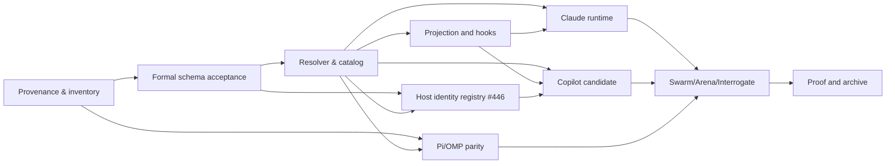

# Recursive implementation plan

This change is design-stage with static planner landed on trunk; it does not assert production runtime implementation.

- [ ] **G0** Approve canonical/reference parity and explicit policy-fork classification; check frozen commits and licenses.
- [ ] **G1** Accept Arena architecture seam, Interrogate review of the formal change, and unique-role model with schema fixtures.
- [ ] **G2** Implement deterministic role/model/effort resolver with model discovery, precedence, fail-closed negative paths and receipt identity.
- [ ] **G3** Integrate projector/model roles and host-local hooks; preserve installed files and opt-out; do not overwrite user configuration.
- [ ] **G4** Add Claude Code native profile/manifest and limited runtime smoke; classify supported capabilities honestly.
- [ ] **G5** Add Copilot candidate/profile only after source/license and host capability analysis.
- [ ] **G6** Run Pi-vs-OMP *separate* parity and capability checks; do not copy another host's process/session manager.
- [ ] **G7** Run Swarm host matrix, Arena design comparison and independent Interrogate review on exact implementation head.
- [ ] **G8** Run strict OpenSpec, schema, projection, role fixture and host-native acceptance tests with durable receipts, then apply/archive accepted requirements.

Dependency graph:

Every child issue MUST state its dependency, deterministic acceptance, file/API ownership and evidence type. Parent closes only when all dependent tasks are proven or explicitly descoped with reason.

## Published GitHub execution graph (2026-10-15)

Program: [#429](https://github.com/tommy-ca/pstack/issues/429). Superseded draft: [PR #428](https://github.com/tommy-ca/pstack/pull/428) (CLOSED; landed on trunk via #450 as 66f67c8, #451 spec change, #452 as 59a6d0c, #453 as ca6f8d9, #454 supersede marker, #455 as 5115205, #456 as dca31a7, #457 fork matrix, #458 skill-token tests, #459/#460/#461 license disposition; then thermo pass #464/#465/#467/#468 at 419fb36, arena record #469, repins and guard coverage #470/#471/#472 at 0bf5657).

| Epic | Children | Dependencies |
| --- | --- | --- |
| [#430](https://github.com/tommy-ca/pstack/issues/430) Provenance/spec | #434, #435, #436 | #434 → #435 → #436 |
| [#431](https://github.com/tommy-ca/pstack/issues/431) Role/model | #437, #438, #439 | #436 → #437 → (#438, #439) |
| [#432](https://github.com/tommy-ca/pstack/issues/432) Adapters | #440, #441, #442, #443, #446 | #437/#438 → #440 → (#439 →) #441; #434/#437 → #443; #436/#437 → #446; #440/#446 → #442 |
| [#433](https://github.com/tommy-ca/pstack/issues/433) Verification | #444, #473, #445 | #435/#437/#440/#441/#442/#443 → #444; #444 related #473 (lineage, not a dependency); #436/#438/#439/#444/#473 → #445 |

These are **open issues** until their acceptance criteria receive independent evidence. The source review is not a completed live multi-model Swarm/Arena/Interrogate run.

## Design-to-code progress snapshot (2026-10-15, superseded draft #428; landed state)

The policy schema now supports bounded `seats` independent of distinct model slugs. The landed implementation includes `scripts/model_role_resolver.py`, a pure role-planning seam with explicit precedence, declared capability gaps, cross-judge selection, and honest status labels. No native harness is dispatched. Host integrations are tracked under #440-#443; #444 owns verification fixtures and receipts. Issue #437 stays open until actual host integration and runtime receipts settle. The planner output has a JSON Schema Draft 2020-12 wire contract (`schemas/portability/model-plan.schema.json`); tests check both honest error plans and rejection of forged runtime PASS. This is a **static type contract**, not a live host integration or settlement protocol.

## New design task #446 (P1) — extensible host identity

Parent: #432. Dependencies: #436 and #437. Implement a bounded, backwards-compatible declarative host identity registry following the formal OpenSpec requirement, with unique namespaced IDs and fail-closed capability states. No host is added automatically by the static model-role policy. Future Copilot issue #442 MUST consider this contract before extending the closed enums; do not duplicate host inventory sources. Superseded PR #428 documented the contract; trunk carries it through #472 at 0bf5657; #446 performs code migration only after acceptance.

## Dated evidence (2026-10-16, thermo pass)

A thermo-nuclear review of the landed stack plus three audit lanes produced the plan for the runtime and evidence gates. Its findings are recorded rather than folded into this change's requirements, because the change is design-stage and G2 through G8 stay open.

Four code units landed: an ownership guard making uninstall refuse a foreign-source install (#464, extended in #472 to refuse install behind a symlinked ancestor and to refuse install over a foreign tree at all), one canonical choice-list rule with a cached validator (#465), skills reconciliation with evidence regeneration (#467), and a decomposition of the role policy and resolver hot paths (#468). Test coverage for each landed behaviour is pinned, including a mutation-proven case for the duplicate-choice rule (#471) and a repin of the DSH candidate table to a trunk revision (#470).

The design question the review surfaced, that the module interpreting evidence is byte-hashed and therefore costs a full multi-host re-proof on a comment, is recorded at [`docs/research/arena-surface-revision-2026-10-16.md`](../../../docs/research/arena-surface-revision-2026-10-16.md) with three candidate designs, two of them measured with runnable harnesses, and a selected base. Its boundary is a product question: whether the freshness gate answers "is this claim still true" or "has anything in the interpretation path changed". G7 and G8 stay open on that decision, and on multi-family independence, which no run in this pass supplied.

## Dated evidence (2026-10-16, wave-2 reconcile)

Trunk moved `3852f4e` to `7a10736` across nine commits: thermo-pass plan reconcile (#474), ownership-guard extension (#472 at `0bf5657`), duplicate-choice guard coverage (#471), DSH candidate repin (#470), surface-revision arena record (#469), role policy and resolver decomposition (#468), skills reconciliation (#467), single choice-list rule (#465), and foreign-source uninstall refusal (#464). This wave-2 note sits outside that range on trunk `927a2d0` (PR #475).

Wave-2 baseline is green: full suite `961 passed, 10 skipped` with `TMPDIR` on a multi-GB filesystem (receipt `.audit/evidence/full-suite-20261016-receipt.json` at head `7a10736`), and `scripts/verify-portable.py doctor --host all` reports `6-Harness Matrix Verdict: PASS` with all six hosts `PASS` at the offline planes and `Runtime: UNTESTED` after syncing the live Antigravity install to trunk. The one full-suite failure seen mid-run was `tests/test_verify_portable.py::test_portable_verifier_antigravity`; the failing receipt said `Stale installed copy`, and the designed sync script fixed the drift, so the cause is recorded as a stale live install rather than a code regression. That failure mode also shows the suite reads live-install state through the durable receipts; this coupling is identified here but has no tracking issue yet, and `#473` owns only the freshness-plane gaps, not this coupling.

Eighteen open issues (`#429`–`#446`) keep their delivery refs historical at `3852f4e`; this note records trunk `7a10736` alongside them without editing those refs. `#473` carries no `3852f4e` delivery pin and dates its measurements to `0bf5657`. The freshness gaps that review proved, four of six hosts unable to fail on a stale package driver and a vacuous droid row, remain tracked in issue #473 rather than fixed here.

## Dated evidence (2026-10-16, wave-3 reconcile)

Trunk moved `927a2d0` to `c6bd628` across two commits: interrogate-findings record plus suite receipt (#476 at `af1b12e`), and hermeticity-coupling scope note (#477). No code changed. This note also records the graph wiring made in this pass: #473 is now a #433 child feeding #445 (#429 inventory and mermaid, #433 checklist, #445 dependencies, #473 parent plus owned-surfaces and evidence-type fields, and the §Published-graph table row for #433). The 19 wave-3 comments posted during this pass say dependencies are unchanged; that sentence is superseded by this paragraph for #429, #433, #445 and #473.

Wave-2 baseline stands with one correction: full suite `961 passed, 10 skipped` (receipt `.audit/evidence/full-suite-20261016-receipt.json` at head `7a10736`). The receipt's `timestamp` field reads `2026-10-16T22:20:00Z` but is local `+02:00` wall clock mislabeled `Z` (true UTC `20:20:00Z`); it postdates its introducing commit and must be regenerated from UTC before being cited as a durable artifact. `scripts/verify-portable.py doctor --host all` reports `6-Harness Matrix Verdict: PASS` with all six hosts `PASS` at the offline planes and `Runtime: UNTESTED`.

Nineteen open issues (`#429`–`#446` plus `#473`): the eighteen pinned issues keep delivery refs historical at `3852f4e` with the wave-2 footer at trunk `7a10736` (pilot #475 at `927a2d0`); `#473` (measured at `0bf5657`, REOPENED 2026-10-16 after a premature COMPLETED closure with acceptance unmet) is the live freshness-gate gap tracker, not a delivery pin. Related to `#444` by studied-surface lineage, not a dependency. The suite's live-install coupling identified in #477 has no tracking issue yet and is not owned by #473. G7 and G8 stay open on the freshness-design decision (#473 live gate blocks #445), the untracked hermeticity coupling, and multi-family independence, which no run in this pass supplied.

## Dated evidence (2026-10-17, thermo-nuclear review)

Three read-only lanes on trunk `d61a2fd`, single model family, no multi-model
PASS claimed. Lane A (freshness gate, `scripts/portability_schema.py`):
verdict not approvable as-is; `supported` derived from a weaker per-row proof
than `verified` (foreign-host and all-FAIL-plane receipts accepted, probe 2
also accepted by `check_evidence_durability`); code-judo ladder fix proven
74/74 in a disposable copy, filed as proposal. Lane B (verifier lever,
`scripts/verify-portable.py` 1305 L): honesty machinery sound; four P1 seam
defects (filename-list binding misses `route_resolver.py`; self-hash freezes
the file; runtime PASS on zero live evidence; corrupt `index.json` silently
reset). Lane C (planner/spec): split earns its keep, boundary misdrawn
(whole-document revalidation per call, three rules written twice, 16-seat cap
planner-only); one wording ambiguity on Interrogate model diversity (delta conditions
diversity on declared policy and permits one-model multi-seat panels, main
spec calls diversity an adapter choice; filed as conflict, corrected to
ambiguity with a one-sentence clarification proposed). Findings filed as
comments on #473 (lane A), #444 (lane B), #437 + #436 (lane C); no trunk code
changed by this review. Full reports: `/tmp/pstack-thermo-a/`,
`/tmp/pstack-thermo-b/`, `/tmp/pstack-thermo-c/` plus `/tmp/00_summary.md`
(disk-backed copies under `/var/tmp/pstack-thermo/`; `/tmp` was 100% full
tmpfs mid-run). G7/G8 stay open; the review adds unmet-acceptance evidence and
closes nothing.

## Dated evidence (2026-10-17, wave-4 reconcile)

Trunk moved `c6bd628` to `4daf1d3` across six commits: wave-3 reconcile with graph wiring (#478), dependency direction correction to lineage (#479), closed-473 record (#480), restore of 473 as reopened live gate (#481), thermo-nuclear review record with lane findings filed (#482), and diversity-conflict correction to wording ambiguity (#483). No code changed in this range; all six are docs notes on the plan.

Current-head checks on `4daf1d3`: `openspec validate --changes --strict` reports 1 passed; `scripts/verify-portable.py doctor --host all` reports 6/6 PASS on offline planes with Runtime UNTESTED on every host; `tests/test_model_role_policy.py` reports 48 passed as a focused-only result. Full-suite status at this head is unverified; 971 tests collect cleanly and the run is in flight.

Nineteen open issues (`#429`-`#446` plus `#473`): the eighteen bodies `#429`-`#446` still pin delivery at `3852f4e` with a wave-2 footer at `7a10736`; `#473` carries no delivery pin by design. No body carries a wave-3 footer or references `4daf1d3`. The `#429` mermaid now carries the five direct table edges and labels the `#444`-`#473` dashed edge as lineage, corrected live on the issue in this pass. The 2026-10-17 thermo lanes filed proposals on `#473`, `#444`, `#437`, and `#436` with no trunk code changed. G7/G8 stay open on multi-family independence, the freshness-design decision, and exact-head independent review. Child-issue body pins and footers stay deferred: eighteen bodies keep historical pins until a dedicated reconcile pass rewrites them with evidence, not bulk text.
<!-- wave-5 verification at 24f0178: interrogate (correctness ISSUES fixed: packaged planes narrowed to package-only; evidence-honesty ISSUES fixed: test parametrized over 5 hosts) + arena (A/B/C: keep per-level tuples, no graft) + independent verifier PASS on 3467ed2->24f0178 (openspec 1 passed, doctor 6/6, check-evidence durable PASS, durability 62 passed, stale-driver probe exit 1 per host). Durability 62 passed. -->

## Dated evidence (2026-10-17, wave-5 reconcile)

Trunk `3467ed2` plus the shipped stack (PR #486, merged as `24f0178`): package-plane freshness enforced per claimed level (packaged checks package-only; verified adds canonical, adapter and runtime; supported enforces all four). The `#473` probe now fails closed: a stale package driver makes `check-evidence` exit 1 for every packaged host while `check-staleness` reports REGENERATE, and fresh receipts keep `check-evidence` green. Pin violations report before staleness so the omp live remedy stays visible.

Current-head checks on `24f0178`: `tests/test_evidence_durability.py` reports 62 passed (parametrized over all five packaged hosts); `scripts/verify-portable.py doctor --host all` reports 6/6 PASS on offline planes with Runtime UNTESTED on every host; `check-evidence --host all` reports durable PASS for five packaged hosts plus droid candidate. Independent verifier confirms the stale-driver probe fails closed per host at this head (finding filed inline in the verification report). Full-suite status at this head is unverified; baseline `957 passed, 10 skipped` was measured at `3467ed2` with 5 tmp-full failures unrelated to this change, plus `893 passed, 7 skipped` over the non-verifier subset at the pre-ship head.

Nineteen open issues (`#429`-`#446` plus `#473`): open state unchanged. `#473` stays open as the live tracker; the packaged-plane gap it measured is closed by `24f0178` and the remaining work is the `supported`-derivation proof-equivalence row plus the hermeticity coupling question, neither owned here. G7/G8 stay open on multi-family independence and exact-head independent review. Child-issue body pins stay deferred as in wave-4.

## Dated evidence (2026-10-17, wave-6 reconcile)

Trunk `104cf9f` plus one code unit: candidate rows report NOT_COVERED instead of PASS (`aa0efab`). A candidate row evaluates no planes, so the honest label names the gap instead of claiming durability. Exit stays 0; only the label changes.

Current-head checks on `aa0efab`: `tests/test_evidence_durability.py` reports 63 passed (62 plus the new NOT_COVERED regression test); `scripts/verify-portable.py doctor --host all` reports 6/6 PASS on offline planes with Runtime UNTESTED on every host; `check-evidence --host all` reports durable PASS for five packaged hosts plus droid NOT_COVERED. Coordinator-run six-host matrix at this head (scout lanes blocked on no exec tool; the six fresh, mutated, restored probes were run by the coordinator and recorded here, not an independent Swarm): five packaged hosts fail closed naming the package plane under a stale package driver and return to PASS on restore; droid stays NOT_COVERED exit 0 under mutation and restore.

Nineteen open issues (`#429`-`#446` plus `#473`): open state unchanged. `#473` packaged-plane gap (closed by `24f0178`) and droid-reporting row (closed by `aa0efab`) are done; remaining work is the `supported`-derivation proof-equivalence row plus the hermeticity coupling question, neither owned here. The role-policy-module line in #473 acceptance stays unbound prose in this note and is not claimed as dispositioned. G7/G8 stay open on multi-family independence and exact-head independent review. Child-issue body pins stay deferred as in wave-5.

## Dated evidence (2026-10-17, wave-7 reconcile)

Trunk `7e59c2c` (PR #487 merged). No code change in this wave. Two records closed: the #473 body now keeps its original acceptance bullets verbatim with a Historical note marking waves 5 to 6 as superseding findings (preference 4 holds; the residual rewrite was reverted), and the swarm lanes SW1 to SW6 are DONE via Task agents with exec in isolated worktrees at `7e59c2c` (first scout attempt blocked on no-exec; retry returned 6 of 6 PASS, main untouched). Coordinator direct probes remain evidence only. The antigravity lane was corrected twice: first run covered staleness only, then the coordinator re-ran isolated check-evidence fresh exit 0 PASS, mutated exit 1 FAIL naming package_driver_revision mismatch on the package plane, restored exit 0 PASS.

Current-head checks on `7e59c2c`: `tests/test_evidence_durability.py` plus `tests/test_eval_blinded_pstack_dsh_candidate.py` report 74 passed; `scripts/verify-portable.py doctor --host all` reports 6 of 6 PASS on offline planes with Runtime UNTESTED on every host; `check-evidence --host all` reports durable PASS for five packaged hosts plus droid NOT_COVERED. Independent verifier PASS on `104cf9f` to `097ec48` plus full suite 968 passed 10 skipped recorded for PR #487.

Nineteen open issues (`#429` to `#446` plus `#473`): open state unchanged. `#473` keeps its original acceptance verbatim; the packaged-plane row (closed by `24f0178`) and droid-reporting row (closed by `7e59c2c`) are marked as delivered in the wave notes, not in the bullets. Remaining work is the supported-derivation proof-equivalence row, the hermeticity question, and the role-policy-module scope line, none owned here. G7 and G8 stay open on multi-family independence and exact-head independent review. Child-issue body pins stay deferred as in wave-6.
