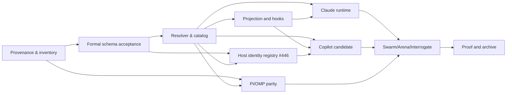

# Recursive implementation plan

This change is design-stage with static planner landed on trunk; it does not assert production runtime implementation.

- [ ] **G0** Approve canonical/reference parity and explicit policy-fork classification; check frozen commits and licenses.
- [ ] **G1** Accept Arena architecture seam, Interrogate review of the formal change, and unique-role model with schema fixtures.
- [ ] **G2** Implement deterministic role/model/effort resolver with model discovery, precedence, fail-closed negative paths and receipt identity.
- [ ] **G3** Integrate projector/model roles and host-local hooks; preserve installed files and opt-out; do not overwrite user configuration.
- [ ] **G4** Add Claude Code native profile/manifest and limited runtime smoke; classify supported capabilities honestly.
- [ ] **G5** Add Copilot candidate/profile only after source/license and host capability analysis.
- [ ] **G6** Run Pi-vs-OMP *separate* parity and capability checks; do not copy another host's process/session manager.
- [ ] **G7** Run Swarm host matrix, Arena design comparison and independent Interrogate review on exact implementation head.
- [ ] **G8** Run strict OpenSpec, schema, projection, role fixture and host-native acceptance tests with durable receipts, then apply/archive accepted requirements.

Dependency graph:

Every child issue MUST state its dependency, deterministic acceptance, file/API ownership and evidence type. Parent closes only when all dependent tasks are proven or explicitly descoped with reason.

## Published GitHub execution graph (2026-10-15)

Program: [#429](https://github.com/tommy-ca/pstack/issues/429). Superseded draft: [PR #428](https://github.com/tommy-ca/pstack/pull/428) (CLOSED; landed on trunk via #450 as 66f67c8, #451 spec change, #452 as 59a6d0c, #453 as ca6f8d9, #454 supersede marker, #455 as 5115205, #456 as dca31a7, #457 fork matrix, #458 skill-token tests, #459/#460/#461 license disposition; then thermo pass #464/#465/#467/#468 at 419fb36, arena record #469, repins and guard coverage #470/#471/#472 at 0bf5657).

| Epic | Children | Dependencies |
| --- | --- | --- |
| [#430](https://github.com/tommy-ca/pstack/issues/430) Provenance/spec | #434, #435, #436 | #434 → #435 → #436 |
| [#431](https://github.com/tommy-ca/pstack/issues/431) Role/model | #437, #438, #439 | #436 → #437 → (#438, #439) |
| [#432](https://github.com/tommy-ca/pstack/issues/432) Adapters | #440, #441, #442, #443, #446 | #437/#438 → #440 → (#439 →) #441; #434/#437 → #443; #436/#437 → #446; #440/#446 → #442 |
| [#433](https://github.com/tommy-ca/pstack/issues/433) Verification | #444, #445 | #435/#437/#440/#441/#442/#443 → #444; #436/#438/#439/#444 → #445 |

These are **open issues** until their acceptance criteria receive independent evidence. The source review is not a completed live multi-model Swarm/Arena/Interrogate run.

## Design-to-code progress snapshot (2026-10-15, superseded draft #428; landed state)

The policy schema now supports bounded `seats` independent of distinct model slugs. The landed implementation includes `scripts/model_role_resolver.py`, a pure role-planning seam with explicit precedence, declared capability gaps, cross-judge selection, and honest status labels. No native harness is dispatched. All host-specific model/provider calls remain future tasks #440–#444. Issue #437 stays open until actual host integration and runtime receipts settle.

The planner output now has a JSON Schema Draft 2020-12 wire contract (`schemas/portability/model-plan.schema.json`); tests check both honest error plans and rejection of forged runtime PASS. This is a **static type contract**, not a live host integration or settlement protocol.

## New design task #446 (P1) — extensible host identity

Parent: #432. Dependencies: #436 and #437. Implement a bounded, backwards-compatible declarative host identity registry following the formal OpenSpec requirement, with unique namespaced IDs and fail-closed capability states. No host is added automatically by the static model-role policy. Future Copilot issue #442 MUST consider this contract before extending the closed enums; do not duplicate host inventory sources. Superseded PR #428 documented the contract; trunk carries it through #472 at 0bf5657; #446 performs code migration only after acceptance.

## Dated evidence (2026-10-16, thermo pass)

A thermo-nuclear review of the landed stack plus three audit lanes produced the plan for the runtime and evidence gates. Its findings are recorded rather than folded into this change's requirements, because the change is design-stage and G2 through G8 stay open.

Four code units landed: an ownership guard making uninstall refuse a foreign-source install (#464, extended in #472 to refuse install behind a symlinked ancestor and to refuse install over a foreign tree at all), one canonical choice-list rule with a cached validator (#465), skills reconciliation with evidence regeneration (#467), and a decomposition of the role policy and resolver hot paths (#468). Test coverage for each landed behaviour is pinned, including a mutation-proven case for the duplicate-choice rule (#471) and a repin of the DSH candidate table to a trunk revision (#470).

The design question the review surfaced, that the module interpreting evidence is byte-hashed and therefore costs a full multi-host re-proof on a comment, is recorded at [`docs/research/arena-surface-revision-2026-10-16.md`](../../../docs/research/arena-surface-revision-2026-10-16.md) with three candidate designs, two of them measured with runnable harnesses, and a selected base. Its boundary is a product question: whether the freshness gate answers "is this claim still true" or "has anything in the interpretation path changed". G7 and G8 stay open on that decision, and on multi-family independence, which no run in this pass supplied.

## Dated evidence (2026-10-16, wave-2 reconcile)

Trunk moved `3852f4e` to `7a10736` across nine commits: thermo-pass plan reconcile (#474), ownership-guard extension (#472 at `0bf5657`), duplicate-choice guard coverage (#471), DSH candidate repin (#470), surface-revision arena record (#469), role policy and resolver decomposition (#468), skills reconciliation (#467), single choice-list rule (#465), and foreign-source uninstall refusal (#464). This wave-2 note sits outside that range on trunk `927a2d0` (PR #475).

Wave-2 baseline is green: full suite `961 passed, 10 skipped` with `TMPDIR` on a multi-GB filesystem (receipt `.audit/evidence/full-suite-20261016-receipt.json` at head `7a10736`), and `scripts/verify-portable.py doctor --host all` reports `6-Harness Matrix Verdict: PASS` with all six hosts `PASS` at the offline planes and `Runtime: UNTESTED` after syncing the live Antigravity install to trunk. The one full-suite failure seen mid-run was `tests/test_verify_portable.py::test_portable_verifier_antigravity`; the failing receipt said `Stale installed copy`, and the designed sync script fixed the drift, so the cause is recorded as a stale live install rather than a code regression. That failure mode also shows the suite reads live-install state through the durable receipts, which is tracked as a hermeticity gap rather than closed out.

Eighteen open issues (`#429`–`#446`) keep their delivery refs historical at `3852f4e`; this note records trunk `7a10736` alongside them without editing those refs. `#473` carries no `3852f4e` delivery pin and dates its measurements to `0bf5657`. The freshness gaps that review proved, four of six hosts unable to fail on a stale package driver and a vacuous droid row, remain tracked in issue #473 rather than fixed here.
