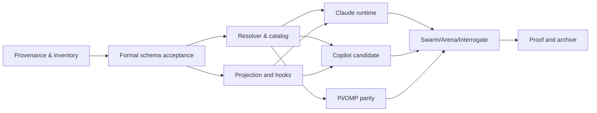

# Recursive implementation plan

This branch formalizes the proposed interface; it does not assert production implementation.

- [ ] **G0** Approve canonical/reference parity and explicit policy-fork classification; check frozen commits and licenses.
- [ ] **G1** Accept Arena architecture seam, Interrogate review of the formal change, and unique-role model with schema fixtures.
- [ ] **G2** Implement deterministic role/model/effort resolver with model discovery, precedence, fail-closed negative paths and receipt identity.
- [ ] **G3** Integrate projector/model roles and host-local hooks; preserve installed files and opt-out; do not overwrite user configuration.
- [ ] **G4** Add Claude Code native profile/manifest and limited runtime smoke; classify supported capabilities honestly.
- [ ] **G5** Add Copilot candidate/profile only after source/license and host capability analysis.
- [ ] **G6** Run Pi-vs-OMP *separate* parity and capability checks; do not copy another host's process/session manager.
- [ ] **G7** Run Swarm host matrix, Arena design comparison and independent Interrogate review on exact implementation head.
- [ ] **G8** Run strict OpenSpec, schema, projection, role fixture and host-native acceptance tests with durable receipts, then apply/archive accepted requirements.

Dependency graph:

Every child issue MUST state its dependency, deterministic acceptance, file/API ownership and evidence type. Parent closes only when all dependent tasks are proven or explicitly descoped with reason.

## Published GitHub execution graph (2026-10-15)

Program: [#429](https://github.com/tommy-ca/pstack/issues/429). Draft spec: [PR #428](https://github.com/tommy-ca/pstack/pull/428).

| Epic | Children | Dependencies |
| --- | --- | --- |
| [#430](https://github.com/tommy-ca/pstack/issues/430) Provenance/spec | #434, #435, #436 | #434 → #435 → #436 |
| [#431](https://github.com/tommy-ca/pstack/issues/431) Role/model | #437, #438, #439 | #436 → #437 → (#438, #439) |
| [#432](https://github.com/tommy-ca/pstack/issues/432) Adapters | #440, #441, #442, #443 | #437/#438 → #440 → (#441, #442); #434/#437 → #443 |
| [#433](https://github.com/tommy-ca/pstack/issues/433) Verification | #444, #445 | #435/#437/#440/#441/#442/#443 → #444 → #445 |

These are **open issues** until their acceptance criteria receive independent evidence. The source review is not a completed live multi-model Swarm/Arena/Interrogate run.
