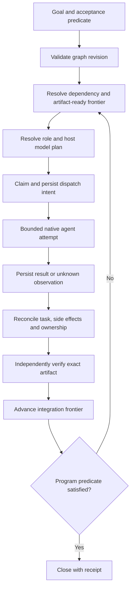

# Design: semantic recomposition of OmO with canonical pstack

Status: Proposed, source-review-only. No runtime certification, independent multi-agent Swarm/Arena/Interrogate execution, or implementation is claimed here.

## Authority and evidence

- Normative methodology: `cursor/plugins/pstack` at the `UPSTREAM` pin `1dcc2bacde73ddd284803b7af28164d0436198fc`. Upstream `main` at `101b274dd991f694e1f7024be2157e5f3adf07de` is a *freshness* reference, not an automatic re-pin.
- Portability target: `tommy-ca/pstack` at design base `ce05650c3825a00b5d7efcbb1458188c05c72913`; accepted `adr/0006-host-owned-durable-orchestration-state.md`; proposed ADR-0021 model/role policy.
- Reference implementation: `code-yeongyu/oh-my-openagent` `dev` at `90eaba6e93a4fbfdb342bd001e6b512e852bdc04`. Audit against pinned paths and tests before copying any code.
- Maintain separately: source code observation, static schema validation, offline fault simulation, and observed-live adapter proof.

## Four distinct semantic kinds

| Kind | Definition | Source of authority | Can own scheduling state? |
| --- | --- | --- | --- |
| Principle skill | Cross-cutting decision policy with triggers and constraints | Canonical `principle-*/SKILL.md` | No |
| Leaf skill | Focused technique producing a bounded artifact or explanation | Canonical individual skills, e.g. `how`, `architect`, `blast-radius`, `create-verification-skill` | No |
| Playbook/composition | Ordered methods with predicate, gates, independent roles and evidence | Canonical `poteto-mode/playbooks`, `swarm`, `arena`, `interrogate` | No |
| Runtime semantic block | Typed implementation behavior; can be supplied by native host, adapter, or bounded child runner | Existing 17 portability capabilities and host-specific mechanisms | Only selected authoritative host |

Do not misclassify Workpool, DAG, role resolver, graph scheduler, or model provider as extra portable capability identifiers.

## Principle → decision → enforcement → proof mappings

| Canonical principle | Design decision | Enforcement | Behavior test |
| --- | --- | --- | --- |
| `principle-model-the-domain` | Work, attempt, session and artifact have separate identities and lifecycles | Tagged unions and state transition reducer | No terminal session can directly set accepted work |
| `principle-boundary-discipline` | SDK and raw RPC types stop at native adapter boundary | Parse at entry; typed ports inside | Forbidden harness imports in portable core |
| `principle-make-operations-idempotent` | Dispatch and external effects reconcile after interruption | Stable effect ID, intent record, state inspection | Crash after launch does not blindly replay |
| `principle-separate-before-serializing-shared-state` | Concurrent writers use disjoint contexts/workspaces | Writable workspace allocation; exclusive integrator | Overlap contention rejected |
| `principle-sequence-verifiable-units` | Work units end at objectively testable boundaries | Revision-bound acceptance | Each unit verifies before dependent integration |
| `principle-prove-it-works` | Actual artifact matters, not agent self-report | Real artifact driver + receipt | Self-report without artifact cannot pass |
| `principle-guard-the-context-window` | Long tasks roll into self-contained briefs | Context budget + checkpoint refs | New session continues without prior hidden context |
| `principle-build-the-lever` | Prefer deterministic harness for proof | Repeatable validation scripts | Negative control fails, positive control passes |
| `principle-test-behavior-not-implementation` | Compare postconditions between adapters | Contract scenarios | Changed native API with same outcome still passes |
| `principle-subtract-before-you-add` | No pstack-local scheduler/DB/model gateway | Import and ownership audit | Detect duplicate authority |
| `principle-encode-lessons-in-structure` | Repeated review errors become enforceable rules | Schema, test, lint, or type | Negative fixture demonstrates refusal |
| `principle-never-block-on-the-human` | Reversible bounded work proceeds; irreversible effects need gate | Policy classifier / approval gate | Unauthorized irreversible action blocked |

Only claim a principle was applied when its concrete constraint changes a decision and its source was inspected.

## Eight design contracts from 24 OmO reference blocks

The stable crosswalk is recorded in `docs/research/omo-pstack-semantic-recomposition-2026-10-17.md`.

1. `AC-01` Intent/policy/brief: SB-01, SB-02, SB-03, SB-04, SB-22, SB-23. Reuse pstack's canonical role registry and the *proposed* typed ModelPlan/resolver; do not add a second role catalog. Validate final selected native model and permissions against the plan.
2. `AC-02` Graph: SB-05, SB-06, SB-07. Pure compilation, revisions, dependency-frontier readiness; host alone owns program work state.
3. `AC-03` Admission/execution: SB-08, SB-09, SB-10, SB-11. Host allocates claims/capacity, adapter runs bounded attempts. Native worker pools are internal mechanisms.
4. `AC-04` Collaboration: SB-12, SB-13, SB-19. Team, mailbox and join contracts. Missing partitions are explicit gaps.
5. `AC-05` Context/artifacts: SB-14, SB-15, SB-16. Immutable digests, revision-pinned memory and isolated output.
6. `AC-06` Recovery: SB-09, SB-17, SB-18. Observe-first, reconcile ambiguous effects, fenced generations, bounded retry and checkpoint rehydration.
7. `AC-07` Acceptance/integration: SB-20, SB-21. Verify exact output, use exclusive integrator and canonical shipping frontier.
8. `AC-08` Portability/conformance: SB-24 plus cross-cutting policy. No new portable capability IDs, and static evidence never substitutes for live proof.

SB-09 is shared by AC-03 and AC-06 as *one decision owner*, not two implementations.

## Source and target boundaries

```text
canonical pstack principle skills / leaf skills / playbooks
  -> host-owned program/graph/acceptance and external deterministic loop
  -> pstack capability bindings + typed model/role plan
  -> OmO or native bounded child execution (internal loop)
  -> artifact and source revision + attempt-generation outcome
  -> independent verification -> host integration frontier
```

Gas City, or any capable host, may own long-horizon state. An OmO internal DAG, Workpool or team can operate under one bounded parent work unit, but may not mutate unrelated host graph units. An alternative OmO-derived standalone host is a separate product mode with exclusive namespace ownership and a full durability/recovery proof burden.

## Data model and transitions

Work unit `(id, programId, graphRevision, controlDeps[], artifactDeps[], acceptanceIds[], stateVersion)`.
Attempt `(id, workId, generation, dispatchKey, sessionRef?, inputRevision, outcomeRef?)`.
Session `(nativeRef, harnessId, observation: live|terminal|unknown)`.
Artifact `(id, contentDigest, producerAttemptId, sourceRevision, type, uri)`.
Evidence `(artifactDigest, sourceRevision, verifier, checks, verdict, timestamp, evidenceLevel)`.
Model plan is owned by `schemas/portability/model-plan.schema.json`; verification receipt is owned by `schemas/portability/receipt.schema.json`.



Control dependency `dependsOn` affects readiness. Artifact dependency `requires(artifactType, producerWorkId, digest?)` additionally binds an exact valid input. OmO's DAG graph is scheduling-only: its `dependsOn` does NOT automatically transmit producer output. The host must resolve artifacts before dispatch.

Attempt and session are distinct. A new session may resume a work unit from a checkpoint; a dead session does not imply failure or success of that work unit. Recover via `adopt_live`, `native_resume`, `restart_from_checkpoint`, `reconcile_then_redispatch`, or `blocked`, based on observed host capability.

Boundary activity telemetry is not durable state. Agent statements or cached mtimes are not verification. An unknown process or remote Git outcome stays unknown pending inspection. Exactly-once arbitrary external effects cannot be guaranteed by a local run epoch.

## Workflow compositions and owners

| Intent | Canonical leaf/composition | Host responsibility | Acceptance |
| --- | --- | --- | --- |
| Explain existing subsystem | `how`, `why` | Read-only context and references | Cited explanation |
| Explore impact | `blast-radius`, `investigation` | Partition and observation | Falsifiable risk evidence |
| Design architecture | `architect`, optionally `arena` | Isolated candidate contexts | Frozen rubric + post-graft checks |
| Implement | `feature`, `refactoring`, `tdd` as applicable | Claims, isolation, attempt lifecycle | Verified patch |
| Parallelize | `swarm` | Coverage partitions, bounded dispatch and complete join | Missing/failed partition not PASS |
| Adversarial review | `interrogate` | Distinct contexts, enforced read-only where required | Lead dispositions; no auto-fix |
| Long-horizon delivery | `orchestrate`, `multi-phase-plan`, `session-pickup` | Durable rolling frontier and recovery | Program predicate verified |
| Ship | `shipping`, `create-verification-skill` | Revision-bounded test, approval and integration | Fresh accepted evidence |
| Iterative recovery | `autonomous-run`, `show-me-your-work` | Reconcile/repair/progress cap | Predicate advances or explicit block |

Canonical Orchestrate's coordinator role owns program decisions, not implementation edits; its standing orders travel verbatim on every new worker brief. A sub-coordinator exists only if track complexity requires it. Canonical Shipping's contiguous verified integration frontier is not a generic permission to merge unverified upstream dependencies.

## Swarm, Arena and Interrogate review of THIS spec

*Analytical review only: no independent agents were run.*

Swarm coverage partitions: canonical principle provenance; OmO DAG/Workpool/runtime semantics; policy and role authority; state/side effects; review independence; artifacts/evidence; native-harness proof. Record each coverage verdict independently and do not score uninspected runtime paths as PASS.

Arena candidates: (A) copy OmO into pstack, (B) host-controlled graph + OmO bounded execution patterns, (C) promote OmO to independent external host, (D) universal harness gateway. Use B as the preferred minimal portability design: B satisfies accepted ADR-0006 and avoids a second control plane. Retain C as a separate product track only after runtime proof.

Interrogate blocking hypotheses: duplicate authority, silent model fallback, artifact-unaware dependency, false reviewer independence, stale exact-head evidence, blind retry of uncertain effects, prompt-only read-only enforcement, and interpretation of transcript liveness as real process state. Require targeted negative tests before promotion.

## Acceptance and evidence

- Static: canonical pin inventory and drift, contract maps, schema validation, no new capability IDs, no duplicate role registry, no host SDK in shared core.
- Offline: cycle/unknown dependency refusal, stale run fencing, model block/degrade, artifact readiness, missing swarm partition, duplicate effect ID, crash at dispatch boundary, stale receipts.
- Live: native install/discovery, role/model actual spawn+join, enforced writable/read-only isolation, native resume or explicit gap, multiwave restart, independently observed verification and integration.
- Record all outcomes using `canonical`, `adapter`, `package`, `runtime` receipt planes. Host evidence is version- and surface-revision-bound. A static-only profile is NOT runtime-supported.

## Open questions (do not fabricate implementation commitments)

1. Which host is authoritative for a real pilot (Gas City or other)? Owner must be explicit before graph execution.
2. Which native harnesses are eligible for live proof? Profiles currently describe many bindings as static-only.
3. Does existing host artifact metadata represent typed dependencies? If not, map the gap to host-owned extensions, not pstack database tables.
4. Which model-policy proposal gates must be accepted before this mapping is normative? ADR-0021 is proposed, not accepted.
