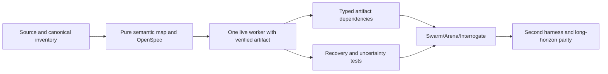

# Execution plan (proposal stage)

No tasks below are marked complete; all evidence described is required future proof. The change intentionally does not create another scheduler or package registry.

## Dependencies

- [ ] **E0 — pin and classify upstream:** Confirm pstack `UPSTREAM` pin, note separately current upstream head; freeze OmO `dev` SHA; classify each of the 24 source blocks, canonical principle/leaf/playbook correspondence, licensing and proof level. **Gate:** all mapped source paths exist; omissions become GAP, no unlicensed code copy.
- [ ] **E1 — validate smallest portable spec:** Reuse 17 capability IDs, ModelPlan and existing four-plane receipt schemas; validate principle/leaf/playbook taxonomy and authority matrix. **Gate:** no second scheduler, store, model role registry, or new capability enum.
- [ ] **E2 — one real native execution:** One canonical role and brief -> one native spawn -> owned artifact -> independent exact-revision verification -> host acceptance. **Gate:** observed-live native host/commit/receipt, including negative self-report test.
- [ ] **E3 — artifact-aware DAG:** Represent typed artifact edges separate from control edges; resolve immutable input refs and propagate invalidation. **Gate:** stale/missing input blocks dispatch, valid successor starts while unrelated sibling runs.
- [ ] **E4 — fault recovery:** Inject crash before/after dispatch, stale generation result, ambiguous remote mutation, memory Git timeout, session rollover and lease contention. **Gate:** no fabricated terminal status and no blind duplicate remote mutation.
- [ ] **E5 — workflow compositions:** Validate Swarm coverage/dropout, Arena isolated candidates and frozen rubric/graft verification, Interrogate independent read-only reviewers and no auto-fix; bind canonical playbook standing orders. **Gate:** exact postconditions and negative controls.
- [ ] **E6 — cross-harness and multiwave:** Repeat equivalent brief on two distinct native harnesses and complete a multiwave program across controller restart; verify four receipt planes independently for each. **Gate:** observed-live evidence and accepted design alternatives reconciled.

## Scoped conformance scenarios

- GRAPH-01 rejects cycle, unknown dependency and unsafe node path.
- DATA-01 requires typed upstream artifact digest; stale accepted artifact invalidates dependent work.
- ROUTE-01 unapproved/unavailable explicit model fails rather than silently falling back.
- CLAIM-01 two simultaneous claims have one owner; stale attempt cannot settle current work.
- EFFECT-01 an unacknowledged remote mutation is inspected before replay.
- RECOVER-01 unknown process observation remains nonterminal; controller restart recovers verified frontier.
- SWARM-01 missing partition produces GAP, not PASS.
- ARENA-01 reused writable context fails independence; post-graft check is required.
- INTERROGATE-01 read-only reviewer cannot mutate and does not auto-fix.
- EVIDENCE-01 changed commit invalidates prior exact-revision verification.
- PORT-01 static capability binding cannot be promoted by a different host's live receipt.

## Related existing work, do not duplicate

- [#429](https://github.com/tommy-ca/pstack/issues/429): role/model authority.
- [#435](https://github.com/tommy-ca/pstack/issues/435): canonical model-policy schema.
- [#439](https://github.com/tommy-ca/pstack/issues/439): panel seats and honest diversity.
- [#444](https://github.com/tommy-ca/pstack/issues/444): offline fixtures and freshness.
- [#473](https://github.com/tommy-ca/pstack/issues/473): freshness residuals.

Do not close or relabel existing issues based on this unexecuted specification. Before implementing, search for additional relevant active work and make explicit dependency links.
