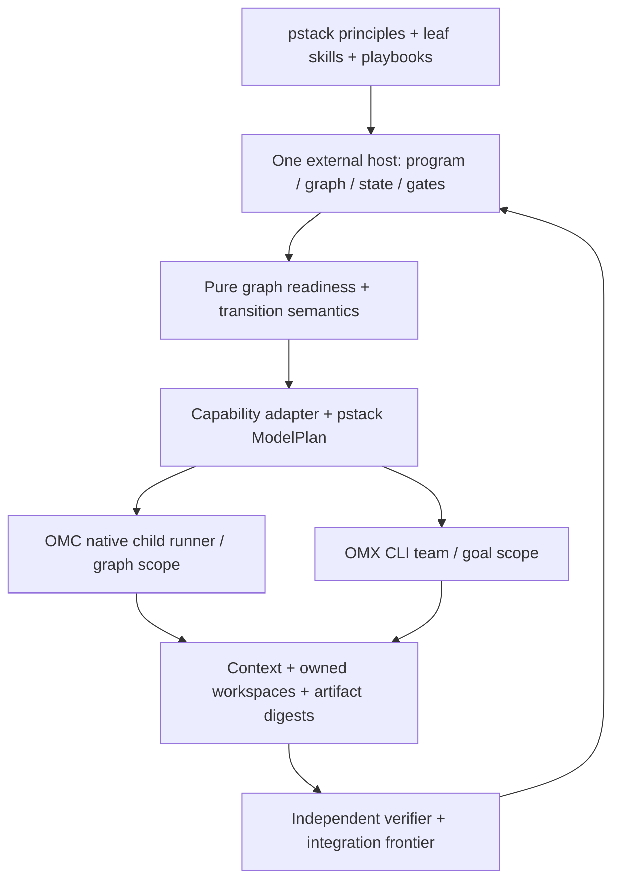
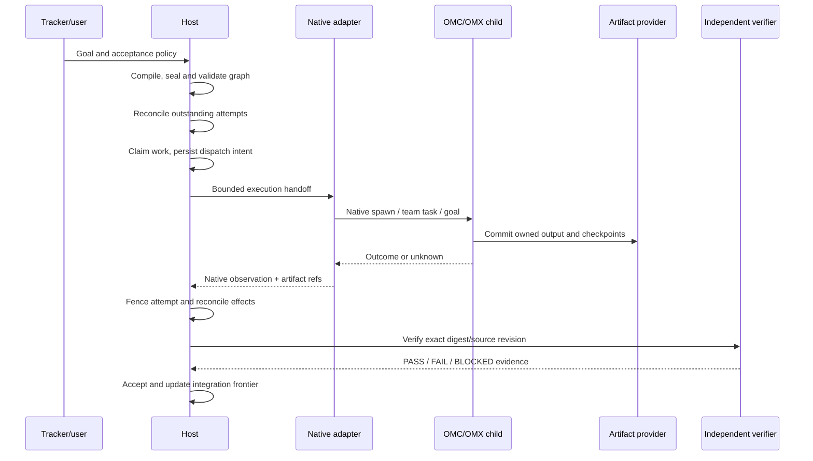

# Architecture and design: OMC/OMX decomposition

Status: proposal / source-review only, not host implementation or observed-live conformance. This is an adjunct to OmO semantic draft PR #502 and does not silently incorporate that draft into main.

## 1. Evidence and authority

Canonical pstack pinned methodology is authoritative for principles, leaf skills, and workflow compositions. Existing `tommy-ca/pstack` portability schemas (17 capabilities, ModelPlan, four-plane receipt) are authoritative for serialization. The selected external orchestration host owns program/work graph, scheduling, durable transitions, acceptance and integration. OMC or OMX runners own only their own bounded native sessions/teams/child graphs. No pstack-local database, session manager, scheduler or provider gateway (ADR-0006).

OMC graph-core may be chosen as an **exclusive** external-host implementation in a separate product profile, but cannot simultaneously run as a competing scheduler over Gas City-hosted program state. OMX CLI Team API is a mutation authority inside an OMX-owned execution scope; that API is *not* a portable cross-harness wire protocol.

## 2. Source-grounded semantic findings

| Reference source | Observed source mechanism | Target semantic invariant | Status |
| --- | --- | --- | --- |
| OMC `src/graph/{types,schema,descriptor}.ts` | node kinds agent/command/human-approval/join; fixed/conditional/fan_out/back_edge; SHA256 sealed descriptor; explicit effect policy | validated graph identity, typed node effects, bounded loops | source-reviewed |
| OMC `src/graph/scheduler.ts` | pure projection, attempt/transition replay fences, joins and terminal-verification activation | deterministic transition reducer with independent evidence | source-reviewed |
| OMC `src/graph/runtime/{runner,journal,store,fence}.ts` | journal authority, snapshot projection, owned run lock and epoch; contained FS on supported POSIX | one owner, safe replay, fail-closed corrupted state | source-reviewed |
| OMC `src/team/{recovery-saga,team-owner-epoch,api-interop}.ts` | worker replacement/adoption, process identity, CLI task operation boundary | reconcile uncertain processes and controlled mutation | source-reviewed |
| OMC `src/workflow/registry.ts` | Tier-0 plan/execute/review/verify role/workflow registry, versioned retirement | crosswalk to canonical pstack intent, avoid competing router | source-reviewed |
| OMC `src/ultragoal/artifacts.ts`, `docs/ultragoal.md` | multi-plan ledger, Claude goal mode snapshot; shell cannot directly mutate Claude /goal | distinguish ledger state from session directive | source-reviewed |
| OMX `src/team/{dag-schema,orchestrator,phase-controller}.ts` | task DAG handoff, bounded plan/PRD/exec/verify/fix state | verifiable phase transitions + task/role constraints | source-reviewed |
| OMX `src/team/{api-interop,state/tasks,completion-evidence}.ts` | CLI task mutation, optimistic version, claim token, structured evidence check | mutation through owner API; structured evidence is not execution proof | source-reviewed |
| OMX `src/state/{workflow-transition,workflow-transition-reconcile}.ts`, `docs/STATE_MODEL.md` | mode source-of-truth vs compatibility projections; allow/overlap/auto-complete | one authoritative lifecycle, explicit transition policy | source-reviewed |
| OMX `src/ultragoal/artifacts.ts` | durable goals/ledger, steering proposal and audit, session goal handoff | authorized, revisioned steering and checkpoint lineage | source-reviewed |

Source observation is distinct from verified runtime behavior. No source tree or test suite was executed in this proposal.

## 3. Atomic blocks and consolidation

Reference block IDs are *semantic analysis only*, not new capability identifiers.

| ID | Atomic block | Owner contract | Source contribution |
| --- | --- | --- | --- |
| OB-01 | Intent and workflow router | AC-01 | OMC workflow registry; OMX mode decisions |
| OB-02 | Stable role/model binding | AC-01 | OMC agent tiers; OMX role routing; existing pstack ModelPlan |
| OB-03 | Plan draft validation | AC-02 | OMC descriptor; OMX team-DAG handoff |
| OB-04 | Graph sealing and identity | AC-02 | OMC hash-checked descriptor |
| OB-05 | Control + artifact dependency | AC-02/AC-05 | OMC edges, OMX depends_on; **artifact edges proposed beyond source** |
| OB-06 | Bounded loop and conditional routing | AC-02 | OMC back_edge max_traversals and conditional edges |
| OB-07 | Pure transition reducer | AC-02 | OMC scheduler; OMX workflow transition |
| OB-08 | Effect policy | AC-03/AC-06 | OMC side_effect_free/idempotent/reconcile |
| OB-09 | Capacity and work admission | AC-03 | OMC concurrency_limit; OMX worker allocation |
| OB-10 | Attempt and ownership fence | AC-03/AC-06 | OMC owner epoch; OMX claims/version |
| OB-11 | Session and agent runner | AC-03 | OMC runner; OMX native/team worker |
| OB-12 | Team and durable mailbox | AC-04 | OMC team state; OMX Team API |
| OB-13 | Dispatch/ack reconciliation | AC-04/AC-06 | OMC recovery saga; OMX dispatch records |
| OB-14 | Workspace ownership | AC-05 | OMC and OMX team worktrees |
| OB-15 | Context and checkpoint | AC-05/AC-06 | ultragoal plan+ledger, session snapshots |
| OB-16 | Goal steering | AC-01/AC-06 | OMX steering proposal; OMC goal handoff |
| OB-17 | Host journal and projection | AC-06 | OMC journal vs snapshot; OMX mode vs HUD projection |
| OB-18 | Artifact and provenance | AC-05 | work outputs; **digest-bound dataflow proposed** |
| OB-19 | Independent real-artifact verifier | AC-07 | pstack Prove It Works; OMX completion evidence limits |
| OB-20 | Integration frontier | AC-07 | pstack Shipping; native worktree merges |
| OB-21 | Human decision boundary | AC-01 | OMC approval node; OMX needs_user_decision |
| OB-22 | Four-plane conformance | AC-08 | pstack receipt and capability binding schemas |

Eight AC contract boundaries (AC-01 intent/policy, AC-02 graph, AC-03 execution, AC-04 collaboration, AC-05 artifacts/context, AC-06 recovery, AC-07 verification/integration, AC-08 portability) **reuse** the earlier OmO draft classification. They do not imply eight services, eight new skills, or a new workflow language.

## 4. Canonical pstack compositions

Cross-cutting principles: model-the-domain (typed work/session/attempt), boundary-discipline (SDK/parser ports), make-operations-idempotent (effect policy and remote reconciliation), separate-before-serializing-shared-state (workspaces/claims), sequence-verifiable-units (graph/PR frontier), prove-it-works (real artifact), guard-the-context-window (checkpoint), subtract-before-you-add (host reuse), test-behavior-not-implementation (cross-harness postconditions), never-block-on-the-human (reversible execution with irreversible gate).

Leaf skills: `how` and `why` ground existing state; `architect` frames contracts; `blast-radius` checks affected paths; `create-verification-skill` establishes real-interface checks; `show-me-your-work` records decisions; `correct` turns repeated failure into enforcement. Only invoke skills present at the current normative pstack pin and preserve their concrete constraints.

Playbooks: `multi-phase-plan` establishes bounded verifiable DAG; `orchestrate` owns rolling program frontier and self-contained briefs; `autonomous-run` drives one predicate; `session-pickup` restores explicit state; `shipping` integrates contiguous independently verified PRs. `swarm`, `arena`, `interrogate` remain composed skills, not new native harness primitives.

## 5. System architecture and ownership



*No runtime duplication:* child graph or team can manage subwork inside one host attempt; it must return one typed outcome and cannot transition unrelated program units. A stand-alone OMC-derived host is a mutually exclusive deployment profile, subject to new runtime conformance.

## 6. Graph model and dataflow

A graph revision has `graphId`, `revision`, `ownerHost`, `descriptorDigest`, nodes, control edges, typed artifact edges, `acceptancePredicateIds` and effect policies. Seal/hash only after structural validation; a persisted digest mismatch blocks execution. The proposed JSON Schema in `schemas/semantic-graph.schema.json` validates shape but cannot itself prove SHA256 integrity—runtime code MUST recompute/compare.

Node kinds: agent, command, human-approval, join. Control edges: fixed, conditional, fanout, explicitly bounded backedge. Other cycles are forbidden; a bounded loop must have a maximum traversal policy. Typed artifact edges are a **new integration contract**, not a claim that OMC/OMX automatically transfer upstream results.


Readiness requires: control predecessors satisfied; typed inputs validated; owner/capacity permitted; model/tool policy eligible; side-effect preconditions satisfied. A successful node without required artifact does not satisfy an artifact-dependent successor.

## 7. Runtime code flow



The native `/goal` state is not controlled by a shell-level ledger command in either implementation. A ledger-to-session directive is a handoff needing observed execution. Use the host's approved model-role plan for final model eligibility, not a second independent fallback registry.

## 8. Recovery and side effects

1. Reconcile host-owned attempts and native observations before dispatch.
2. `unknown` liveness is not `failed` or `succeeded`.
3. Owner epoch and claim tokens reject stale internal mutations, but do not fence remote Git/API side effects by themselves.
4. Node effect policy must be explicit: `side_effect_free`, `idempotent` with stable effect key, or `reconcile` requiring external inspection before retry.
5. Persisted intent preceding a network call can leave ambiguous completion; do not blindly repeat the call.
6. Rehydrate from immutable context/checkpoint; native resume only when capability and observed host support permit it.
7. Journal is authoritative; projection/HUD/cache is not. Corrupted state or descriptor mismatch blocks rather than inventing recovery.
8. Context rollover carries standing orders verbatim; goal/acceptance predicates cannot be silently weakened by the worker.

## 9. Data models

```ts
type WorkId = string; type AttemptId = string; type Revision = string;
type NativeObservation =
  | { kind: "live"; nativeSessionId: string }
  | { kind: "terminal"; outcome: "produced"|"failed"|"cancelled"; resultRef?: string }
  | { kind: "unknown"; reason: string };
type EffectPolicy =
  | { policy: "side_effect_free" }
  | { policy: "idempotent"; effectKey: string }
  | { policy: "reconcile" };
interface WorkUnit {
  id: WorkId; graphId: string; graphRevision: number;
  controlDependencies: WorkId[];
  artifactInputs: Array<{ upstreamWorkId: WorkId; artifactType: string; digest?: string }>;
  acceptanceIds: string[]; stateVersion: number;
}
interface Attempt { workId: WorkId; attemptId: AttemptId; generation: number; dispatchKey: string; nativeSessionRef?: string; }
interface Artifact { id: string; digest: string; sourceRevision: Revision; producerAttemptId: AttemptId; uri: string; }
interface Verification { artifactId: string; digest: string; sourceRevision: Revision; checkId: string; verifierId: string; verdict: "PASS"|"FAIL"|"BLOCKED"|"UNTESTED"; evidenceRef: string; }
```

Proposed JSON Schema exemplars live only in this OpenSpec change. The existing `schemas/portability/{binding,capability,model-plan,receipt}.schema.json` remain authoritative. Verification claims must use the existing canonical/adapter/package/runtime receipt planes.

## 10. Swarm / Arena / Interrogate (ANALYTICAL, NOT LIVE)

Swarm source partitions: (1) OMC graph/scheduler, (2) OMC team and goal/recovery, (3) OMX team/claims, (4) OMX transition/Ultragoal, (5) pstack principles/skills, (6) dataflow/security/verification, (7) portability. Every partition must report source path, commit, observed mechanism, missing proof and verdict. Source inspection is not observed-live acceptance.

Arena candidates: A copy both runtimes into pstack (reject duplicate authority); B native host graph with OMC/OMX bounded child execution (select); C promote OMC graph core to sole host in standalone profile (conditional); D invent a universal workflow/provider broker (defer). Selection criteria: ADR-0006, state consistency, recovery, testability, cost and minimum duplication. No independent model candidates actually run.

Interrogate blocking hypotheses: unsealed graphs accepted as executable; bounded loop exhausted but reactivated; stale owner resumes after restart; cross-team direct file writes; idempotency keys not enforced remotely; CLI evidence files fabricated; goal ledger confused with interactive /goal; advisor/reviewer shared writable contexts; verification patch freshness lost on rebase. Each requires negative behavioral tests. No independent reviewer agents actually run.

## 11. Design decisions

- ACCEPT conceptually: OMC typed graph/effect policy, OMX mutation+phase contracts, pstack evidence and methodology.
- REUSE: existing 17 portable capabilities, pstack ModelPlan and four-plane receipt; no new role registry.
- ADAPT: bound OmO/OMC/OMX semantics to eight existing AC contracts and one host authority.
- DEFER: full runtime transplant, nested universal coordinator graph, separate broker/database, unmeasured distribution.
- GATE: all runtime and approval guarantees pending observed-native tests.

SOLID: domain types and host ports are small and substitution tested. KISS/DRY/YAGNI: no second scheduler, single authority for mutation, minimal proposed schemas, depth-first one verified vertical slice before swarm scale.
