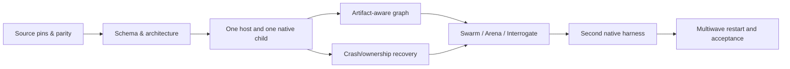

# Depth-first execution graph and conformance gates

No tasks are marked complete. Source inspection alone is not runtime verification.

- [ ] **G0** Inventory OMC/OMX semantic sources, source pins, changed tree comparison, canonical pstack pin, licensing, evidence tiers; reconcile earlier OmO proposal #502. **Gate:** source files anchored, 22 reference blocks mapped to AC owners and no copied runtime claims.
- [ ] **G1** Validate proposed schemas/requirements; no new portable capability enum, model registry, scheduler, database, or cross-harness API named after private OMX/OMC functions. **Gate:** JSON Schema Draft 2020-12 parsing and schema negative cases pass; policy and ADR audit pass.
- [ ] **G2** Implement mapping for one execution brief through one selected host and one real OMC or OMX child. **Gate:** observed native spawn/join, exact artifact, independent verifier, serialized receipt; agent self-report alone fails.
- [ ] **G3** Add control and typed artifact/data edge separation with descriptor sealing and dependency-readiness tests. **Gate:** sealed hash mismatch rejects; missing artifact blocks; bounded-backedge guard terminates.
- [ ] **G4** Fault inject controller crash before/after dispatch, stale claims, process unknown, corrupt journal, timed-out remote write and unacknowledged message. **Gate:** no false-success or unauthorized duplicate effects; explicit blocked when recovery unsupported.
- [ ] **G5** Compose Swarm coverage with explicit dropouts, Arena independent workspaces/frozen rubric/post-graft checks, Interrogate independent read-only reviewers with no automatic edits. **Gate:** negative isolation tests and evidence join pass.
- [ ] **G6** Port equivalent semantic workload to second host (Codex and Claude Code targets); map native capability and ModelPlan status honestly. **Gate:** four-plane receipts at exact adapter versions, no sharing proof across hosts.
- [ ] **G7** Run multiwave program through controller restart and session rollover. **Gate:** accepted program predicate at exact integrated revisions and no remaining uncertain effects.

## Behavior test matrix

| ID | Negative/positive test | Expected |
| --- | --- | --- |
| GRAPH-01 | Unsealed or wrong descriptor hash | Refuse execution |
| GRAPH-02 | General cycle / exhausted back_edge | Reject or terminate bounded execution |
| GRAPH-03 | Parallel node ready, unrelated sibling active | Admit if capacity and dependencies allow |
| DATA-01 | Accepted predecessor missing artifact digest | Block successor |
| POLICY-01 | Native model differs from authorized ModelPlan | Block dispatch |
| OWN-01 | Stale claim generation tries to settle task | Refuse mutation |
| OWNER-02 | Controller crashes after native launch | Adopt/reconcile/unknown, never blind duplicate |
| EFFECT-01 | Remote push times out after possibly landing | Inspect remote ref first |
| GOAL-01 | Ledger says complete, native /goal unknown | Do not infer session goal completion |
| MODE-01 | Illegal workflow overlap | Reject via state policy |
| EVID-01 | Valid JSON report asserts tests ran but didn't | Independent verification still required |
| EVID-02 | Rebase changes tested artifact | Invalidate stale receipt where material |
| SWARM-01 | Required partition drops | GAP not PASS |
| ARENA-01 | Two candidates reuse writable context | Independence FAIL |
| INT-01 | Reviewer can mutate code or shares context | Independent review not proven |
| PORT-01 | Static-only host adapter | runtime UNTESTED |
| LONG-01 | Multiwave external restart | Retain verified frontier and resume safe work |

## Related work (do not duplicate)

- PR #502: OmO reference semantics; verify status before changing the same document.
- Issue #429: role/model policy parent; ADR-0021 remains proposed.
- Issues #435, #439, #444, #473: canonical role metadata, reviewer diversity, offline fixtures and freshness.
- Existing pstack four-plane receipt and 17 capabilities remain normative.
