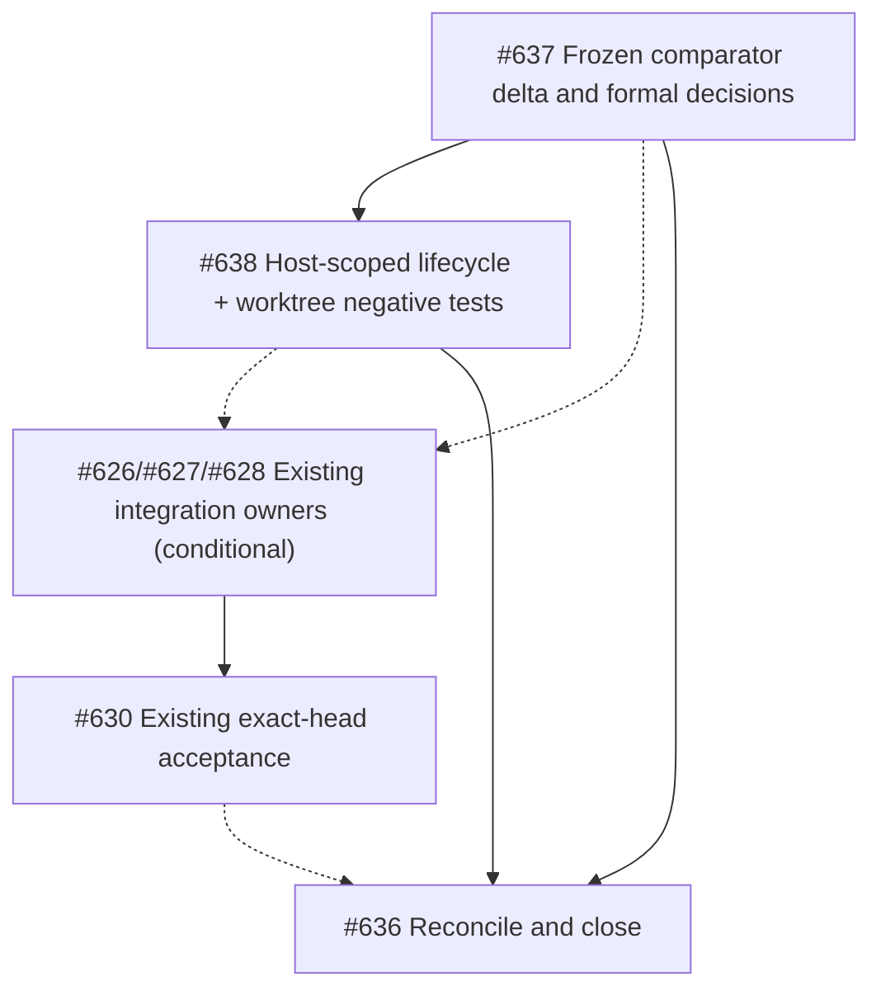

# Recursive implementation and proof plan (source-pinned design)

Program: [#636](https://github.com/tommy-ca/pstack/issues/636); leaf audits [#637](https://github.com/tommy-ca/pstack/issues/637) and [#638](https://github.com/tommy-ca/pstack/issues/638).

- [x] Record three exact source HEADs, applied upstream pin and old comparator snapshot (design evidence only).
- [x] Verify structural inventory: target 63 shared skill definitions, comparator 65, canonical 56 at checked HEADs; classify *behavior*, not raw file count.
- [x] Identify comparator changed source families after `94f5ce95`: 16 commits including Pi activity, session, worktree and CLI tests, agent/process state, safety playbooks, generator models and new skills. No test execution claimed.
- [ ] **A / #637** Reconcile all relevant comparator-diff items with current `tools/forks.json` and pinned canonical `pstack/` delta; emit a per-file/semantic-atom decision table and identify source license/NOTICE. Completed #434/#443 are baselines, not TODOs.
- [ ] **B / #638** Implement only accepted host-scoped negative fixtures for activity-by-call-ID, ephemeral progress, resume, cancellation settlement and hidden worktree files. Run no-op/control first; preserve independent native adapters and keep unsupported features as GAP.
- [ ] **C / #626 #627 #628** If classification demonstrates an uncovered canonical semantics bug, add a specific bounded acceptance case to the appropriate **already-open** issue. Do not automatically block the canonical 0.15.29 pin for comparator-only changes.
- [ ] **D / #630** Complete independent exact-head Swarm coverage and Interrogate review with model-family/runtime identities; Arena only for a concrete contested alternative; attach actual output and host-scoped receipts or explicit BLOCKED.
- [ ] **E / #636** Reconcile classifications and scoped decisions in the public adoption matrix, update issues, and close the bounded delta only after A and B are proven or descoped with cause. Leave #622 and #429 histories intact.

No running multi-model Swarm/Arena/Interrogate is implied by a document-only architecture or these graph edges. The independent canonical #623 → #629 → #630 synchronization chain remains authoritative.
