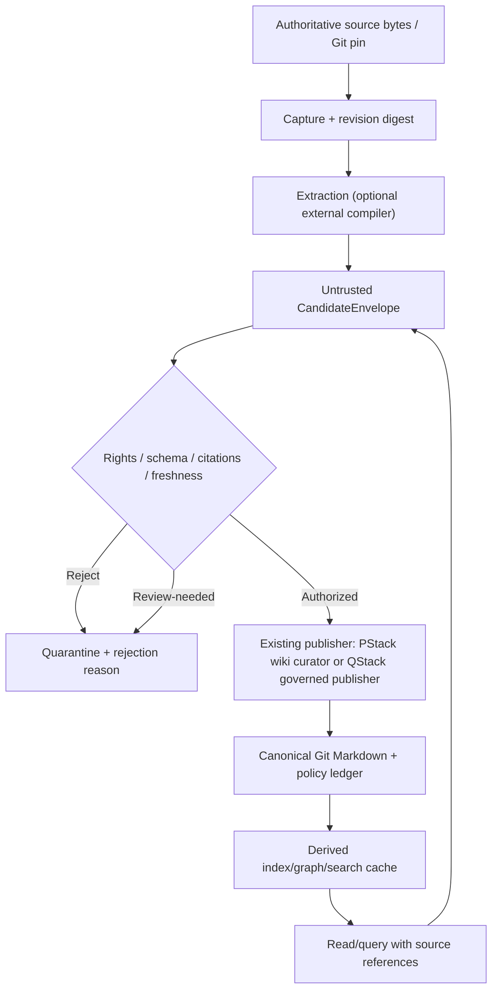
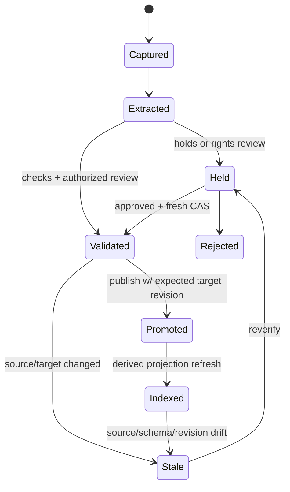

# LLM Wiki v2 — reference-derived architecture and formal design

> **Status:** design / contract extraction, not a claim of cross-engine parity. Scope is `tommy-ca/pstack`; QStack is read-only as a reference for governance. [Requirements](specs/llm-wiki/spec.md), [data models](data-models.md), [work plan](tasks.md).

## Pinned reference evidence

| Source | Frozen revision | Specific contract | Proposed PStack derivative |
| --- | --- | --- | --- |
| [Atomicstrata ARCHITECTURE.md](https://github.com/atomicstrata/llm-wiki-compiler/blob/0f8ff86ef0a28f4c15627a2ea5e94a96cadd834e/ARCHITECTURE.md) | `0f8ff86` | `sources/`→ extract→ generate→ review/publish; storage interfaces; mutation-locked approval; retryable embedding intent | Optional `ExtractCandidates`, `ReviewGate`, `ProjectionManifest`; no direct publisher |
| [Atomicstrata wiki-model](https://github.com/atomicstrata/llm-wiki-compiler/blob/0f8ff86ef0a28f4c15627a2ea5e94a96cadd834e/docs/concepts/wiki-model.mdx) | same | source SHA/ownership incremental state, wiki/index, candidate/archive, eval | `SourceRevision`, `AffectedClosure`, `CandidateEnvelope` |
| [Atomicstrata review-policy](https://github.com/atomicstrata/llm-wiki-compiler/blob/0f8ff86ef0a28f4c15627a2ea5e94a96cadd834e/docs/configuration/review-policy.mdx) | same | union of hold reasons, corrupt/unknown policy fail closed | `ReviewDecision`, `PolicyGate` |
| [Atomicstrata citations](https://github.com/atomicstrata/llm-wiki-compiler/blob/0f8ff86ef0a28f4c15627a2ea5e94a96cadd834e/docs/concepts/citations.mdx) | same | source and line-range markers; syntactic citation lint != entailment | `EvidenceSpan`, `CitationResolution` |
| [Atomicstrata state-recovery](https://github.com/atomicstrata/llm-wiki-compiler/blob/0f8ff86ef0a28f4c15627a2ea5e94a96cadd834e/docs/troubleshooting/state-recovery.mdx) | same | future-format state version fails closed; backup/reset | `StateVersionGate` |
| [Geronimo type-system](https://github.com/geronimo-iia/llm-wiki/blob/9d974c9e4d9d6c21638a5f520e6d89f79647724e/docs/specifications/model/type-system.md) | `9d974c9` | JSON Schema Draft 2020-12; `x-wiki-types`, `x-index-aliases`, `x-graph-edges` | `TypeRegistry`, `FieldContract`, `RelationType` |
| [Geronimo ingest](https://github.com/geronimo-iia/llm-wiki/blob/9d974c9e4d9d6c21638a5f520e6d89f79647724e/docs/specifications/engine/ingest-pipeline.md) | same | parse frontmatter→validate type→index; do not rewrite authored bytes | `AdmissionGate` + `RebuildableProjection` |
| [Geronimo index](https://github.com/geronimo-iia/llm-wiki/blob/9d974c9e4d9d6c21638a5f520e6d89f79647724e/docs/specifications/engine/index-management.md) | same | Tantivy BM25, git diff incremental state, disposable index, schema-change rebuild | `ProjectionManifest`, `StalenessGate` |
| [Geronimo invariants](https://github.com/geronimo-iia/llm-wiki/blob/9d974c9e4d9d6c21638a5f520e6d89f79647724e/docs/invariants.md) | same | stable snapshot key, graph refresh owner, rebuild lock, space-mutation rollback, lock ordering | `SerializableRebuild`, `ReadSnapshot` |
| [Geronimo epistemic model](https://github.com/geronimo-iia/llm-wiki/blob/9d974c9e4d9d6c21638a5f520e6d89f79647724e/docs/specifications/model/epistemic-model.md) | same | source vs synthesized concept vs query result | `EpistemicRole` |
| [QStack wiki governance](https://github.com/tommy-ca/qstack/blob/149b6082fe7bcd00e86a13ed48fbf8ee51268882/openspec/specs/wiki-governance/spec.md) | `149b608` | governed publisher, rights, high-impact ack, quarantine, immutable event lineage | **External policy only**; preserve QStack owner and ledger |
| [QStack atomic primitives](https://github.com/tommy-ca/qstack/blob/149b6082fe7bcd00e86a13ed48fbf8ee51268882/docs/spec/catalog/llm-wiki-v1-atomic-primitives.md) | same | nine stable semantic roles and six implementation planes | Map rather than duplicate nine-role registry |

**Evidence levels:** these sources document intended upstream behavior. This pass did not run the Atomicstrata Node SDK, Geronimo Rust binary, external LLM providers or their performance benchmarks. A source-documented property is a candidate contract, not tested local parity.

## Authority planes



The query-to-candidate arrow represents a new proposed knowledge claim; it never creates direct source authority. PStack's `.llm-wiki/log.md` is **not** QStack's immutable `knowledge/operations.jsonl` event log. PStack source and log are separate filesystem writes.

## Candidate lifecycle / promotion

State set `Captured, Extracted, Held, Validated, Rejected, Promoted, Indexed, Stale`. The schema's on-disk candidate states are narrower: `proposed|held|validated|rejected`. `Promoted`, `Indexed` and `Stale` are **journal/projection** events, not reclassification of an untrusted candidate as an authoritative artifact.



An initial `proposed` candidate is not automatically `validated`. Every state transition must preserve the previous canonical version on rejection and must guard future published writes with a target precondition.

## Atomic implementation blocks (not services)

| Plane | Atom | Input→output | Owner | Existing status |
| --- | --- | --- | --- | --- |
| Evidence | `SourceRevision` | source bytes + id→SHA-256 capture | `WikiSource` | PARTIAL: basename `xb` in #881, no stable source-id registry |
| Evidence | `EvidenceSpan` | revision+line range→verifiable pointer | `WikiSource` | SPEC ONLY |
| Compilation | `AffectedClosure` | source-diff/owners→candidate page set | `WikiSynthesis` | SPEC ONLY |
| Compilation | `CandidateEnvelope` | proposed content+provenance→typed JSON | `WikiArticle` / `WikiSynthesis` | SPEC + test vectors, not runtime CLI |
| Contract | `TypeRegistry` | type name+schema version→validator | `WikiArticle` | SPEC ONLY; Python check remains structural |
| Contract | `PolicyGate` | rights/impact/hold→decision | `WikiLever` / `WikiIntent` | SPEC ONLY; QStack independent authority |
| Contract | `PromotionCAS` | candidate+expected target→commit/reject | `WikiArticle` / `WikiLogEntry` | SPEC ONLY |
| Projection | `ProjectionManifest` | authoritative revision set→index digest | `WikiIndex` / `WikiSearchIndex` | PARTIAL: generated Markdown index, no manifest |
| Projection | `TypedRelation` | frontmatter/link+schema→graph edges | `WikiGraphMap` | SPEC ONLY |
| Read | `QueryPlan` | query+snapshot→ranked refs | `WikiSearchIndex` | SPEC ONLY |
| Verification | `Attestation` | pinned code + command + verdict→receipt | `WikiLever` / `WikiLogEntry` | PARTIAL: offline skill in #881, no TLC |
| Lifecycle | `AdmissionDecision` | candidate+rights+review→accepted/held/rejected | `WikiIntent` | SPEC ONLY |

The existing nine QStack roles are unchanged. Choosing a field name here does **not** introduce a second schema registry, daemon, or production implementation.

## Formal state invariants to check

```text
I1 WriteOnce:
  For each accepted SourceRevision id r:
  captured_digest_after(r) == captured_digest_at_first_success(r)

I2 IdempotentReplay:
  apply(r, digest) twice == apply(r, digest) once (no additional durable events)

I3 CandidateIsolation:
  Candidate writers cannot mutate canonical content or publication ledger.

I4 FreshPromotion:
  promote(c) implies
    c.source_digest == current_source_digest(c.source_id) AND
    c.expected_target_digest == current_target_digest(c.target) AND
    c.content_digest == reviewed_content_digest(c)

I5 ProjectionConsistency:
  query_index(h) is usable only when h == derivation_digest(canonical_head, schema_version, algorithm_version)

I6 CitationNonEntailment:
  resolve(citation) == true does not imply evidence_supports(claim) == true.

I7 ConservativeVerdict:
  final_verdict == max_severity(all required lane verdicts)
  with FAIL > BLOCKED > UNTESTED > PASS

I8 SingleWriter:
  one authorized publisher serializes canonical transitions;
  untrusted inference and optional search never elevate write authority.
```

`I1/I2` have **bounded serial real-code tests** in `scripts/verify_llm_wiki_model.py` (39 histories, 3 event alphabet, length ≤3) and an overwrite-mutant negative control. `I3..I8` are formalization targets and policy checks, **not** claimed as machine-proven. The included TLA+ `WikiRawImmutability` module models a small abstract write-once store but was not checked with TLC. State+log durability is not modeled as an atomic pair.

## Code and data flow, status

```text
PStack actual: scripts/llm_wiki.py ingest -> raw/sources/<basename> -> log.md
PStack actual: scripts/llm_wiki.py index --write -> .llm-wiki/index.md
PStack actual: scripts/llm_wiki.py check -> structure/config/links ONLY
PStack proposed: extract -> candidate JSON -> schema/rights/review -> authorized curator -> index manifest
QStack existing governance: quarantine -> owner-controlled publisher -> knowledge/ + operations.jsonl
Optional upstream engines: DISABLED / NOT INSTALLED / NOT BENCHMARKED
```

## Recovery and trust boundaries

- Reject malformed, unknown-version and out-of-root artifacts; no automatic follow of symlinks from untrusted candidates.
- Reconstruct derived search/index/graph from canonical Markdown. An index snapshot key must persist across process restarts and change with input.
- Treat capture-and-human-log as nontransactional. A future reconciliation tool could compare discovered captures with log receipts, but is not implemented in this change.
- Prefer pure Python baseline and Git review per binding #873; only opt into reference engines under a new evidence-backed decision.
