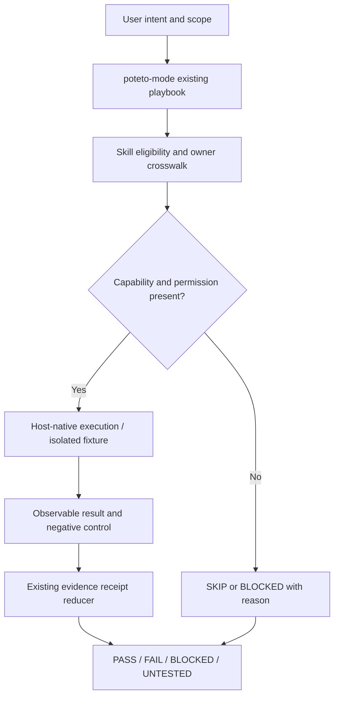

# Design: reconcile DeepSeek 22 skills with existing PStack owners

## System boundaries and alternatives

**Selected: refine existing owners.** Prior source audit already established 20 reusable semantic atoms and a living PStack specification. Current source drift adds six candidate skills but does not justify a second framework.

| Alternative | Benefit | Risk | Verdict |
| --- | --- | --- | --- |
| Vendor all 22 skill directories | Source parity | DSH-specific commands/privileges, duplicate routing, maintenance | Reject |
| Add a portable `dsh` meta-router | Single entry | Conflicts with `poteto-mode`, second skills registry | Reject |
| Add targeted contracts to existing owners | Minimal interfaces, existing verification receipts, host-neutral | Requires behavioral comparison before code edits | **Accept** |
| Add specialized host/domain reference packs | Conditional deep coverage | Overactivation and future upkeep | Optional, evidence-gated |

**Single authority for each concern:** PStack playbook/router selects; principle/skill owns generic rule; host adapter resolves actual tools; optional project/domain overlay adds constraints; existing verifier records observable evidence. QStack must remain downstream and quant-only.

## Code and data flows



**Source admission:** pinned DeepSeek source → source crosswalk `SOURCE_STATIC` → behavioral proposal → PStack owner → baseline vs candidate eval + safety negative controls → approved skill edit → actual host verification. No source markdown can grant executable permissions.

**Swarm:** partition DeepSeek skill review into context/documentation, test/CI/review, UI/release, and lifecycle/session domains. Each worker reads pinned immutable source and returns evidence; shared source/branch state is read-only.

**Arena:** when choosing materially different design shapes, produce independent artifacts in isolated worktrees, compare 3-6 criteria (owner fit, correctness, host portability, maintenance burden, verifiability), pick and synthesize exactly one design. Do not run just to vote on trivial wording.

**Interrogate:** review changes against intended behavior from current base/head; try to falsify lifecycle/retry safety, authorization, tests and migration behavior. Only repeatable real-code counterexamples count as findings. Static risks remain `UNTESTED` observations rather than verified defects.

## Reusable semantic building blocks

Retain the existing `B01..B20` decomposition in the [2026-10-11 archived atomic patterns](../archive/2026-10-11-deepseek-skill-portability/atomic-patterns.md); do **not** clone it. New source material specializes existing atoms:

| Source-derived concept | Existing atom | Owner and when applicable |
| --- | --- | --- |
| Lifetime-scoped service effects, await cleanup before dependency release | B06, B07, B10 | `interrogate` / formal verifier, resource-owning tasks |
| Deterministic projection/replay, not repeating I/O, bounded state | B06, B13, B15 | `statechart` / formal verification, only event-sourced systems |
| PR change/test truth, specific user-visible delta, provenance | B05, B14, B16 | `opening-a-pr`, `make-pr-easy-to-review` |
| Responsive action/focus/touch accessibility | B03, B13, B20 | `visual-parity`, only UI |
| Icon/artwork evidence and approval | B03, B20 | optional product visual pack |
| macOS signing privileges/keyring | B02, B06, B20 | explicit host-specific user permission, otherwise defer |

## Schema models (conceptual, not a competing serialized authority)

```yaml
SourceSkill:
  repository: deepseek-ai/deepseek-harness
  commit_sha: 40-char-git-sha
  path: .agents/skills/<slug>/SKILL.md
  license: MIT
  source_change: new | changed | unchanged
  decision: refine | optional | defer
  pstack_owner: existing-skill-or-playbook
  evidence_class: SOURCE_STATIC

Invocation:
  request_id: opaque
  intent: review | design | fix | verify | document | ship
  mode: read_only | authorized_write
  required_capabilities: [host-capability]
  disallowed_contexts: [context]
  eligible: boolean

VerificationReceipt:
  # REFERENCE existing receipt schema; do not implement this as another type
  source_revision: git-sha
  target_head: git-sha
  host_profile: name
  check_id: name
  observed_command: exact-executed-command
  result: PASS | FAIL | BLOCKED | UNTESTED
  evidence_refs: [existing-artifact-id]
```

A source crosswalk does **not** get to set `PASS`; status authority belongs to the existing four-plane receipts (canonical/adapter/package/runtime). Reduction remains `FAIL > BLOCKED > UNTESTED > PASS`. Distinguish `SKIP` (not applicable) from `PASS` (executed proof).

## Verification matrix for a later implementation pass

| Negative test | Expected safety behavior | Existing owner |
| --- | --- | --- |
| Two processes race for a shared fixed port | Private atomic allocations, no collision, awaited cleanup | CI verification skill |
| Cleanup releases an API dependency before consumer settlement | Violation surfaced by failing deterministic interleaving | formal verification / interrogate |
| Projection replay performs I/O or has checkpoint/full replay divergence | Invariant fails, no claimed runtime success | statechart / formal skill |
| Partial durable write followed by blind retry | Retry rejected or recovered by state owner | bug-fix / interrogate |
| UI-only overlay selected for backend project | Explicit SKIP | poteto-mode/router |
| macOS signing request absent or unsupported host | No keychain/file mutation | host adapter |
| PR tested at head A but published at head B | Receipt invalidated; relevant tests rerun | shipping / review |
| PR contains only docs and no model-backed UI demo | No false live/UI evidence claim | PR description / evidence |
| Arena or Swarm worker never ran | No independent-worker receipt is minted | orchestrator/evidence |

## Adoption phases

1. **Source:** enumerate all 22 source leaves and identify changed source IDs (done by static GitHub inspection for this change).
2. **Compare:** diff modified source leaves against current PStack owners; classify actual functional gaps rather than names.
3. **Pilot:** extend only one canonical owner if a real negative test fails; measure evidence and total maintenance cost.
4. **Evaluate:** run baseline-versus-candidate tests and host profiles; require negative controls and no false-positive/false-PASS regression.
5. **Promote:** update runtime skill(s) only when tests justify it; reconcile QStack downstream only by reference.

## Guardrails
The archived 16-skill decision and source pin are frozen evidence, not incorrect history. This change does not modify `UPSTREAM` or generate harness-specific packages. DeepSeek license attribution is retained in the source crosswalk; substantial verbatim skill copying would need the source copyright/license notice.
