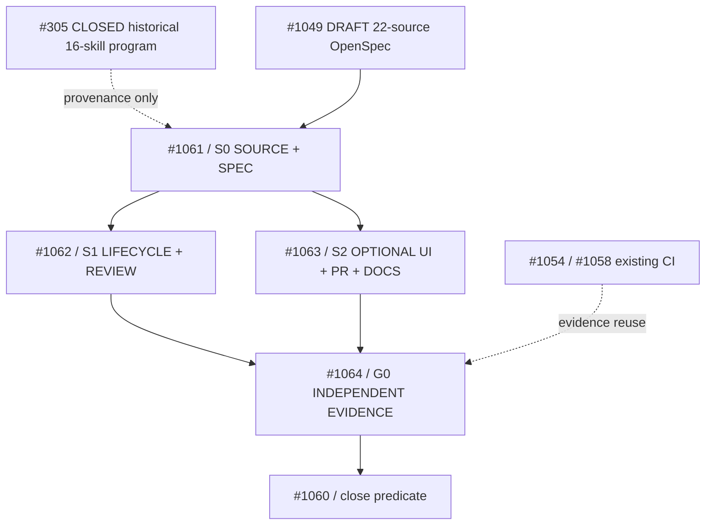

# Execution issue graph — DeepSeek Harness 22-source portability refresh

**Root:** [#1060](https://github.com/tommy-ca/pstack/issues/1060). **Spec PR:** [#1049](https://github.com/tommy-ca/pstack/pull/1049). **Frozen previous program:** [#305](https://github.com/tommy-ca/pstack/issues/305) and its closed #306–#315 children. **Current nonduplicated verification-tools owner:** [#1054](https://github.com/tommy-ca/pstack/issues/1054) / [#1058](https://github.com/tommy-ca/pstack/issues/1058).

## Scope
The source is `deepseek-ai/deepseek-harness@fcc0ad462172522aaf5c93a7b2e01f6b9f0b0159` (MIT). The pinned tree has 22 `SKILL.md` directories: **12 GENERAL / 5 CONDITIONAL / 5 EXCLUDE**. The source crosswalk and `source-delta-review.md` are the complete census. No `dsh-*` skill is authorized for installation. An upstream skill name is **not** a child issue and a concept is **not** automatically an implementation requirement.

## Recursive dependency DAG



| Issue | Owners / atomic blocks | Inputs and evidence | Completion / next edge |
| --- | --- | --- | --- |
| [#1061 S0](https://github.com/tommy-ca/pstack/issues/1061) | `source-disposition → contract → existing owner`; `technical-writing`, `authoring-a-skill` | 22/22 source links; 12/5/5 filter; OpenSpec CLI structure; current `main` reconciliation | Exact pinned source matrix, source exclusions, spec delta validated; unblocks #1062/#1063 |
| [#1062 S1](https://github.com/tommy-ca/pstack/issues/1062) | `resource-owner → readiness → bounded overlap → quiescent teardown → observed failure effects`; `create-verification-skill`, `fix-ci`, Thermos, `interrogate`; `bug-fix`/`investigation`/`refactoring` | Current-head reproducible negative control or explicit existing-owner no-gap verdict; references historical #311–#313, current #1056 scaffold | No speculative skills; accepted repro+fix or NO_CHANGE_NEEDED, then #1064 |
| [#1063 S2](https://github.com/tommy-ca/pstack/issues/1063) | `positive-trigger → project capability → expected effect → negative-trigger → user-path evidence`; `technical-writing`, `make-pr-easy-to-review`, `create-verification-skill`; `opening-a-pr`/`visual-parity` | UI/PR/doc tests and backend-only false-trigger controls; 5 excluded implementations never activate | Measured task outcomes, current receipts, then #1064 |
| [#1064 G0](https://github.com/tommy-ca/pstack/issues/1064) | `Swarm` independent partitions; `Arena` only for live competing designs; `Interrogate` adversarial executable tests; source- and head-pinned existing status reducer | Completion of #1061–#1063; current #1054/#1058 test receipts; host matrix if authorized/available | Falsifiable acceptance, documented exceptions, no false PASS; enables #1060 closure |

## Formal lifecycle and status flow

```text
SOURCE_STATIC
  → SPEC_DRAFT (#1049)
  → SPEC_VALIDATED (#1061)
  → BEHAVIOR_PROBED (#1062 and #1063)
      ├─ if existing owner passes: NO_CHANGE_NEEDED
      └─ if reproducible gap: smallest existing-owner patch + negative control
  → INDEPENDENT_GATE (#1064, if tool capabilities are available)
  → RELEASE / EXPLICIT_WAIVER / BLOCKED
```

These are **planning labels**, not new package enums or runtime data models. Use PStack's existing four-plane/three-tier evidence contract. `FAIL > BLOCKED > UNTESTED > PASS`; SKIP is irrelevant context, not PASS. Source instructions are lower-trust data. A source review alone never proves a native-host execution.

## Skill / principle / playbook discipline

- **Retain canonical leaves:** `create-verification-skill`, `fix-ci`, `thermo-nuclear-review`, `thermo-nuclear-code-quality-review`, `interrogate`, `benchmark-checklist`, `technical-writing`, `make-pr-easy-to-review`, `unslop`.
- **Retain canonical principles:** `principle-prove-it-works`, `principle-boundary-discipline`, `principle-subtract-before-you-add`, `principle-experience-first`, `principle-minimize-reader-load`, `principle-guard-the-context-window`.
- **Retain canonical playbooks:** `bug-fix`, `investigation`, `refactoring`, `perf-issue`, `authoring-a-skill`, `opening-a-pr`, `visual-parity`, `shipping`.
- **No new leaf/principle/playbook solely from an upstream title.** A new leaf needs repeatable unique invocation, independent output and a failing existing-owner contract; a new principle needs a previously unowned invariant; a playbook needs a distinct recurring sequence.
- **No QStack generic dependency:** `qstack-mode → poteto-mode` only. Quant-only verification remains in QStack (for example its [validator-contracts program](https://github.com/tommy-ca/qstack/issues/3087)); PStack does not depend on QStack.

## Safety and no-duplication checks

1. The previous [#305](https://github.com/tommy-ca/pstack/issues/305) and #306–#315 remain historically CLOSED: do not alter their frozen 16-source record or retroactively claim new-HEAD proof.
2. Current [#1054](https://github.com/tommy-ca/pstack/issues/1054) owns driver, scaffolder, Antigravity and multi-harness CI. Source refresh does **not** duplicate that tool implementation.
3. DSH-only exclusion examples: Cordis framework lifecycle code, macOS CUA certificates/keychain mutation, `gh stack` semantics, DSH branding/artwork, `SessionProjection` runtime. Generic concepts may be verified through existing PStack project/host owners.
4. Baseline and candidate evaluations require actual runnable cases. Independent Swarm/Arena/Interrogate and live host proof are **NOT_RUN** until receipts exist.
5. Issue close predicates are evidence-driven: no-gap is a valid answer; more files/skills/issues are not success metrics.

## Evidence checkpoint (2026-11-07)

Source ledger, owner crosswalk and new issue links are **SOURCE_STATIC**. Prior PR head `98c9b8ac289a1af398799b79523a82173640ce09` had one completed GitHub Actions `Portable offline contracts` run marked `success` (job: `Python contracts (no host CLIs)`); it did **not** run this entire issue DAG, OpenSpec CLI, model-backed six-host acceptance or independent Swarm/Arena/Interrogate. Subsequent branch commits invalidate that as a latest-head receipt; reconfirm latest SHA and runs before claiming checks.
