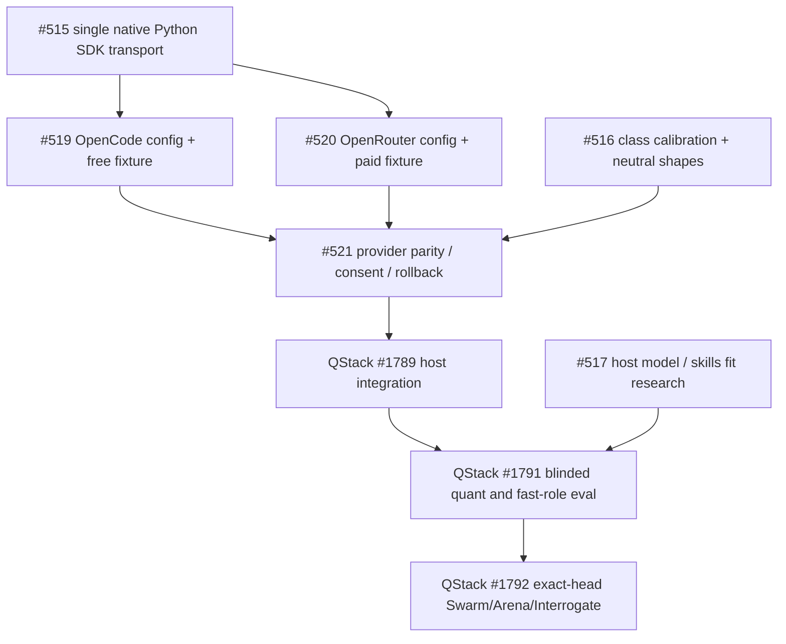

# JEV decisions: minimal SDK and provider plan

> **Status:** Proposed OpenSpec-adjacent reference design, 2026-10-17. This is a research/specification PR only; not a live API implementation, calibrated acceptance, or a request to change QStack's router. Issues PStack #515/#516/#517/#519/#520/#521; QStack #1786/#1789/#1790/#1791/#1792.

## Decision: subtract transport proliferation

**Choose one Python decision client behind the existing PStack `SemanticDecisionProvider` contract.** PStack's current Python `scripts/decision_adapter.py` and `scripts/route_resolver.py` are already the implementation boundary. Prefer `typesafe-sdk` as the *smallest* dependency for the free-first OpenCode/paid OpenRouter/optional direct TypeSafe *System One* protocol; its `TypeSafeClient(base_url=..., api_key=..., model=...)` supports configurable API root. OpenRouter documents the official Python SDK with `base_url='https://openrouter.ai/api'`. OpenCode publishes System One endpoints; compatibility with this client is a hypothesis until a keyed wire-contract test, not a claim of live support.

Alternatives, **not additive layers**:
- **Vercel AI SDK 7 TypeScript**: `experimental_decide` is native as of `ai` >= 7.0.128; supported `decisionModels` in `customProvider`. Choose it only for an existing TypeScript decision caller; avoid Node/Bun subprocess bridging for the Python resolver.
- **Vercel AI SDK for Python (`ai`)**: native `ai.ops.experimental.evaluate` with `ChoiceQuestion`, `ScoreQuestion`, `NoulQuestion`, initially documented via AI Gateway (`AI_GATEWAY_API_KEY`). Substitute only if PStack already adopts that gateway and it measurably removes code; Gateway does not automatically provide the free OpenCode JEV entitlement.
- **PydanticAI**: excellent for generative Python agents and typed model output. Its documented `OpenAIDecisionsModel` targets the OpenAI Decisions API (`openai-decisions:gpt-6-luna`), not proof that OpenCode or TypeSafe System One works. Adding PydanticAI and AI SDK simultaneously is unnecessary for a one-request classifier. Existing PStack host agent/harness continues to select generative workers.
- **Plain HTTP**: fallback only when official SDK fails a documented endpoint/response contract; prefer one tiny transport with explicit tests rather than importing an agent framework.

**Subtraction rule:** turn #519 (OpenCode) and #520 (OpenRouter) into *configuration profile + conformance fixture* issues, NOT distinct Python implementations. #515 owns the *single* typed transport. #516 is pure class-specific policy, #517 is research, #521 owns cross-profile tests, budget/consent and rollout. No new generic gateway, role-router clone, QStack provider adapter, or shadow scheduler.

## Verified provider catalog and endpoint variants

| Config profile | Model ID | Documented endpoint | SDK base URL candidate | Access |
|---|---|---|---|---|
| `opencode-console` | `jev-1.13-free` | `https://opencode.ai/inference/systemone/v1/systemone` | `https://opencode.ai/inference/systemone` | Limited-time free, not guaranteed; requires appropriate Console credentials |
| `opencode-zen` | `jev-1.13-free` | `https://opencode.ai/zen/v1/systemone` | `https://opencode.ai/zen` | Limited-time free; verify configured account/endpoint |
| `opencode-console` or `opencode-zen` | `jev-1.13` | corresponding System One endpoint | matching service root | Paid, advertised $0.042/M input tokens |
| `openrouter` | `jev-1.13`, `jev-1.14` | `https://openrouter.ai/api/v1/systemone` (official TypeSafe SDK bridge), alternatively `/api/alpha/decisions` for its own API | `https://openrouter.ai/api` | Paid, advertised $0.042/M input |
| `typesafe-direct` | pinned documented TypeSafe JEV identifier | `https://api.typesafe.ai/v1/systemone` | `https://api.typesafe.ai` | Separate direct account, optional, no assumed free access |

**OpenCode Go/Go Plus is distinct from OpenCode Console/Zen.** Current Go catalog does not list Jev; do not assume its subscription grants decision endpoint access. **OpenRouter's output-token-free price does not mean requests are free.** `jev-1.13-free` and `jev-1.13` are different SKUs. Official docs list both `/zen/` and `/inference/systemone/` surfaces; do not silently choose or rewrite paths at runtime. One allowlisted profile corresponds to exactly one documented URL and credential.

Sources (reviewed 2026-10-17; prices and availability must be rechecked at use):
- OpenCode Zen model catalog, limited-time JEV free and `/zen` endpoint: https://docs.opencode.ai/docs/zen/
- OpenCode Console model catalog for `/inference/systemone`: https://dev.opencode.ai/v2/docs/console/models
- OpenCode Go model catalog: https://opencode.ai/v2/docs/console/go/
- OpenRouter System One SDK configuration (Python/JS): https://openrouter.ai/blog/insights/what-is-jev/
- TypeSafe official Python SDK and `base_url`: https://github.com/typesafe-ai/typesafe-sdk-python
- AI SDK native decision interface (2026-10-07): https://vercel.com/i/ai-sdk-evaluation-to-decisions
- AI SDK for Python JEV native evaluate (2026-10-02): https://vercel.com/blog/jev-for-python-engineers
- PydanticAI OpenAI Decisions model scope: https://github.com/pydantic/pydantic-ai/blob/main/docs/models/openai.md

## Requirements / invariants

- **R-JEV-01 Host authority.** Compute `/poteto-mode` deterministic/explicit preflight *first*. Never promote JEV to model/worker authority, tool authorization, code generation, trading orders, capital/risk enable, qorch freeze/promotion, holdout release, PR merge, autonomy override or human gate. Host's *how/architect/swarm/arena/interrogate* triggers are mandatory.
- **R-JEV-02 Single seam.** Existing `SemanticDecisionProvider.decide(DecisionRequest)->ProviderObservation` is the only runtime boundary; clients, headers, model aliases, wire DTOs and HTTP versions live inside one provider implementation.
- **R-JEV-03 Bounded public egress.** Only explicit `safe_to_send` or `derived_sanitized` context with current PStack caps (state <= 2048 UTF-8 bytes, <=32 options, total <=8192 bytes). No implicit sending task prompt, code, diffs, private repo data, secrets, or arbitrary tool output; regex blocking is an auxiliary check, not a privacy classifier.
- **R-JEV-04 Finite decision vocabulary.** Phase 1 only invokes *already used, eligible closed-set playbook `Choice`*. Preserve `Score` and `Boolean` neutral request contracts but do NOT construct provider wire shapes for them until callers/evaluation justify it. Existing numeric `ScoreRange(minimum, maximum)` is not equivalent to TypeSafe's discrete ordered rubric, and `Noul` probability cannot safely be coerced into a Boolean before a class policy decides threshold.
- **R-JEV-05 Exact evidence.** Preserve selected option ID and probability map/confidence; verify returned provider/model identity (including resolved snapshot), question-set ID, policy/class version, source pins, fixture revision. Unknown or unverified identity cannot enable advisory. Invalid option, malformed/conflicting response, absent required confidence, or stale calibration => baseline unchanged.
- **R-JEV-06 Per-class calibration.** Living PStack spec forbids universal thresholds; replace resolver's hardcoded `DEFAULT_ADVISORY_CONFIDENCE_THRESHOLD = 0.70` with evidence-defined class-specific policy or disable promotion until calibrated. Confidence alone is not authority; check margins, baseline agreement, risk, and host availability.
- **R-JEV-07 Free vs paid.** Default OFF. Shadow optional and behavior-inert. One explicitly authorized provider/model at a time to start. Free retired/429/401/402/403/timeout => existing baseline; **NO automatic paid fallback**. Paid profiles require separate positive opt-in, bounded spending/call count and no automatic wallet top-up.
- **R-JEV-08 Portability.** JEV optional. A PStack host without Python, secrets or Jev retains baseline routing and supported status. Model aliases/configured host worker capabilities are resolved by `#429`, not the JEV client. QStack is only a confirmed QUANT overlay.
- **R-JEV-09 No unsupported role claim.** The `references/decision-routing.json` registry currently contains only seven eligible semantic candidate playbooks, not leaf-skill IDs or fast worker tiers. Treat model selection/skills suggestions as *shadow research* until #517 and QStack #1791 establish incremental value.
- **R-JEV-10 Prove via exact head.** Fake transport and fresh main/PR diffs are separate evidence from optional authenticated public-fixture JEV smoke. Independent Swarm/Arena/Interrogate runners are required for their own PASS; no synthetic roleplay substitutes.

## Minimal data / code flow

```text
task intent + host profile + explicit commands
 -> PStack preflight and deterministic baseline route (authoritative)
 -> [eligible? public/sanitized? enabled? budget?] -> optional bounded ChoiceRequest
 -> exactly one TypeSafe Python SDK client configured with an allowlisted API root/model
 -> System One typed choices/probabilities/confidence
 -> provider-edge parser -> PStack ProviderObservation(status, kind, value, provider/model id, confidence, probabilities)
 -> pure host admission(policy_class, calibrated threshold, entitlements, receipts)
 -> acting route = permitted advisory OR unchanged baseline
 -> PStack leaf skill/playbook & worker role resolution (host-owned)
 -> QStack overlay ONLY if quant domain independently confirmed
 -> qorch durable research state (when applicable), immutable artifacts, verification
```

### Neutral data contract and ownership

| Type | Owner | Notes |
|---|---|---|
| `ChoiceRequest(question_id, SafeContext, tuple[ChoiceOption, ...])` | PStack adapter | IDs are closed/whitelisted from current canonical playbook registry. Labels are short public descriptions only |
| `ProviderObservation(DecisionOutcome, provider_identity, model_identity, confidence, probabilities)` | PStack adapter | Transport names and snapshot evidence do not leak into host policy; reject unknown identity for controlling routes |
| `JevProviderProfile(key, api_root, configured_model, credential_env, paid, max_spend)` | Provider config boundary, proposed | Exact host allowlist and unit-tested path concatenation. Env-only key, no cached raw prompt. Do not invent a broad provider registry |
| `RouteDecision(baseline, observation, admission, acting)` | PStack routing | Deterministic, auditable; no JEV action side effects. Policy owns class calibration, not client |
| `QuantDomainOverlay` / `ResearchProgram` | QStack/qorch | QStack contributes invariants and research lifecycle facts only; no provider selection |

## Task-fit / host routing decision matrix (hypotheses pending blind evaluation)

| Task | JEV (if any) | Who actually executes |
|---|---|---|
| Explicit PStack command; safety/approval; simple deterministic facts | SKIP | Fixed PStack rule |
| Ambiguous low-risk bug triage / investigation / perf / refactor / prototype | Optional existing playbook Choice in shadow | Host selected playbook and configured worker |
| Fast worker selection for small, reversible task | Candidate low-risk closed-set role hint ONLY after #517 evaluation | Host capabilities + budgets + rollback decide |
| Quant skills/factors/research playbook | Hint only after caller, taxonomy and QStack domain are confirmed | QStack overlay composed over host; qorch owns state |
| Architecture, code crossing boundary, multi-step plan | No authority; high-capability host plan required | PStack how/architect/figure-it-out |
| Swarm fan-out | At most classify non-critical slice suitability in a later evaluated phase | Independent configured workers via PStack |
| Arena/Interrogate judgments | NO substitution for independent family reviewers | Real independent host-configured panel |
| Backtest PIT/holdout, strategy promotion, OMS orders/live risk | SKIP | Deterministic quant & human controls |

## Recursive implementation / evaluation DAG (reuse existing issues)



**Depth-first sequence:** (1) offline adapter mapping + exact URL tests and opt-in live public-fixture smoke #515 → (2) one free provider profile #519; paid profile #520 is optional and can remain NOT IMPLEMENTED → (3) baseline preservation & class policy #516/#521 → (4) QStack host projection #1789 and blinded eval #1791 → (5) independently run review/evidence #1792. Do not inflate the graph with duplicate adapter epics.

## Arena rubric and adversarial verification

**Design arms** (author analysis only; NOT independently executed): A = no JEV baseline, B = one Python TypeSafe SDK + provider config (preferred), C = Python AI SDK via Gateway (only where Gateway is adopted), D = PydanticAI + generated agent routing (reject unless existing Python generative agent provides proven reuse). Compare lines of new code/dependencies, supported verified providers, baseline preservation, private egress, full task quality + wall latency and total spend. Prefer A if no incremental benefit; prefer B over C/D for current Python PStack if free-first works.

**Interrogate falsifiers**: latest model alias drifts; 1.13 vs 1.14 confounds; Go subscription misidentified; `opencode/zen` vs `/inference/systemone` confusion; base URL duplicated path; provider-specific error 429/retired free silently bills; malicious prompt encoded as SafeContext; SDK retries multiply paid costs; numeric ScoreRange incorrectly mapped to rubric; Boolean Noul probability rounded before threshold; high-confidence wrong choice; stale missing receipt grants authority; host worker model unavailable; QUANT false positive; qorch live-risk gate bypass; same-family reviewer collapse. Execute with actual independent models only on a real host and record runner/model IDs and both HEAD SHAs.

Acceptance: contract fixtures and golden OFF/shadow equivalence pass at exact HEAD; zero forbidden operations; live credentials or provider call unavailable means live smoke BLOCKED; class calibration and cost/latency budgets predeclared before advisory promotion. Source docs, PR review and mock observations never constitute production or live-trading readiness.